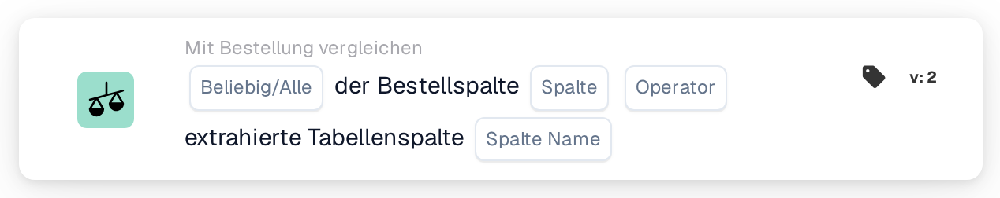
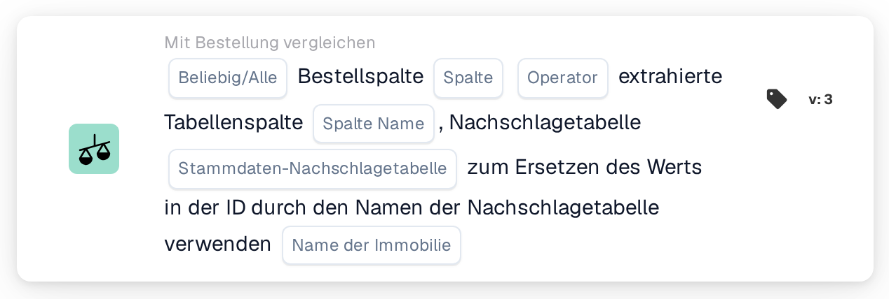

# Bestellspalte und extrahierte Tabellenspalte

<figure><figcaption>
Version 2
</figcaption></figure>

<figure><figcaption>
Version 3
</figcaption></figure>

## Zweck:

Diese Workflow-Karte vergleicht eine Spalte der zugeordneten Bestellpositionen mit einer Spalte der extrahierten Positionstabelle des Dokuments. Für jede Dokumentzeile, die der Bestellabgleich einer Bestellposition zugeordnet hat, wird der Wert in der ausgewählten Bestellspalte mit dem Wert in der ausgewählten Tabellenspalte dieser Zeile verglichen. Die einzelnen Ergebnisse werden anschließend mit der Einstellung **Beliebig/Alle** zum einen Ergebnis der Karte zusammengefasst.

Version 3 kann den Bestellwert vor dem Vergleich zusätzlich über eine Stammdaten-Nachschlagetabelle übersetzen. Das hilft, wenn Bestellung und Dokument unterschiedliche Codes für dieselbe Sache verwenden, zum Beispiel unterschiedliche Einheitencodes.

Der Bestellabgleich sollte vor dieser Karte laufen. Ohne zugeordnete Bestellung meldet die Karte fehlende Daten.

## Bestandteile der Karte:

1. **Beliebig/Alle**
   * **Beschreibung:** Wie die Vergleiche der einzelnen Zeilen zum Ergebnis der Karte zusammengefasst werden.
   * **Optionen:**
     * **Irgendeine:** Mindestens eine verglichene Zeile erfüllt die Bedingung.
     * **Alle:** Jede verglichene Zeile erfüllt die Bedingung. Ist kein Wert festgelegt, verwendet die Karte **Alle**.
2. **Spalte**
   * **Beschreibung:** Die Spalte der Bestellposition, deren Wert verglichen wird.
   * **Detail:** Der Wert wird aus der Bestellposition gelesen, die der Dokumentzeile zugeordnet wurde.
3. **Operator**
   * **Beschreibung:** Wie der Bestellwert mit dem Dokumentwert verglichen wird. Der Bestellwert steht auf der linken Seite des Vergleichs, **Größer als** bedeutet also, dass der Bestellwert größer ist als der Dokumentwert.
   * **Optionen:**
     * **Entspricht**
     * **Ungleich**
     * **Größer als**
     * **Größer oder gleich**
     * **Weniger als**
     * **Weniger oder gleich**
4. **Spalte Name**
   * **Beschreibung:** Die Spalte der extrahierten Tabelle des Dokuments, die mit der Bestellspalte verglichen wird.
   * **Detail:** Die Karte verwendet die erste extrahierte Tabelle des Dokuments.
5. **Stammdaten-Nachschlagetabelle (nur Version 3)**
   * **Beschreibung:** Eine optionale Nachschlagetabelle, mit der der Bestellwert vor dem Vergleich übersetzt wird.
   * **Detail:** Der in Großbuchstaben umgewandelte Bestellwert wird in der Eigenschaft **codevalue** der Nachschlagetabelle gesucht. Wird ein Datensatz gefunden und hat er einen Wert für den ausgewählten **Name der Immobilie**, wird der Bestellwert durch den bereinigten Wert dieser Eigenschaft ersetzt. Wird kein Datensatz oder kein Wert gefunden, wird der Bestellwert in Großbuchstaben verwendet. Der Dokumentwert wird nicht übersetzt.
6. **Name der Immobilie (nur Version 3)**
   * **Beschreibung:** Die Eigenschaft des Nachschlagetabellen-Datensatzes, deren Wert den Bestellwert ersetzt.
   * **Detail:** **Stammdaten-Nachschlagetabelle** und **Name der Immobilie** können beide leer bleiben; in diesem Fall vergleicht die Karte die Werte ohne Übersetzung. Ist nur eines der beiden Felder festgelegt, meldet die Karte fehlende Daten.

## Funktionalität:

* **Bedingungsauswertung:** Für jede zugeordnete Bestellposition sucht die Karte die damit verbundene Zeile (in Version 3 die Zeilen) der Dokumenttabelle und vergleicht die beiden Werte mit dem ausgewählten Operator.
  * Sind beide Werte Zahlen, werden sie als Zahlen verglichen.
  * Andernfalls werden sie als Text verglichen. Bei **Entspricht** spielen Unterschiede in der Groß- und Kleinschreibung keine Rolle. In Version 3 werden beide Werte vor dem Vergleich in Großbuchstaben umgewandelt; ein aus der Nachschlagetabelle übernommener Wert wird so verwendet, wie er dort gespeichert ist. Die Operatoren **Größer** und **Weniger** vergleichen Text in einfacher Zeichenreihenfolge und sind daher vor allem für numerische Spalten sinnvoll.
* **Ausführung der Aktion:**
  * **True-Bedingung:**\
    Mit **Alle** erfüllt jede verglichene Zeile den Operator, mit **Irgendeine** mindestens eine. Der Workflow wird fortgesetzt.
  * **False-Bedingung:**\
    Ist das zusammengefasste Ergebnis nicht erfüllt, stoppt der Workflow mit einer nicht erfüllten Bedingung.
* **Fehlende Daten:** Die Karte wertet die Bedingung nicht aus und meldet fehlende Daten im Workflow-Protokoll, wenn:
  * das Dokument keine zugeordnete Bestellung hat oder die Daten einer zugeordneten Bestellung nicht verfügbar sind,
  * das Dokument keine extrahierte Tabelle hat,
  * die Bestellspalte einer verglichenen Position leer ist (ein numerischer Wert 0 gilt ebenfalls als leer),
  * die Tabellenspalte einer verglichenen Zeile leer oder nicht vorhanden ist,
  * überhaupt keine Zeile verglichen werden konnte,
  * eine erforderliche Eingabe nicht festgelegt ist (in Version 3 auch, wenn nur eine der beiden Nachschlage-Eingaben festgelegt ist).

## Einrichtung und Konfiguration:

* Die Karte kann als And-Bedingung nach dem Bestellabgleich aus der Kategorie **Mit Bestellung vergleichen** hinzugefügt werden. Danach können **Beliebig/Alle**, die Bestell-**Spalte**, der **Operator** und der **Spalte Name** der Dokumenttabelle ausgewählt werden. In Version 3 könnten eine **Stammdaten-Nachschlagetabelle** und ein **Name der Immobilie** ergänzt werden, wenn die Bestellung andere Codes verwendet als das Dokument.
* Zum Prüfen einer Konfiguration kann **Testkarte** im Kartenmenü des Workflow Builders auf ein vorhandenes Dokument angewendet werden. Das Kartenprotokoll listet jeden Vergleich mit beiden Werten und seinem Ergebnis auf.

## Fazit:

Die Workflow-Karte „Purchase Order Column and Extracted Table Column“ prüft eine einzelne Positionsspalte Zeile für Zeile gegen die zugeordnete Bestellung. Sie kann für jede Spalte verwendet werden, die auf beiden Seiten vorhanden ist, und Version 3 deckt auch Fälle ab, in denen beide Seiten unterschiedliche Codes für denselben Wert verwenden.
