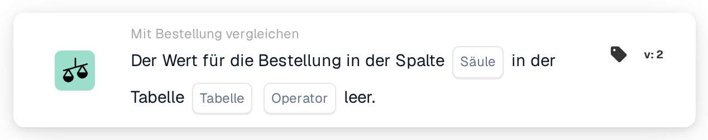

# Bestellspalte leer

<figure><figcaption>
Version 2
</figcaption></figure>

## Zweck:

Diese Workflow-Karte prüft, ob eine Spalte der Bestelldaten leer ist. Sie betrachtet direkt die gespeicherte Bestellung, ihre Positionen oder ihre verteilten Kosten und kann zum Beispiel verwendet werden, um Dokumente zurückzuhalten, deren Bestellung Informationen fehlen, auf die spätere Schritte angewiesen sind.

## Bestandteile der Karte:

1. **Säule**
   * **Beschreibung:** Die Bestellspalte, die geprüft wird.
   * **Detail:** Die Liste enthält die Spalten des Bestellkopfs, der Bestellpositionen und der verteilten Kosten, zum Beispiel **Lieferanten-ID**, **Einzelpreis**, **Menge** oder **Zusatzkosten Typ**. Die Spalte sollte zu der unter **Tabelle** ausgewählten Tabelle gehören.
2. **Operator**
   * **Beschreibung:** Ob die Spalte leer sein soll oder nicht.
   * **Optionen:**
     * **Ist:** Die Bedingung ist erfüllt, wenn die Spalte in mindestens einem geprüften Datensatz leer ist.
     * **Ist nicht:** Die Bedingung ist erfüllt, wenn die Spalte in jedem geprüften Datensatz einen Wert hat.
3. **Tabelle**
   * **Beschreibung:** Die Bestelltabelle, aus der die Spalte gelesen wird.
   * **Optionen:**
     * **Bestellnummer:** Der Bestellkopf (ein Datensatz).
     * **Bestellzeile:** Alle Positionen der Bestellung.
     * **Verteilte Kosten für Bestellungen:** Alle verteilten Kosten der Bestellung.

## Funktionalität:

* **Verwendete Bestellung:** Bringt der Workflow-Lauf eine eigene Bestellung mit, wird diese Bestellung geprüft. Andernfalls verwendet die Karte die Bestellung der ersten zugeordneten Dokumentzeile oder, wenn keine Zeile zugeordnet ist, die erste für das Dokument geladene Bestellung.
* **Bedingungsauswertung:** Die Karte liest alle Datensätze der ausgewählten Tabelle, die zur Bestellung gehören, und prüft in jedem davon die ausgewählte Spalte. Eine Spalte gilt als leer, wenn sie keinen Wert, einen leeren Text oder den numerischen Wert 0 enthält. Ein Ja/Nein-Wert gilt immer als gefüllt, auch wenn er „Nein“ ist.
* **Spalte nicht in der Tabelle:** Existiert die ausgewählte Spalte in der ausgewählten Tabelle nicht, meldet die Karte keinen Fehler. Mit **Ist** gilt die Bedingung als erfüllt, mit **Ist nicht** als nicht erfüllt.
* **Ausführung der Aktion:**
  * **True-Bedingung:**\
    Mit **Ist** ist die Spalte in mindestens einem Datensatz leer, mit **Ist nicht** hat sie in jedem Datensatz einen Wert. Der Workflow wird fortgesetzt.
  * **False-Bedingung:**\
    Andernfalls stoppt der Workflow mit einer nicht erfüllten Bedingung.
* **Fehlende Daten:** Die Karte wertet die Bedingung nicht aus und meldet fehlende Daten im Workflow-Protokoll, wenn keine Bestellung verfügbar ist (weder aus dem Workflow-Lauf noch dem Dokument zugeordnet), wenn **Säule** oder **Tabelle** nicht festgelegt ist oder wenn für die Bestellung kein Datensatz der ausgewählten Tabelle existiert.

## Einrichtung und Konfiguration:

* Die Karte kann als And-Bedingung aus der Kategorie **Mit Bestellung vergleichen** hinzugefügt werden. Danach können **Säule**, der Operator und **Tabelle** ausgewählt werden. Wird eine Spalte gewählt, die zur ausgewählten Tabelle gehört, lässt sich das oben beschriebene stille Ergebnis vermeiden.
* Mit **Testkarte** im Kartenmenü des Workflow Builders kann die Karte an einem vorhandenen Dokument ausprobiert werden.

## Fazit:

Die Workflow-Karte „Purchase Order Column Empty“ prüft die Vollständigkeit der Bestelldaten selbst. Sie hilft, Dokumente frühzeitig anzuhalten, wenn der Bestellung ein Wert fehlt, von dem die Genehmigung, der Export oder andere Workflow-Schritte abhängen.
