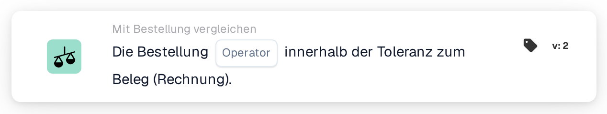

# Vollständige Übereinstimmung mit der Bestellung

<figure><figcaption>
Version 2
</figcaption></figure>

## Zweck:

Diese Workflow-Karte prüft, ob die zugeordnete Bestellung insgesamt innerhalb der Toleranzen mit dem Dokument übereinstimmt. Menge, Einzelpreis und Zusatzkosten jeder zugeordneten Position werden in einem Schritt geprüft, sodass eine einzige Karte entscheiden kann, ob ein Dokument ohne manuelle Prüfung verarbeitet werden kann.

Der Bestellabgleich sollte vor dieser Karte laufen. Ohne zugeordnete Bestellung meldet die Karte fehlende Daten.

## Bestandteile der Karte:

1. **Operator**
   * **Beschreibung:** Ob die Bestellung vollständig mit dem Dokument übereinstimmen soll oder nicht.
   * **Optionen:**
     * **Ist:** Die Bedingung ist erfüllt, wenn jede Prüfung innerhalb der Toleranz liegt.
     * **Ist nicht:** Die Bedingung ist erfüllt, wenn mindestens eine Prüfung außerhalb der Toleranz liegt.

## Funktionalität:

* **Bedingungsauswertung:** Die Karte durchläuft jede zugeordnete Bestellposition (einschließlich Unterpositionen) und verwendet die Vergleichsdaten, die der Bestellabgleich dafür gespeichert hat:
  * **Menge:** Die Menge des Dokuments wird innerhalb der Mengentoleranz der Position mit der Bestellmenge verglichen.
  * **Einzelpreis:** Der Einzelpreis des Dokuments wird innerhalb der Einzelpreistoleranz der Position mit dem Einzelpreis der Bestellung verglichen. Trägt die Position in ihren Vergleichsdaten keinen Einzelpreis, sondern nur in ihren allgemeinen Abgleichsinformationen, verwendet die Karte statt der an der Position gespeicherten Toleranz die für den Dokumenttyp konfigurierte Einzelpreistoleranz; eine prozentuale Toleranz wird dann vom Bestellpreis aus bemessen.
  * **Zusatzkosten:** Für jede Zusatzkostenposition der Position werden Kostensatz, Einzelpreis und Betrag jeweils innerhalb ihrer Toleranzen mit der Bestellung verglichen.
  * Bei Lieferscheinen, die keine Preise tragen, wird nur die Menge verglichen.
* Alle Prüfungen aller Positionen werden zusammengefasst: Die Bestellung stimmt nur dann vollständig überein, wenn jede einzelne Prüfung innerhalb der Toleranz liegt.
* **Ausführung der Aktion:**
  * **True-Bedingung:**\
    Mit **Ist** liegt jede Prüfung innerhalb der Toleranz, mit **Ist nicht** mindestens eine nicht. Der Workflow wird fortgesetzt.
  * **False-Bedingung:**\
    Andernfalls stoppt der Workflow mit einer nicht erfüllten Bedingung.
* **Fehlende Daten:** Die Karte wertet die Bedingung nicht aus und meldet fehlende Daten im Workflow-Protokoll, wenn das Dokument keine zugeordnete Bestellung hat oder wenn einer zugeordneten Position ein Teil der für ihre Prüfungen benötigten Daten fehlt, zum Beispiel eine Menge, ein Einzelpreis, ein Zusatzkostenwert oder die Toleranz eines dieser Werte (einschließlich einer fehlenden oder unbrauchbaren Einzelpreistoleranz am Dokumenttyp, wo diese benötigt wird). Eine fehlende Toleranz wird nicht als Toleranz von 0 behandelt. Das gilt auch mit **Ist nicht**: Fehlende Daten werden als fehlende Daten gemeldet, nicht als Abweichung.

## Einrichtung und Konfiguration:

* Die Karte kann als And-Bedingung nach dem Bestellabgleich aus der Kategorie **Mit Bestellung vergleichen** hinzugefügt werden. Danach kann der Operator (**Ist** oder **Ist nicht**) ausgewählt werden. Die Toleranzen selbst werden nicht auf der Karte festgelegt; sie stammen aus dem Bestellabgleich und den Einstellungen des Dokumenttyps.
* Mit **Testkarte** im Kartenmenü des Workflow Builders kann die Karte an einem vorhandenen Dokument ausprobiert werden. Das Kartenprotokoll listet jeden Mengen-, Einzelpreis- und Zusatzkostenvergleich mit den Werten von Dokument und Bestellung auf.

## Fazit:

Die Workflow-Karte „Purchase Order Full Match“ fasst den Bestellvergleich eines Dokuments in einer Bedingung zusammen. Dokumente, die in jeder Position mit ihrer Bestellung übereinstimmen, können automatisch durchlaufen, während jede Abweichung außerhalb der Toleranzen als nicht erfüllte Bedingung und fehlende Vergleichsdaten als fehlende Daten gemeldet werden, niemals als Übereinstimmung.
