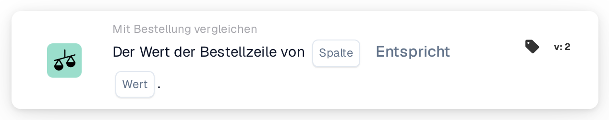

# Wert der Bestellposition

<figure><figcaption>
Version 2
</figcaption></figure>

## Zweck:

Diese Workflow-Karte vergleicht eine Spalte der zugeordneten Bestellpositionen mit einem festen Wert. Sie kann verwendet werden, um eine Eigenschaft der bestellten Positionen zu prüfen, die nicht auf dem Dokument steht, zum Beispiel einen Status, einen Einheitencode oder eine Liefermethode, und das Dokument entsprechend zu behandeln.

Der Bestellabgleich sollte vor dieser Karte laufen. Ohne zugeordnete Bestellung meldet die Karte fehlende Daten.

## Bestandteile der Karte:

1. **Spalte**
   * **Beschreibung:** Die Spalte der Bestellposition, deren Wert verglichen wird.
2. **Operator**
   * **Beschreibung:** Wie der Wert der Bestellposition mit dem Wert auf der Karte verglichen wird. Voreingestellt ist **Entspricht**.
   * **Optionen:**
     * **Entspricht:** Der Positionswert ist gleich dem Wert. Bei Text wird Groß- und Kleinschreibung nicht beachtet.
     * **Ungleich:** Der Positionswert weicht vom Wert ab. Bei Text wird Groß- und Kleinschreibung beachtet.
     * **Größer als**, **Größer oder gleich**, **Weniger als**, **Weniger oder gleich:** Vor allem für numerische Spalten sinnvoll.
     * **Enthält:** Der Positionswert ist genau einer der Einträge unter **Wert**, einschließlich Groß- und Kleinschreibung. Teilübereinstimmungen zählen nicht.
     * **Enthält nicht:** Der Positionswert ist keiner der Einträge unter **Wert** (auf dieselbe exakte Weise verglichen).
3. **Wert**
   * **Beschreibung:** Der Wert, mit dem der Wert der Bestellposition verglichen wird.
   * **Detail:** Bei **Enthält** und **Enthält nicht** können mehrere Einträge eingegeben werden, durch Kommas getrennt. Bei den Operatoren **Größer** und **Weniger** wird eine Liste von Werten nicht unterstützt.

## Funktionalität:

* **Bedingungsauswertung:** Für jede zugeordnete Bestellposition (einschließlich Unterpositionen) liest die Karte den Wert der ausgewählten Spalte und vergleicht ihn mit dem Operator mit **Wert**. Sind beide Zahlen, werden sie als Zahlen verglichen, andernfalls als Text.
* Die Bedingung gilt nur dann als erfüllt, wenn jede verglichene Position sie erfüllt; diese Karte hat keine Option **Beliebig/Alle**.
* **Ausführung der Aktion:**
  * **True-Bedingung:**\
    Erfüllt jede verglichene Position die Bedingung, wird der Workflow fortgesetzt.
  * **False-Bedingung:**\
    Erfüllt mindestens eine Position sie nicht, stoppt der Workflow mit einer nicht erfüllten Bedingung.
* **Fehlende Daten:** Die Karte wertet die Bedingung nicht aus und meldet fehlende Daten im Workflow-Protokoll, wenn **Spalte** oder **Wert** nicht festgelegt ist, wenn das Dokument keine zugeordnete Bestellung hat oder deren Daten nicht verfügbar sind, wenn die ausgewählte Spalte einer zugeordneten Position leer ist (ein numerischer Wert 0 gilt ebenfalls als leer) oder wenn keine Position verglichen werden konnte.
* **Konfigurationsfehler:** Enthält **Wert** ein Komma und ist einer der Operatoren **Größer** oder **Weniger** ausgewählt, stoppt die Karte mit einem Konfigurationsfehler.

## Einrichtung und Konfiguration:

* Die Karte kann als And-Bedingung nach dem Bestellabgleich aus der Kategorie **Mit Bestellung vergleichen** hinzugefügt werden. Danach können die **Spalte** der Bestellposition, der Operator und der **Wert** festgelegt werden. Für eine Prüfung gegen mehrere zulässige Werte könnte **Enthält** mit einer durch Kommas getrennten Liste verwendet werden.
* Mit **Testkarte** im Kartenmenü des Workflow Builders kann die Karte an einem vorhandenen Dokument ausprobiert werden. Das Kartenprotokoll listet jeden verglichenen Positionswert mit dem verwendeten Operator und Wert auf.

## Fazit:

Die Workflow-Karte „Purchase Order Line Value“ bringt Daten der Bestellpositionen als einfache Bedingung in den Workflow. So kann ein Workflow darauf reagieren, wie die Waren bestellt wurden, auch wenn diese Information nicht auf dem Dokument selbst erscheint.
