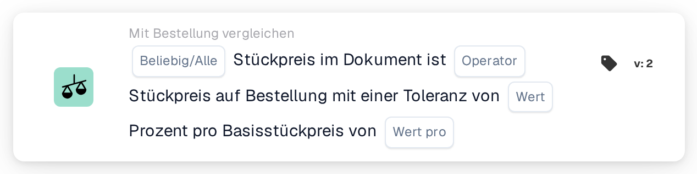

# Einzelpreistoleranz pro Basispreis

<figure><figcaption>
Version 2
</figcaption></figure>

## Zweck:

Diese Workflow-Karte vergleicht die Einzelpreise des Dokuments mit den Einzelpreisen der zugeordneten Bestellpositionen und verwendet dabei eine prozentuale Toleranz, die mit dem Bestellpreis wächst. Die Toleranz wird als Prozentsatz pro Basisstückpreis eingegeben, sodass höherpreisige Artikel eine größere prozentuale Toleranz erhalten als niedrigpreisige.

Für eine feste Toleranz kann die Karte **Any / All Unit Price is** verwendet werden.

Der Bestellabgleich sollte vor dieser Karte laufen. Ohne zugeordnete Bestellung meldet die Karte fehlende Daten.

## Bestandteile der Karte:

1. **Beliebig/Alle**
   * **Beschreibung:** Wie die Vergleiche der einzelnen Positionen zum Ergebnis der Karte zusammengefasst werden.
   * **Optionen:**
     * **Irgendeine:** Mindestens eine Position erfüllt den Vergleich.
     * **Alle:** Jede verglichene Position erfüllt den Vergleich. Ist kein Wert festgelegt, verwendet die Karte **Alle**.
2. **Operator**
   * **Beschreibung:** Wie der Einzelpreis des Dokuments unter Berücksichtigung der Toleranz mit dem Einzelpreis der Bestellung verglichen wird.
   * **Optionen:**
     * **Entspricht:** Der Dokumentpreis liegt innerhalb des Toleranzbereichs um den Bestellpreis.
     * **Ungleich:** Der Dokumentpreis liegt außerhalb des Toleranzbereichs.
     * **Größer als:** Der Dokumentpreis liegt über dem Toleranzbereich.
     * **Größer oder gleich:** Der Dokumentpreis liegt innerhalb des Toleranzbereichs oder darüber.
     * **Weniger als:** Der Dokumentpreis liegt unter dem Toleranzbereich.
     * **Weniger oder gleich:** Der Dokumentpreis liegt innerhalb des Toleranzbereichs oder darunter.
3. **Wert**
   * **Beschreibung:** Die Toleranz in Prozent, die beim Basisstückpreis gilt.
   * **Detail:** Eine Zahl, zum Beispiel `1` für 1 Prozent.
4. **Wert pro**
   * **Beschreibung:** Der Basisstückpreis, auf den sich der Toleranzprozentsatz bezieht.
   * **Detail:** Eine Zahl größer als 0, zum Beispiel `100`.

## Funktionalität:

* **Berechnung der Toleranz:** Für jede Position wird der Toleranzprozentsatz mit dem Verhältnis des Bestell-Einzelpreises zum Basisstückpreis skaliert:\
  Toleranz % = **Wert** × (Bestell-Einzelpreis ÷ **Wert pro**)\
  Der Toleranzbereich ist der Bestell-Einzelpreis plus und minus diesen Prozentsatz.\
  Beispiel mit **Wert** 1 und **Wert pro** 100: Ein Bestellpreis von 50 ergibt eine Toleranz von 0,5 %, der Bereich liegt also zwischen 49,75 und 50,25. Ein Bestellpreis von 200 ergibt 2 %, der Bereich liegt also zwischen 196 und 204.
* **Bedingungsauswertung:** Für jede zugeordnete Bestellposition wird der Einzelpreis des Dokuments mit dem Operator und dem berechneten Bereich mit dem Einzelpreis der Bestellposition verglichen. Zugeordnete Einträge ohne Bestellposition werden übersprungen. Die Ergebnisse werden mit **Beliebig/Alle** zusammengefasst.
* **Ausführung der Aktion:**
  * **True-Bedingung:**\
    Ist das zusammengefasste Ergebnis erfüllt, wird der Workflow fortgesetzt.
  * **False-Bedingung:**\
    Ist das zusammengefasste Ergebnis nicht erfüllt, stoppt der Workflow mit einer nicht erfüllten Bedingung. Das ist auch der Fall, wenn keine Position verglichen werden konnte.
* **Fehlende Daten:** Die Karte wertet die Bedingung nicht aus und meldet fehlende Daten im Workflow-Protokoll, wenn **Wert** oder **Wert pro** nicht festgelegt ist, wenn das Dokument keine zugeordnete Bestellung hat oder wenn dem Dokument oder der Bestellung der Einzelpreis einer verglichenen Position fehlt (ein leerer Einzelpreis oder ein numerischer Einzelpreis von 0 gilt als fehlend).
* **Fehler:** Die Karte stoppt mit einem Fehler, wenn **Wert** oder **Wert pro** keine Zahl ist, wenn ein Einzelpreis nicht als Zahl gelesen werden kann, wenn **Wert pro** 0 ist oder wenn die berechnete Toleranz für eine Position unter 0 % oder über 100 % liegt.

## Einrichtung und Konfiguration:

* Die Karte kann als And-Bedingung nach dem Bestellabgleich aus der Kategorie **Mit Bestellung vergleichen** hinzugefügt werden. Danach können **Beliebig/Alle**, der Operator, der Toleranzprozentsatz unter **Wert** und der Basisstückpreis unter **Wert pro** eingegeben werden. Der Basisstückpreis sollte so gewählt werden, dass die berechnete Toleranz für die Preisspanne der Artikel zwischen 0 % und 100 % bleibt.
* Mit **Testkarte** im Kartenmenü des Workflow Builders kann die Karte an einem vorhandenen Dokument ausprobiert werden. Das Kartenprotokoll zeigt für jede Position beide Preise, die berechnete Toleranz in Prozent und den sich daraus ergebenden Bereich.

## Fazit:

Die Workflow-Karte „Unit Price Tolerance per Base Price“ wendet beim Einzelpreisvergleich mit der Bestellung eine preisabhängige Toleranz an. So sind mit einer einzigen Karte eine enge Toleranz für niedrigpreisige Artikel und eine weitere für höherpreisige Artikel möglich.
