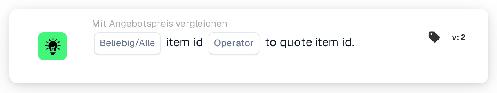

# Artikelnummer mit Angebotsartikelnummer vergleichen

<figure><figcaption>
Version 2
</figcaption></figure>

## Zweck:

Diese Workflow-Karte vergleicht die Artikelnummer in jeder Zeile eines Dokuments mit der Artikelnummer, die für denselben Lieferantenartikel in der Artikelpreistabelle des Lieferanten gespeichert ist. Sie kann verwendet werden, um Zeilen zu erkennen, in denen das Dokument einen anderen Artikel nennt als den, auf den sich die Preisdaten beziehen. Je nach Ergebnis wird der Workflow mit der True- oder der False-Bedingung fortgesetzt.

## Bestandteile der Karte:

1. **Beliebig/Alle**
   * **Beschreibung:** Legt fest, ob eine Zeile oder jede verglichene Zeile der Dokumenttabelle die Bedingung erfüllen soll.
   * **Optionen:**
     * **Irgendeine:** Die Bedingung ist wahr, wenn mindestens eine verglichene Zeile die Bedingung erfüllt.
     * **Alle:** Die Bedingung ist nur wahr, wenn jede verglichene Zeile die Bedingung erfüllt.
2. **Operator**
   * **Beschreibung:** Legt fest, wie die Artikelnummer in der Artikelpreistabelle des Lieferanten mit der Artikelnummer in der Dokumentzeile verglichen wird.
   * **Optionen:**
     * **Entspricht:** Die Artikelnummern sind gleich. Artikelnummern, die sich beide als Zahlen lesen lassen, werden als Zahlen verglichen (zum Beispiel sind „007“ und „7“ gleich); andernfalls werden sie als Text ohne Unterscheidung von Groß- und Kleinschreibung verglichen.
     * **Ungleich:** Die Artikelnummern unterscheiden sich. Artikelnummern, die sich beide als Zahlen lesen lassen, werden als Zahlen verglichen; andernfalls werden sie als Text verglichen, wobei hier Groß- und Kleinschreibung unterschieden wird.
     * **Größer als, Größer oder gleich, Weniger als, Weniger oder gleich:** Werden von der Karte ebenfalls angeboten. Mit diesen Operatoren werden die Artikelnummern immer als Text Zeichen für Zeichen verglichen, sodass zum Beispiel „10“ als kleiner als „9“ gilt.

## Funktionalität:

* **Bedingungsauswertung:** Für jede Zeile der Dokumenttabelle sucht die Karte die Lieferantenartikel-ID der Zeile (Spalte `SUPPLIER_ITEM_NUMBER`) in der Artikelpreistabelle des Lieferanten und vergleicht die dort gespeicherte Artikelnummer mit der Artikelnummer der Zeile (Spalte `ITEM_NUMBER`). Die Ergebnisse aller verglichenen Zeilen werden dann mit **Irgendeine** oder **Alle** zusammengefasst.
* **Übersprungene Zeilen:** Eine Zeile wird vom Vergleich ausgenommen, wenn die Artikelpreistabelle des Lieferanten keinen Eintrag für ihre Lieferantenartikel-ID hat oder der Eintrag keine Artikelnummer enthält. Jede übersprungene Zeile wird im Workflow-Protokoll vermerkt.
* **Gültigkeitsdaten:** Hat ein Eintrag in der Artikelpreistabelle des Lieferanten ein Start- oder Enddatum und liegt das Dokumentdatum außerhalb dieses Zeitraums, vermerkt die Karte dies im Workflow-Protokoll. Dieser Hinweis ändert das Ergebnis der Karte nicht.
* **Ausführung der Aktion:**
  * **True-Bedingung:**\
    Die Artikelnummern erfüllen den ausgewählten Operator für eine oder alle verglichenen Zeilen. Der Workflow wird mit der True-Bedingung fortgesetzt.
  * **False-Bedingung:**\
    Ist die Bedingung nicht erfüllt, wird der Workflow mit der False-Bedingung fortgesetzt, zum Beispiel um das Dokument zur manuellen Prüfung zu senden. Die False-Bedingung wird auch verwendet, wenn keine der Zeilen verglichen werden konnte, weil keine Zeile eine Artikelnummer in der Artikelpreistabelle des Lieferanten hatte.
* **Fehlende Daten:** Hat das Dokument keine Tabelle oder mehr als eine Tabelle oder konnten keine Zeilen aus der Tabelle gelesen werden, wertet die Karte die Bedingung nicht aus und meldet die fehlenden Daten im Workflow-Protokoll. Ist keine Option für **Beliebig/Alle** festgelegt, vermerkt die Karte dies im Protokoll und verwendet **Alle**.

## Einrichtung und Konfiguration:

* Die Karte kann aus der Kategorie **Mit Angebotspreis vergleichen** hinzugefügt werden. Danach können **Irgendeine** oder **Alle** und der Operator ausgewählt werden. Für eine Prüfung auf übereinstimmende Artikelnummern ist **Entspricht** oder **Ungleich** die übliche Wahl. Zuletzt wird die Fortsetzungsbedingung (True oder False) festgelegt, die den nächsten Schritt im Workflow bestimmt.
* Die Karte arbeitet mit Dokumenten, die genau eine Tabelle haben, deren Zeilen die Lieferantenartikel-ID und die Artikelnummer enthalten.

## Fazit:

Die Workflow-Karte „Item ID to Quote Item ID“ stellt sicher, dass die Artikel eines Dokuments mit den Artikeln übereinstimmen, auf die sich die Artikelpreistabelle des Lieferanten bezieht. Zeilen ohne Preisdaten werden übersprungen, statt als Abweichungen gezählt zu werden, sodass das Ergebnis nur Zeilen widerspiegelt, die tatsächlich verglichen werden können.
