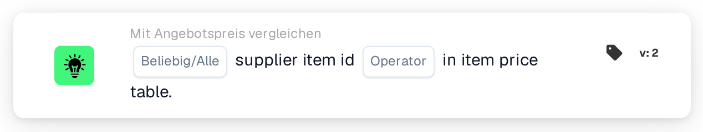

# Lieferantenartikel-ID in der Artikelpreistabelle

<figure><figcaption>
Version 2
</figcaption></figure>

## Zweck:

Diese Workflow-Karte prüft, ob die Lieferantenartikel-IDs in den Positionen eines Dokuments in der Artikelpreistabelle des Lieferanten gefunden werden. Sie kann verwendet werden, um festzustellen, ob DocBits für die Artikel eines Angebots Preisdaten zum Lieferanten des Dokuments hat, bevor andere Angebotsvergleiche laufen, oder um Dokumente mit unbekannten Artikeln an eine manuelle Prüfung weiterzuleiten. Je nach Ergebnis wird der Workflow mit der True- oder der False-Bedingung fortgesetzt.

## Bestandteile der Karte:

1. **Beliebig/Alle**
   * **Beschreibung:** Legt fest, ob eine Zeile oder jede Zeile der Dokumenttabelle die Bedingung erfüllen soll.
   * **Optionen:**
     * **Irgendeine:** Die Bedingung ist wahr, wenn mindestens eine Zeile die Bedingung erfüllt.
     * **Alle:** Die Bedingung ist nur wahr, wenn jede Zeile die Bedingung erfüllt.
2. **Operator**
   * **Beschreibung:** Legt fest, ob die Lieferantenartikel-ID in der Artikelpreistabelle des Lieferanten gefunden werden soll oder nicht.
   * **Optionen:**
     * **Ist:** Eine Zeile erfüllt die Bedingung, wenn ihre Lieferantenartikel-ID in der Artikelpreistabelle des Lieferanten steht.
     * **Ist nicht:** Eine Zeile erfüllt die Bedingung, wenn ihre Lieferantenartikel-ID nicht in der Artikelpreistabelle des Lieferanten steht.

## Funktionalität:

* **Bedingungsauswertung:** Die Karte liest die Lieferantenartikel-ID (Spalte `SUPPLIER_ITEM_NUMBER`) jeder Zeile der Dokumenttabelle und prüft, ob die Artikelpreistabelle des Lieferanten einen Eintrag dafür enthält. Die Ergebnisse aller Zeilen werden dann mit **Irgendeine** oder **Alle** zusammengefasst.
* **Gültigkeitsdaten:** Hat ein Eintrag in der Artikelpreistabelle des Lieferanten ein Start- oder Enddatum und liegt das Dokumentdatum außerhalb dieses Zeitraums, vermerkt die Karte dies im Workflow-Protokoll. Dieser Hinweis ändert das Ergebnis der Karte nicht.
* **Ausführung der Aktion:**
  * **True-Bedingung:**\
    Mit **Ist** stehen die Lieferantenartikel-IDs (eine oder alle, je nach Auswahl) in der Artikelpreistabelle des Lieferanten, mit **Ist nicht** nicht. Der Workflow wird mit der True-Bedingung fortgesetzt, zum Beispiel um mit dem Preisvergleich weiterzumachen.
  * **False-Bedingung:**\
    Ist die Bedingung nicht erfüllt, wird der Workflow mit der False-Bedingung fortgesetzt, zum Beispiel um das Dokument zur manuellen Prüfung zu senden.
* **Fehlende Daten:** Hat das Dokument keine Tabelle oder mehr als eine Tabelle, konnten keine Zeilen aus der Tabelle gelesen werden oder gibt es für das Dokument überhaupt keine Artikelpreisdaten des Lieferanten, wertet die Karte die Bedingung nicht aus und meldet die fehlenden Daten im Workflow-Protokoll. Ist keine Option für **Beliebig/Alle** festgelegt, vermerkt die Karte dies im Protokoll und verwendet **Alle**.
* **Fehler:** Die Karte endet mit einem Fehler, wenn eine Zeile der Tabelle keine Spalte `SUPPLIER_ITEM_NUMBER` hat. Ist kein Operator festgelegt, meldet die Karte einen Konfigurationsfehler.

## Einrichtung und Konfiguration:

* Die Karte kann aus der Kategorie **Mit Angebotspreis vergleichen** hinzugefügt werden. Danach können **Irgendeine** oder **Alle** und der Operator (**Ist** oder **Ist nicht**) ausgewählt werden. Zuletzt wird die Fortsetzungsbedingung (True oder False) festgelegt, die den nächsten Schritt im Workflow bestimmt.
* Die Karte arbeitet mit Dokumenten, die genau eine Tabelle haben, deren Zeilen die Lieferantenartikel-ID enthalten.

## Fazit:

Die Workflow-Karte „Supplier Item ID in Item Price Table“ zeigt, ob die Artikel eines Dokuments in der Artikelpreistabelle des Lieferanten bekannt sind. Sie kann als erste Prüfung in einem Angebots-Workflow dienen, sodass die späteren Vergleiche von Preis, Artikelnummer und Mengeneinheit nur für Dokumente laufen, deren Artikel Preisdaten haben.
