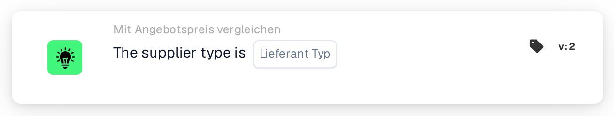

# Lieferantentyp

<figure><figcaption>
Version 2
</figcaption></figure>

## Zweck:

Diese Workflow-Karte prüft den Lieferantentyp der Artikel in den Artikelpreisdaten des Lieferanten zu einem Dokument, zum Beispiel ob es sich um Vertragsartikel oder verwaltete Artikel handelt. Sie kann verwendet werden, um je nachdem, wie die Artikel des Lieferanten verwaltet werden, unterschiedliche Genehmigungsregeln anzuwenden. Je nach Ergebnis wird der Workflow mit der True- oder der False-Bedingung fortgesetzt.

## Bestandteile der Karte:

1. **Lieferant Typ**
   * **Beschreibung:** Der Lieferantentyp, gegen den das Dokument geprüft wird.
   * **Optionen:**
     * **Contract:** Passt zu Einträgen, deren Verwaltungsklasse „contract“ ist.
     * **Managed:** Passt zu Einträgen, deren Verwaltungsklasse „managed“ ist.
     * **NonManaged:** Passt zu Einträgen, deren Verwaltungsklasse „unmanaged“ ist.

## Funktionalität:

* **Bedingungsauswertung:** Die Karte liest den Lieferantentyp (die Verwaltungsklasse) jedes Eintrags in den Artikelpreisdaten des Lieferanten zum Dokument und vergleicht ihn mit dem auf der Karte ausgewählten Lieferantentyp. Beim Vergleich wird nicht zwischen Groß- und Kleinschreibung unterschieden.
* **Ausführung der Aktion:**
  * **True-Bedingung:**\
    Jeder Eintrag in den Artikelpreisdaten des Lieferanten hat den ausgewählten Lieferantentyp. Der Workflow wird mit der True-Bedingung fortgesetzt, zum Beispiel um die Regeln für diesen Lieferantentyp anzuwenden.
  * **False-Bedingung:**\
    Hat mindestens ein Eintrag einen anderen Lieferantentyp oder keine Verwaltungsklasse, wird der Workflow mit der False-Bedingung fortgesetzt.
* **Fehlende Daten:** Ist auf der Karte kein Lieferantentyp ausgewählt oder hat das Dokument keine Artikelpreisdaten des Lieferanten, wertet die Karte die Bedingung nicht aus und meldet die fehlenden Daten im Workflow-Protokoll.

## Einrichtung und Konfiguration:

* Die Karte kann aus der Kategorie **Mit Angebotspreis vergleichen** hinzugefügt werden. Danach kann im Feld **Lieferant Typ** der Lieferantentyp ausgewählt werden. Zuletzt wird die Fortsetzungsbedingung (True oder False) festgelegt, die den nächsten Schritt im Workflow bestimmt.

## Fazit:

Mit der Workflow-Karte „Supplier Type“ kann ein Angebots-Workflow nach dem Lieferantentyp der Artikel verzweigen, sodass Vertragsartikel, verwaltete und nicht verwaltete Artikel jeweils nach eigenen Regeln behandelt werden können.
