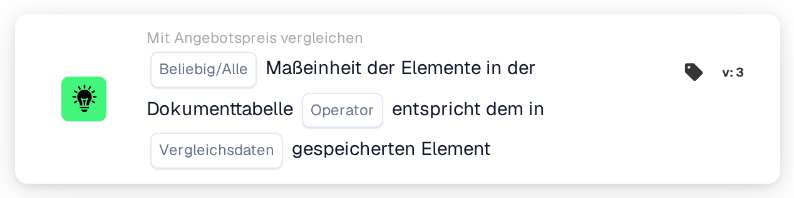

# Mengeneinheit

<figure><figcaption>
Version 2
</figcaption></figure>

<figure><figcaption>
Version 3
</figcaption></figure>

## Zweck:

Diese Workflow-Karte vergleicht die Mengeneinheit der Artikel in der Dokumenttabelle mit der Mengeneinheit, die für dieselben Artikel an anderer Stelle gespeichert ist. In Version 2 wird immer mit der Artikelpreistabelle des Lieferanten verglichen. Version 3 bietet zusätzlich die Wahl zwischen der Artikelpreistabelle des Lieferanten und den Positionen der zugeordneten Bestellung. Die Karte kann verwendet werden, um Zeilen zu erkennen, in denen ein Artikel in einer anderen Einheit als erwartet angeboten oder in Rechnung gestellt wird. Je nach Ergebnis wird der Workflow mit der True- oder der False-Bedingung fortgesetzt.

## Bestandteile der Karte:

1. **Beliebig/Alle**
   * **Beschreibung:** Legt fest, ob eine Zeile oder jede verglichene Zeile der Dokumenttabelle die Bedingung erfüllen soll.
   * **Optionen:**
     * **Irgendeine:** Die Bedingung ist wahr, wenn mindestens eine verglichene Zeile die Bedingung erfüllt.
     * **Alle:** Die Bedingung ist nur wahr, wenn jede verglichene Zeile die Bedingung erfüllt.
2. **Operator**
   * **Beschreibung:** Legt fest, ob die Mengeneinheiten gleich oder unterschiedlich sein sollen.
   * **Optionen:**
     * **Entspricht:** Die Mengeneinheit in der Dokumentzeile ist dieselbe wie die gespeicherte.
     * **Ungleich:** Die Mengeneinheit in der Dokumentzeile weicht von der gespeicherten ab.
3. **Vergleichsdaten** (nur Version 3)
   * **Beschreibung:** Die Quelle, mit der die Mengeneinheit des Dokuments verglichen wird.
   * **Optionen:**
     * **Angebotspreis des Lieferantenartikels:** Die Mengeneinheit, die für den Lieferantenartikel in der Artikelpreistabelle des Lieferanten gespeichert ist, wie in Version 2.
     * **Bestellposition:** Die Mengeneinheit der zugeordneten Bestellposition.

## Funktionalität:

* **Bedingungsauswertung:** Die Karte liest die Mengeneinheit (Spalte `UNIT`) der Zeilen in der ersten Dokumenttabelle und vergleicht sie mit der ausgewählten Quelle. Beim Vergleich wird nicht zwischen Groß- und Kleinschreibung unterschieden. Die Ergebnisse aller verglichenen Zeilen werden dann mit **Irgendeine** oder **Alle** zusammengefasst.
  * **Angebotspreis des Lieferantenartikels:** Verglichen werden nur Zeilen, die mit einem Eintrag der zugeordneten Angebotsdaten verknüpft sind. Für jede dieser Zeilen wird die für ihren Lieferantenartikel gespeicherte Mengeneinheit verwendet.
  * **Bestellposition** (Version 3): Verglichen werden nur Zeilen, die einer Bestellposition zugeordnet sind. Die Mengeneinheit der Bestellposition wird zunächst mit der Nachschlagetabelle für Mengeneinheiten übersetzt (von der EDI-Einheit in die M3-Einheit). Auf beiden Seiten werden einige Schreibweisen als gleich behandelt: „each“ als „ea“ sowie „lbs“ und „lbp“ als „lb“.
* **Übersprungene Zeilen:** Eine Zeile wird vom Vergleich ausgenommen, wenn die Quelle keine Mengeneinheit für sie enthält. Jede übersprungene Zeile wird im Workflow-Protokoll vermerkt.
* **Ausführung der Aktion:**
  * **True-Bedingung:**\
    Die Mengeneinheiten erfüllen den ausgewählten Operator für eine oder alle verglichenen Zeilen. Der Workflow wird mit der True-Bedingung fortgesetzt.
  * **False-Bedingung:**\
    Ist die Bedingung nicht erfüllt, wird der Workflow mit der False-Bedingung fortgesetzt, zum Beispiel um das Dokument zur manuellen Prüfung zu senden. Die False-Bedingung wird auch verwendet, wenn keine Zeile mit der ausgewählten Quelle verknüpft werden konnte, und in Version 3, wenn keine Option unter **Vergleichsdaten** ausgewählt ist, weil dann keine Zeile verglichen wird.
* **Fehlende Daten:** Die Karte wertet die Bedingung nicht aus und meldet die fehlenden Daten im Workflow-Protokoll, wenn:
  * das Dokument keine Tabelle hat,
  * **Angebotspreis des Lieferantenartikels** (oder Version 2) verwendet wird und das Dokument keine zugeordneten Angebotsdaten oder keine Artikelpreisdaten des Lieferanten hat,
  * **Bestellposition** ausgewählt ist und das Dokument keine zugeordnete Bestellung hat,
  * eine verglichene Zeile im Dokument eine leere Mengeneinheit hat,
  * keine der Zeilen verglichen werden konnte, weil jede Zeile übersprungen wurde.

  Ist keine Option für **Beliebig/Alle** festgelegt, vermerkt die Karte dies im Protokoll und verwendet **Alle**.
* **Fehler:** Ist mit **Bestellposition** eine Bestellposition in Unterpositionen mit unterschiedlichen Mengeneinheiten aufgeteilt, endet die Karte mit einem Fehler.

## Einrichtung und Konfiguration:

* Die Karte kann aus der Kategorie **Mit Angebotspreis vergleichen** hinzugefügt werden. Danach können **Irgendeine** oder **Alle** und der Operator ausgewählt werden. In Version 3 kann zusätzlich im Feld **Vergleichsdaten** die Vergleichsquelle ausgewählt werden. Zuletzt wird die Fortsetzungsbedingung (True oder False) festgelegt, die den nächsten Schritt im Workflow bestimmt.
* Die Dokumenttabelle sollte eine Spalte `UNIT` enthalten. Für den Vergleich mit Bestellpositionen sollte die Nachschlagetabelle für Mengeneinheiten die Zuordnungen zwischen den auf Dokumenten und auf Bestellungen verwendeten Einheiten enthalten.

## Fazit:

Die Workflow-Karte „Unit of Measure“ stellt sicher, dass Artikel in der erwarteten Einheit angeboten oder in Rechnung gestellt werden. Zeilen ohne gespeicherte Mengeneinheit werden übersprungen, statt als Abweichungen gezählt zu werden, und Version 3 erweitert die Prüfung von der Artikelpreistabelle des Lieferanten auf Bestellpositionen.
