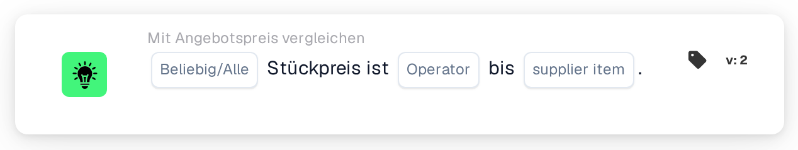

# Einzelpreis mit Lieferantenartikelpreis vergleichen

<figure><figcaption>
Version 2
</figcaption></figure>

## Zweck:

Diese Workflow-Karte vergleicht den Einzelpreis in jeder Zeile eines Dokuments mit einem Preis aus der Artikelpreistabelle des Lieferanten, entweder dem verwalteten Preis oder dem zuletzt gezahlten Preis für denselben Lieferantenartikel. Sie kann verwendet werden, um zu prüfen, ob ein angebotener Preis dem bekannten Preis entspricht, ihn übersteigt oder darunter bleibt, bevor das Dokument genehmigt wird. Je nach Ergebnis wird der Workflow mit der True- oder der False-Bedingung fortgesetzt.

## Bestandteile der Karte:

1. **Beliebig/Alle**
   * **Beschreibung:** Legt fest, ob eine Zeile oder jede verglichene Zeile der Dokumenttabelle die Bedingung erfüllen soll.
   * **Optionen:**
     * **Irgendeine:** Die Bedingung ist wahr, wenn mindestens eine verglichene Zeile die Bedingung erfüllt.
     * **Alle:** Die Bedingung ist nur wahr, wenn jede verglichene Zeile die Bedingung erfüllt.
2. **Operator**
   * **Beschreibung:** Legt fest, wie der Einzelpreis des Dokuments mit dem ausgewählten Lieferantenartikelpreis verglichen wird.
   * **Optionen:**
     * **Entspricht:** Der Einzelpreis ist gleich dem Lieferantenartikelpreis.
     * **Ungleich:** Der Einzelpreis weicht vom Lieferantenartikelpreis ab.
     * **Größer als:** Der Einzelpreis ist höher als der Lieferantenartikelpreis.
     * **Größer oder gleich:** Der Einzelpreis ist höher als der Lieferantenartikelpreis oder gleich hoch.
     * **Weniger als:** Der Einzelpreis ist niedriger als der Lieferantenartikelpreis.
     * **Weniger oder gleich:** Der Einzelpreis ist niedriger als der Lieferantenartikelpreis oder gleich hoch.
3. **supplier item**
   * **Beschreibung:** Der Preis aus der Artikelpreistabelle des Lieferanten, mit dem der Einzelpreis verglichen wird.
   * **Optionen:**
     * **ManagedPrice:** Der für den Lieferantenartikel gespeicherte verwaltete Preis.
     * **LastPrice:** Der zuletzt für den Lieferantenartikel gezahlte Preis.

## Funktionalität:

* **Bedingungsauswertung:** Für jede Zeile der Dokumenttabelle sucht die Karte die Lieferantenartikel-ID der Zeile (Spalte `SUPPLIER_ITEM_NUMBER`) in der Artikelpreistabelle des Lieferanten und vergleicht den Einzelpreis der Zeile (Spalte `UNIT_PRICE`) mit dem ausgewählten Preis. Beide Preise werden als Zahlen verglichen. Die Ergebnisse aller verglichenen Zeilen werden dann mit **Irgendeine** oder **Alle** zusammengefasst.
* **Übersprungene Zeilen:** Eine Zeile wird vom Vergleich ausgenommen, wenn ihr Einzelpreis leer ist oder nicht als Zahl gelesen werden kann oder wenn für ihren Lieferantenartikel kein Preis der ausgewählten Art gespeichert ist, zum Beispiel weil der Lieferantenartikel nicht in der Artikelpreistabelle des Lieferanten steht. Jede übersprungene Zeile wird zusammen mit der Seite, die keinen Preis hatte, im Workflow-Protokoll vermerkt.
* **Ausführung der Aktion:**
  * **True-Bedingung:**\
    Die Einzelpreise erfüllen den ausgewählten Operator für eine oder alle verglichenen Zeilen. Der Workflow wird mit der True-Bedingung fortgesetzt, zum Beispiel um das Dokument zu genehmigen.
  * **False-Bedingung:**\
    Ist die Bedingung nicht erfüllt, wird der Workflow mit der False-Bedingung fortgesetzt, zum Beispiel um das Dokument zur Preisprüfung zu senden.
* **Fehlende Daten:** Die Karte wertet die Bedingung nicht aus und meldet die fehlenden Daten im Workflow-Protokoll, wenn:
  * auf der Karte kein Lieferantenartikelpreis ausgewählt ist,
  * das Dokument keine zugeordneten Angebotsdaten hat,
  * das Dokument keine Tabelle oder mehr als eine Tabelle hat oder keine Zeilen aus der Tabelle gelesen werden konnten,
  * keine der Zeilen verglichen werden konnte, weil jede Zeile übersprungen wurde.

  Ist keine Option für **Beliebig/Alle** festgelegt, vermerkt die Karte dies im Protokoll und verwendet **Alle**.
* **Fehler:** Hat eine Zeile der Tabelle keine Spalte `SUPPLIER_ITEM_NUMBER` oder keine Spalte `UNIT_PRICE`, endet die Karte mit einem Fehler.

## Einrichtung und Konfiguration:

* Die Karte kann aus der Kategorie **Mit Angebotspreis vergleichen** hinzugefügt werden. Danach können **Irgendeine** oder **Alle**, der Operator und im Feld **supplier item** der Vergleichspreis ausgewählt werden. Zuletzt wird die Fortsetzungsbedingung (True oder False) festgelegt, die den nächsten Schritt im Workflow bestimmt.
* Die Karte arbeitet mit Dokumenten, die genau eine Tabelle haben, deren Zeilen die Lieferantenartikel-ID und den Einzelpreis enthalten.

## Fazit:

Die Workflow-Karte „Unit Price to Supplier Item Price“ prüft angebotene Preise gegen den verwalteten Preis oder den zuletzt gezahlten Preis. Zeilen ohne Preis auf einer der beiden Seiten werden übersprungen, sodass eine einzelne unvollständige Zeile nicht über das Ergebnis entscheidet, und ein Dokument ohne vergleichbare Zeile wird als fehlende Daten gemeldet.
