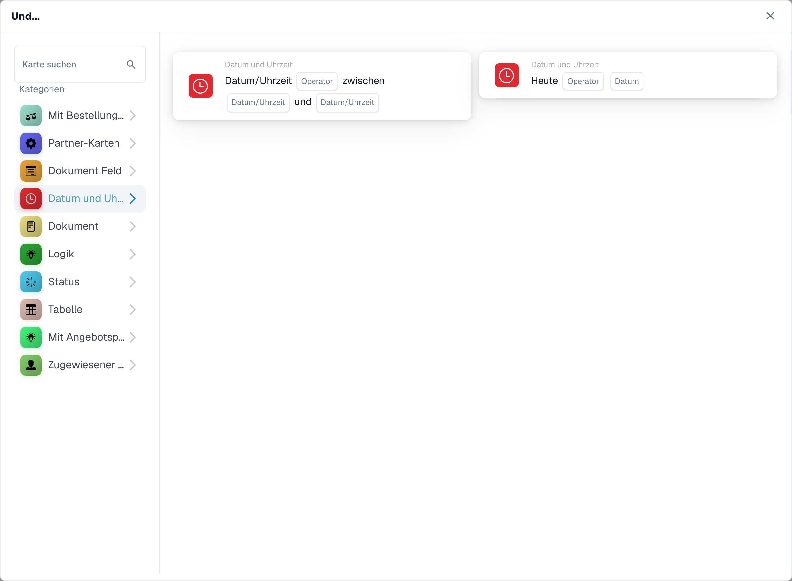

# Datum und Uhrzeit

Die **Datum und Zeit**-Karten im **Karte hinzufügen**-Picker des Workflow-Builders (öffnen über die **Und**-Gruppe → **Karte hinzufügen**):

<figure><figcaption>
Verfügbare Karten der ausgewählten Kategorie. Füllen Sie die Platzhalter vor der Verwendung aus.
</figcaption></figure>
