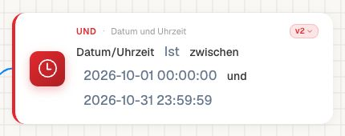

# Datum oder Uhrzeit prüfen

Die Karte **Date or Time** (`condition_time_is_isnot_between`, Version 2) vergleicht die aktuelle Ausführungszeit mit zwei eingetragenen Grenzen. Im geprüften Dev-Stand stammt diese Zeit aus UTC. Das auf einem Rechnungsbeleg erkannte Einreichungs- oder Rechnungsdatum wird durch diese Karte nicht automatisch ausgewählt.

Für den Vergleich zweier Dokumentfelder verwenden Sie eine passende Feldvergleichskarte. Ein Zeitfenster löst außerdem keinen Workflow selbstständig aus: Die Karte wird geprüft, wenn ein Workflow gestartet wird und diesen Knoten erreicht.

<figure><figcaption>
Ausgefüllte Datums-/Zeitkarte mit Oktoberfenster und Version 2.
</figcaption></figure>

## Ein vollständig ausgefülltes Beispiel

Öffnen Sie einen eigenen inaktiven Trainingsworkflow. Begrenzen Sie seinen Einstieg auf den Dokumenttyp Rechnung und die synthetische Rechnungsnummer `WF-TRAINING-001`. Fügen Sie unter **UND → Datum und Uhrzeit** die Karte hinzu und lassen Sie Version 2 ausgewählt.

| Parameter | Beispielwert | Bedeutung |
| --- | --- | --- |
| Linke Grenze (`date_time_left`) | `2026-10-01 00:00:00` | Beginn des vorgesehenen UTC-Zeitfensters |
| Rechte Grenze (`date_time_right`) | `2026-10-31 23:59:59` | Ende des vorgesehenen UTC-Zeitfensters |
| Operator | `is` | Aktuelle Ausführungszeit muss im Fenster liegen |

Tragen Sie vollständige Jahres-, Monats- und Tageswerte ein. Damit bleibt die Bedeutung des gespeicherten Beispiels eindeutig. Im geprüften Parser werden Zeitzonenangaben nicht in eine andere Zeitzone umgerechnet; verwenden Sie für diesen Stand Grenzen in UTC und prüfen Sie lokale Geschäftszeiten ausdrücklich dagegen.

Starten Sie **Test → Benutzerdefinierte Daten** mit dem synthetischen Rechnungsbeispiel. Öffnen Sie anschließend **Details** und die Datums-/Zeitkarte. Der Test am 22. Oktober 2026 lag im Oktoberfenster und ergab `success`.

## Treffer, Nichttreffer und Eingabefehler unterscheiden

| Tatsächlich geprüfter Fall am 22.10.2026 | Knotenpfad | Schlussfolgerung |
| --- | --- | --- |
| Fenster 01.10.2026 bis 31.10.2026 | `success` | Die aktuelle Ausführungszeit liegt im Fenster. |
| Fenster 01.10.2025 bis 31.10.2025 | `failed_condition` | Die Bedingung trifft fachlich nicht zu. |
| Linke Grenze `not-a-date` | `error` | Die Eingabe konnte nicht als Datum gelesen werden. |

Bei einem normalen aufsteigenden Zeitfenster verwendet die Implementierung inklusive Vergleiche für Anfang und Ende. Prüfen Sie Uhrzeitfenster über Mitternacht getrennt mit Fällen unmittelbar vor, auf und nach beiden Grenzen; übertragen Sie den Nachweis für ein normales Datumsfenster nicht auf einen Tageswechsel.

`isnot` kehrt die fachliche Fensterprüfung um. Ein unlesbares Datum wird dadurch nicht zu einem gültigen Nichttreffer. Prüfen Sie in diesem Fall zuerst Eingabeformat und konkrete Meldung des ersten betroffenen Knotens.

## Für die Freigabe nachweisen

Speichern Sie Kartenparameter, Version, UTC-Zeit des Tests und tatsächlichen Knotenpfad zusammen. Wiederholen Sie die Prüfung nach einer Zeit-, Datums- oder Versionsänderung. Der Advanced-Test bestätigt die Kartenlogik mit den Testdaten; ein geplanter Start oder ein echter Dokumentlauf braucht einen eigenen Nachweis.

[Heute vergleichen](today.md) · [Test und Echtlauf unterscheiden](../../workflow-logs.md) · [Sicher aktivieren](../../workflow-go-live.md)
