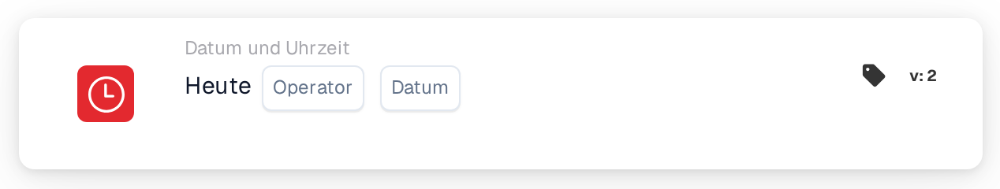

# Heute mit einem Datum vergleichen

<figure><figcaption>
Version 2
</figcaption></figure>

## Zweck:

Diese Workflow-Karte vergleicht das heutige Datum mit einem auf der Karte eingetragenen Datum. Sie kann für Regeln verwendet werden, die erst ab oder nur bis zu einem bestimmten Datum gelten sollen, zum Beispiel für eine Prozessänderung ab einem geplanten Starttermin.

## Bestandteile der Karte:

1. **Operator**
   * **Beschreibung:** Wie das heutige Datum mit dem Datum auf der Karte verglichen wird.
   * **Optionen:**
     * **Entspricht:** Heute ist das Datum auf der Karte.
     * **Ungleich:** Heute ist ein beliebiger anderer Tag.
     * **Größer als:** Heute liegt nach dem Datum auf der Karte.
     * **Größer oder gleich:** Heute ist das Datum auf der Karte oder später.
     * **Weniger als:** Heute liegt vor dem Datum auf der Karte.
     * **Weniger oder gleich:** Heute ist das Datum auf der Karte oder früher.
2. **Datum**
   * **Beschreibung:** Das Datum, mit dem heute verglichen wird.

## Funktionalität:

* **Bedingungsauswertung:** Wenn der Workflow die Karte erreicht, nimmt sie das aktuelle Datum in UTC und vergleicht es mit dem Operator mit dem Datum auf der Karte. Verglichen werden nur die Daten; Uhrzeiten werden ignoriert. Die Daten auf dem Dokument spielen keine Rolle.
* **Ausführung der Aktion:**
  * **True-Bedingung:**\
    Trifft der Vergleich zu, wird der Workflow mit den nächsten Karten fortgesetzt.
  * **False-Bedingung:**\
    Trifft er nicht zu, stoppt der Workflow mit einer nicht erfüllten Bedingung.
* **Fehlende Daten:** Ist auf der Karte kein Datum eingetragen, wertet die Karte die Bedingung nicht aus und meldet die fehlende Eingabe im Workflow-Protokoll.

## Einrichtung und Konfiguration:

* Die Karte kann als And-Bedingung aus der Kategorie **Datum und Uhrzeit** hinzugefügt werden. Danach werden ein Operator und ein Datum ausgewählt.
* **Beispiel:** Mit **Größer oder gleich** und `2026-11-01` ist die Karte ab dem 1. November 2026 (UTC) erfüllt und am 31. Oktober 2026 nicht erfüllt.
* Da das Datum in UTC ermittelt wird, kann es um Mitternacht vom lokalen Datum abweichen: In Europa sieht die Karte kurz nach Mitternacht noch den Vortag, in Amerika sieht sie am Abend bereits den nächsten Tag.

## Fazit:

Die Workflow-Karte „Today“ macht das Kalenderdatum zu einer Workflow-Bedingung. Datumsbasierte Regeln, etwa ein Start- oder Enddatum für einen Prozess, können einmal eingerichtet werden und greifen dann automatisch.
