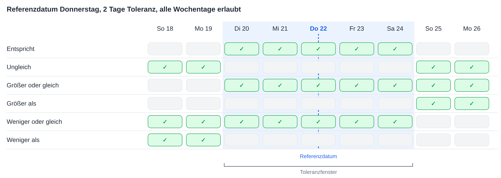
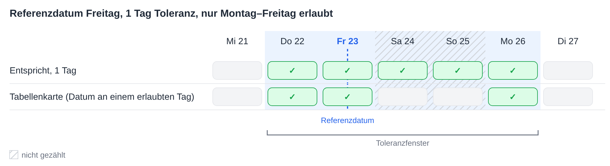
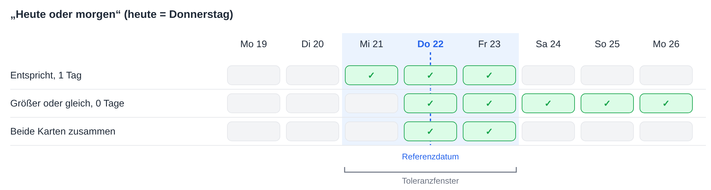

# Datumstoleranzen

Mehrere Workflow-Karten vergleichen ein Datum mit einem Referenzdatum und lassen eine Toleranz von einer bestimmten Anzahl Tagen zu. Alle berechnen die Toleranz auf dieselbe Weise. Diese Seite erklärt diese Berechnung, die Bedeutung der einzelnen Operatoren, die Funktionsweise der **Erlaubte Toleranztage** und wie sich zwei Karten für Bereiche wie „heute oder morgen“ kombinieren lassen.

Die Karten, die diese Berechnung verwenden:

* [Table Date to Current Date](table/table-date-to-current-date.md) – ein Datum in einer Dokumenttabelle wird mit dem aktuellen Datum verglichen.
* [Promised delivery date for line items in table with promised delivery date](compare-with-purchase-order/promised-delivery-date-for-line-items-in-table-with-promised-delivery-date/README.md) – zugesagte Liefertermine von Positionen werden mit dem aktuellen Datum verglichen.
* [Promised Delivery Date on Purchase Order](compare-with-purchase-order/promised-delivery-date-on-purchase-order.md) – Liefertermine von Positionen werden mit dem Liefertermin der Bestellung verglichen.

## Das Toleranzfenster

Vom Referenzdatum aus wird die Toleranz rückwärts und vorwärts gezählt. Das Ergebnis ist ein **Toleranzfenster**: vom Startdatum bis zum Enddatum, beide eingeschlossen.

* Bei einer Toleranz von **0 Tagen** umfasst das Fenster nur das Referenzdatum selbst.
* Bei einer Toleranz von **2 Tagen** reicht das Fenster 2 Tage vor und 2 Tage nach dem Referenzdatum.
* Das **aktuelle Datum** ist das Datum auf den DocBits-Servern, die in **UTC** laufen.

Jeder Operator vergleicht das Datum mit diesem Fenster:

| Operator | Wahr, wenn das Datum … |
|---|---|
| **Entspricht** | innerhalb des Fensters liegt |
| **Ungleich** | außerhalb des Fensters liegt |
| **Größer oder gleich** | am oder nach dem **Beginn** des Fensters liegt |
| **Größer als** | nach dem **Ende** des Fensters liegt |
| **Weniger oder gleich** | am oder vor dem **Ende** des Fensters liegt |
| **Weniger als** | vor dem **Beginn** des Fensters liegt |

Die Toleranz erweitert auch **Größer oder gleich** und **Weniger oder gleich**: Bei 2 Tagen akzeptiert **Größer oder gleich** bereits ein Datum 2 Tage vor dem Referenzdatum.

<figure><figcaption>
Referenzdatum Donnerstag, 22., 2 Tage Toleranz: Das Fenster reicht von Dienstag, 20., bis Samstag, 24.
</figcaption></figure>

## Erlaubte Toleranztage

Karten mit der Option **Erlaubte Toleranztage** zählen bei der Berechnung des Fensters nur die ausgewählten Wochentage. Nicht ausgewählte Wochentage werden beim Zählen übersprungen, bleiben aber innerhalb des Fensters.

**Beispiel:** Referenzdatum Freitag, 1 Tag Toleranz, nur Montag bis Freitag ausgewählt. Rückwärts gezählt wird Donnerstag erreicht. Vorwärts gezählt werden Samstag und Sonntag übersprungen und Montag erreicht. Das Fenster reicht von **Donnerstag bis Montag**.

**Table Date to Current Date** fügt eine weitere Prüfung hinzu: Das Datum in der Tabelle sollte außerdem auf einen der ausgewählten Wochentage fallen. Ein Samstag innerhalb des Fensters wird von dieser Karte daher nicht akzeptiert. Die beiden anderen Karten haben diese zusätzliche Prüfung nicht.

<figure><figcaption>
Nur Montag bis Freitag werden gezählt, daher ist 1 Tag nach Freitag der Montag.
</figcaption></figure>

## Beispiel: Heute oder morgen

Eine einzelne Karte kann nicht genau „heute oder morgen“ akzeptieren, weil das Fenster immer in beide Richtungen gleich viele Tage reicht. Zwei Karten nacheinander können das:

1. **Entspricht** mit **1 Tag** Toleranz akzeptiert gestern, heute und morgen.
2. **Größer oder gleich** mit **0 Tagen** Toleranz akzeptiert heute und jeden späteren Tag.

Übrig bleiben nur Datumswerte, die beide Karten bestehen: **heute und morgen**.

<figure><figcaption>
Heute ist Donnerstag, der 22.: Zusammen akzeptieren die beiden Karten Donnerstag, 22., und Freitag, 23.
</figcaption></figure>

Auf dieselbe Weise lassen sich weitere Bereiche bilden:

| Bereich | Erste Karte | Zweite Karte |
|---|---|---|
| Heute oder morgen | **Entspricht**, 1 Tag | **Größer oder gleich**, 0 Tage |
| Gestern oder heute | **Entspricht**, 1 Tag | **Weniger oder gleich**, 0 Tage |
| Heute bis 3 Tage voraus | **Entspricht**, 3 Tage | **Größer oder gleich**, 0 Tage |
| Nicht heute | **Ungleich**, 0 Tage | – |
| Ab übermorgen | **Größer als**, 1 Tag | – |

Sind nur Montag bis Freitag als **Erlaubte Toleranztage** ausgewählt, ist „morgen“ an einem Freitag der darauffolgende Montag.

## Fazit

Alle Datumskarten mit Toleranz verwenden ein Fenster um das Referenzdatum. Wer weiß, wo das Fenster beginnt und endet, erkennt, was jeder Operator akzeptiert, und zwei Karten zusammen können Bereiche abdecken, die eine einzelne Karte nicht abdecken kann.
