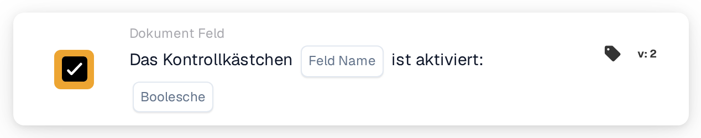

# Das Kontrollkästchen ist aktiviert

<figure><figcaption>
Version 2
</figcaption></figure>

## Zweck:

Diese Workflow-Karte prüft, ob ein Kontrollkästchenfeld auf dem Dokument aktiviert oder deaktiviert ist. Sie kann verwendet werden, damit ein Workflow erst weiterläuft, nachdem auf dem Dokument eine Markierung gesetzt wurde, zum Beispiel eine Prüfmarkierung.

## Admin-Video:



[Video mit deutschen Untertiteln öffnen](https://docbits-videos.fra1.cdn.digitaloceanspaces.com/settings-assistant/workflow-card-checkbox-admin/v1/de-theme-v4.html)

## Bestandteile der Karte:

1. **Feld Name**
   * **Beschreibung:** Der technische Name des Kontrollkästchenfelds auf dem Dokument.
   * **Detail:** Das Feld sollte ein Kontrollkästchenfeld (Boolean) des Dokumenttyps sein.
2. **Boolescher Wert**
   * **Beschreibung:** Der Zustand, den das Kontrollkästchen haben sollte.
   * **Optionen:**
     * **Wahr:** Das Kontrollkästchen sollte aktiviert sein.
     * **Falsch:** Das Kontrollkästchen sollte deaktiviert sein.

## Funktionalität:

* **Bedingungsauswertung:** Wenn der Workflow die Karte erreicht, liest sie den aktuellen Wert des Felds auf dem Dokument und vergleicht ihn mit **Boolescher Wert**. Die Karte überwacht das Feld nicht über längere Zeit und ändert es nicht.
  * Ein leerer Kontrollkästchenwert gilt als deaktiviert.
  * Ist kein **Boolescher Wert** ausgewählt, prüft die Karte auf ein deaktiviertes Kontrollkästchen.
  * Ist das Feld kein Kontrollkästchenfeld, vermerkt die Karte dies im Workflow-Protokoll und vergleicht seinen Wert trotzdem.
* **Ausführung der Aktion:**
  * **True-Bedingung:**\
    Stimmt der Zustand des Kontrollkästchens mit **Boolescher Wert** überein, wird der Workflow mit den nächsten Karten fortgesetzt.
  * **False-Bedingung:**\
    Stimmt er nicht überein, stoppt der Workflow mit einer nicht erfüllten Bedingung.
* **Fehlende Daten:** Existiert das Feld auf dem Dokument nicht, wertet die Karte die Bedingung nicht aus. Sie meldet, dass das Feld auf dem Dokument nicht gefunden wurde. Das ist ein anderes Ergebnis als ein deaktiviertes Kontrollkästchen.

## Einrichtung und Konfiguration:

* Die Karte kann als And-Bedingung aus der Kategorie **Dokument Feld** hinzugefügt werden. Danach wird der technische Name des Kontrollkästchenfelds unter **Feld Name** eingetragen und **Wahr** oder **Falsch** ausgewählt.
* Mit **Testkarte** im Kartenmenü des Workflow Builders kann die Konfiguration an einem Dokument mit aktiviertem Kontrollkästchen, an einem mit deaktiviertem Kontrollkästchen und an einem ohne das Feld geprüft werden.

## Fazit:

Die Workflow-Karte „Checkbox is checked“ macht ein Kontrollkästchen auf dem Dokument zu einer Workflow-Bedingung. So kann ein Workflow auf einen manuellen Schritt warten, etwa eine abgeschlossene Prüfung, bevor die folgenden Aktionen ausgeführt werden.
