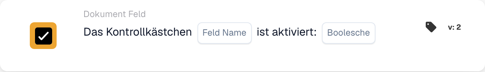

# Das Kontrollkästchen ist aktiviert

<figure><figcaption>
Kartenfelder in der angezeigten Version. Die Platzhalter sind noch nicht ausgefüllt.
</figcaption></figure>

## **Zweck:**

Diese Workflow-Karte ist darauf ausgelegt, Aktionen auf Basis des Zustands (aktiviert oder deaktiviert) eines Kontrollkästchens innerhalb Ihres ERP-Systems zu automatisieren. Indem sie den Zustand des Kontrollkästchens auswertet, ermöglicht sie das Auslösen bestimmter Prozesse oder die Durchsetzung bestimmter Regeln innerhalb der Anwendung.

## **Bestandteile der Karte:**

* **Feldname**
  * **Beschreibung:** Gibt den Namen des Kontrollkästchenfelds an, das ausgewertet wird.
  * **Detail:** Dieser sollte exakt mit dem im System verwendeten Feldbezeichner übereinstimmen. Er bestimmt, welcher Kontrollkästchenzustand überwacht wird.
* **Boolescher Wert**
  * **Beschreibung:** Legt die Bedingung fest, die den Workflow auslöst.
  * **Optionen:**
    * **True:** Der Workflow wird ausgelöst, wenn das Kontrollkästchen aktiviert ist.
    * **False:** Der Workflow wird ausgelöst, wenn das Kontrollkästchen deaktiviert ist.

#### **Funktionalität:**

* **Zustandserkennung:** Die Karte prüft bei ihrer Auswertung den Zustand des angegebenen Kontrollkästchenfelds.
* **Bedingungsauswertung:** Das System prüft, ob sich das Kontrollkästchen in dem durch die Boolean-Bedingung angegebenen Zustand (aktiviert oder deaktiviert) befindet.
* **Ausführung der Aktion:**
  * **Bedingung erfüllt (True):**\
    Stimmt der Zustand des Kontrollkästchens mit der angegebenen Boolean-Bedingung überein (entweder true für aktiviert oder false für deaktiviert), leitet das System die zugehörigen Aktionen ein. Dazu können das Aktivieren oder Deaktivieren von Formularfeldern, das Auslösen von Benachrichtigungen, das Starten von Workflows oder das Aktualisieren von Datensätzen gehören.
  * **Bedingung nicht erfüllt (False):**\
    Stimmt der Zustand des Kontrollkästchens nicht mit der Bedingung überein, werden je nach Workflow-Einrichtung alternative oder keine Aktionen ausgeführt.

## **Einrichtung und Konfiguration:**

* Benutzer konfigurieren die Karte, indem sie das Kontrollkästchenfeld aus einer Liste verfügbarer Felder auswählen und die Boolean-Bedingung festlegen.

## Fazit:

Die Workflow-Karte "Checkbox Field Condition" ist ein grundlegendes Werkzeug für die Verwaltung dynamischer Formulare und Dokumente innerhalb eines ERP-Systems, in dem Benutzereingaben nachfolgende Datenprozesse bestimmen können. Indem sie Aktionen auf Basis des Zustands eines Kontrollkästchens automatisiert, steigert diese Karte die Workflow-Effizienz und stellt sicher, dass das Systemverhalten mit den Benutzereingaben übereinstimmt. Eine klare Dokumentation dieser Karte hilft Benutzern, sie effektiv in ihren Abläufen einzusetzen, und ermöglicht eine bessere Kontrolle über das Verhalten von Formularen und Prozessautomatisierungen.

**Hinweis: Nicht jeder Kunde verfügt über das Kontrollkästchen, es kann jedoch bei Bedarf hinzugefügt werden.**

<!-- workflow-card-practical-example-20261021 -->

## Praxisbeispiel

**Wann nutzen:** Eine Folgeaktion nur nach einer ausdrücklich gesetzten Prüfmarkierung erreichen.

**Wo:** Standard-Workflow-Designer → Und → Dokumentenfeld.

**Konfiguration:** Wählen Sie in Version 2 das vorhandene Boolesche Feld `validation_complete` und den Vergleichswert Wahr (`true`).

**Erwartetes Ergebnis und Gegenbeispiel:** Eine gesetzte Checkbox erfüllt diese Bedingung; eine vorhandene, nicht gesetzte Checkbox erfüllt sie nicht. Ein fehlendes Feld ist ein eigener Fehlerfall. Prüfen Sie, dass das gewählte Feld tatsächlich Boolesche Werte verwendet.

Die Beispiele beschreiben erwartete Ergebnisse. Verwenden Sie die in Ihrer Organisation tatsächlich konfigurierten Felder und angebotenen Werte.

## Admin-Beispielvideo

Wann ich ein angehaktes Kontrollkästchen als Bedingung verwende und wie ich den Booleschen Wert prüfe. Die Beispiele zeigen erwartete Ergebnisse.



[Video mit deutschen Untertiteln öffnen](https://docbits-videos.fra1.cdn.digitaloceanspaces.com/settings-assistant/workflow-card-checkbox-admin/v1/de.html)

[Transkript lesen](https://docbits-videos.fra1.cdn.digitaloceanspaces.com/settings-assistant/workflow-card-checkbox-admin/v1/de.txt)
