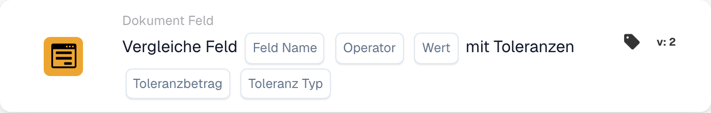

# Feld mit Toleranzen vergleichen

<figure><figcaption>
Kartenfelder in der angezeigten Version. Die Platzhalter sind noch nicht ausgefüllt.
</figcaption></figure>

## Wann Sie diese Karte verwenden

Mit dieser Bedingung vergleichen Sie ein numerisches Belegfeld mit einem festen Referenzwert und lassen eine festgelegte Abweichung zu. Beispielsweise kann ein Gesamtbetrag als passend gelten, wenn er höchstens 5 vom Sollwert 100 abweicht.

## Wo Sie die Karte finden

Fügen Sie im Standard-Workflow-Designer unter **Und** eine Karte hinzu. Öffnen Sie **Dokument Feld** und wählen Sie den Vergleich eines Feldes mit Referenzwert und Toleranzen. Das folgende Beispiel verwendet Version 2.

## Einstellungen

Verwenden Sie ein in Ihrer Organisation konfiguriertes numerisches Feld. Feldwert, Referenzwert und Toleranz werden numerisch ausgewertet. Achten Sie auf übereinstimmende Einheiten.

| Einstellung | Bedeutung |
| --- | --- |
| Feldname | Das konfigurierte Belegfeld, beispielsweise `total_amount`. |
| Operator | Der gewünschte Vergleich: `eq`, `neq`, `gt`, `ge`, `lt` oder `le`. |
| Referenzwert | Die feste Zahl, mit der das Feld verglichen wird. |
| Toleranzbetrag | Die zulässige numerische Abweichung. |
| Toleranztyp | **Wert** (`value`) für einen absoluten Betrag oder **Prozentsatz** (`percent`) für eine relative Abweichung. |

Bei einem positiven Referenzwert von 200 entspricht eine prozentuale Toleranz von 5 einer Abweichung von 10. Eine absolute Toleranz von 5 entspricht dagegen einer Abweichung von 5. Prüfen Sie die relevanten Grenzfälle für Ihren Operator und Ihre Werte.

## Wie die Toleranz den Vergleich verändert

Bei Referenzwert **100** und absoluter Toleranz **5** liegt die untere Grenze bei **95**, die obere bei **105**.

| Operator | Die Bedingung ist erfüllt, wenn der Feldwert… |
| --- | --- |
| `eq` (=) | Zwischen 95 und 105 liegt, einschließlich beider Grenzen. |
| `neq` (≠) | Unter 95 oder über 105 liegt. |
| `gt` (>) | Über 105 liegt. |
| `ge` (≥) | Mindestens 95 beträgt. |
| `lt` (<) | Unter 95 liegt. |
| `le` (≤) | Höchstens 105 beträgt. |

Die Karte liefert ein Bedingungsergebnis. Nachfolgende Schritte hängen vom Auslöser, weiteren Bedingungen und den konfigurierten Aktionen des Workflows ab.

<!-- workflow-card-complete-example-20261021 condition_docfield_operator_value_tolerances -->

## Praktisches Beispiel

1. Wählen Sie das konfigurierte numerische Feld **Gesamtbetrag** (`total_amount`).
2. Wählen Sie **Entspricht** (`eq`).
3. Tragen Sie Referenzwert **100** und Toleranz **5** ein.
4. Wählen Sie den Toleranztyp **Wert** (`value`).

| Feldwert | Absolute Differenz zu 100 | Erwartetes Ergebnis |
| --- | --- | --- |
| 103 | 3 | Bedingung erfüllt. |
| 110 | 10 | Bedingung nicht erfüllt. |
| 95 oder 105 | 5 | Bedingung erfüllt: Der Gleichheitsvergleich schließt die Toleranzgrenzen ein. |

Dies sind erwartete Rechenergebnisse. Die Aufnahme zeigt eine ungespeicherte Konfiguration; ein Workflow wurde dafür nicht ausgeführt.

## Vor dem Aktivieren

Prüfen Sie mit geeigneten Testdaten einen passenden Fall, einen unpassenden Fall und die Grenzwerte. Untersuchen Sie fehlende Felder, nichtnumerische Werte und Konfigurationsfehler gesondert. Kontrollieren Sie im Ausführungsprotokoll die tatsächlich verwendeten Werte, den Operator, die Toleranz und das Ergebnis.

Wenn beide Beträge aus Belegfeldern stammen, verwenden Sie die separate Karte zum [Vergleich zweier Felder mit Toleranz](compare-two-fields-with-tolerance.md).
