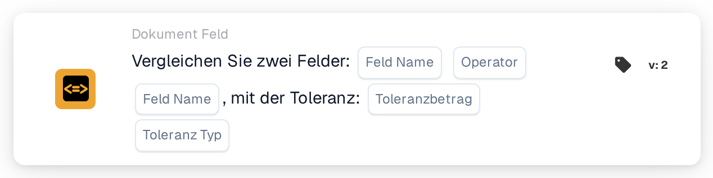

# Vergleichen Sie zwei Felder mit Toleranz

<figure><figcaption>
Version 2
</figcaption></figure>

## **Zweck:**

Diese Workflow-Karte ist darauf ausgelegt, Aktionen zu automatisieren, indem sie die Werte zweier angegebener Dokumentfelder vergleicht, mit der zusätzlichen Möglichkeit, einen Toleranzwert anzuwenden. Diese Funktion ermöglicht es dem System, beim Vergleich von Feldwerten eine Fehlertoleranz (Toleranz) zu berücksichtigen, und erlaubt so eine flexiblere Entscheidungsfindung innerhalb von Workflows.

## **Bestandteile der Karte:**

1. **Feldname (1)**
   * **Beschreibung:** Gibt das erste zu vergleichende Dokumentfeld an.
   * **Detail:** Dieser muss exakt mit dem Bezeichner des ersten Feldes innerhalb des Dokuments übereinstimmen.
2. **Operator**
   * **Beschreibung:** Legt die Art des Vergleichs fest, der zwischen den beiden Feldern durchgeführt wird.
   * **Optionen:**
     * **Gleich (=):** Prüft, ob die Werte der beiden Felder gleich sind.
     * **Ungleich (≠):** Stellt sicher, dass sich die Werte der beiden Felder unterscheiden.
     * **Größer als (>):** Bestätigt, dass der Wert des ersten Feldes größer als der des zweiten Feldes ist.
     * **Größer oder gleich (≥):** Überprüft, dass der Wert des ersten Feldes gleich oder größer als der des zweiten Feldes ist.
     * **Kleiner als (<):** Prüft, ob der Wert des ersten Feldes kleiner als der des zweiten Feldes ist.
     * **Kleiner oder gleich (≤):** Stellt sicher, dass der Wert des ersten Feldes kleiner oder gleich dem des zweiten Feldes ist.
3. **Feldname (2)**
   * **Beschreibung:** Gibt das zweite Dokumentfeld an, das mit dem ersten Feld verglichen wird.
   * **Detail:** Dieser sollte exakt mit dem Bezeichner des zweiten Feldes innerhalb des Dokuments übereinstimmen.
4. **Toleranzbetrag**
   * **Beschreibung:** Legt die zulässige Fehlertoleranz für den Vergleich fest.
   * **Detail:** Der Toleranzbetrag ist ein numerischer Wert, der die maximal zulässige Differenz zwischen den beiden Feldwerten angibt, damit der Vergleich als erfüllt gilt.
5. **Toleranztyp**
   * **Beschreibung:** Gibt die Maßeinheit für den Toleranzbetrag an.
   * **Optionen:**
     * **Wert:** Die Toleranz ist ein absoluter Wert, das heißt, die beiden Felder dürfen sich um den angegebenen Toleranzbetrag unterscheiden.
     * **Prozent:** Die Toleranz wird als Prozentsatz des zweiten Feldwerts berechnet und lässt so eine relative Fehlertoleranz zu.

## **Funktionalität:**

* **Bedingungsauswertung:** Das System wertet aus, ob die Werte in den beiden angegebenen Feldern die Vergleichsbedingung unter Berücksichtigung der definierten Toleranz erfüllen. Liegt die absolute oder relative Differenz zwischen den beiden Feldern innerhalb der Toleranz, gilt die Bedingung als erfüllt.
* **Ausführung der Aktion:**
  * **Bedingung erfüllt (True):**\
    Stimmen die Werte der beiden Felder unter Berücksichtigung der Toleranz mit der Vergleichsbedingung überein, löst das System die zugehörigen Aktionen aus. Diese Aktionen können das Fortführen des Workflows, das Aktualisieren von Datensätzen, das Auslösen von Warnungen oder das Aktivieren bestimmter Vorgänge umfassen.
  * **Bedingung nicht erfüllt (False):**\
    Stimmen die Werte der beiden Felder unter Berücksichtigung der Toleranz nicht mit der angegebenen Bedingung überein, werden je nach Konfiguration des Workflows alternative oder keine Aktionen ausgeführt.

## **Einrichtung und Konfiguration:**

* Benutzer konfigurieren die Karte, indem sie die beiden zu vergleichenden Felder aus einer Liste der im System verfügbaren Felder auswählen. Der Operator wird aus einer Dropdown-Liste der verfügbaren Vergleichsoptionen ausgewählt. Benutzer geben den Toleranzbetrag ein und wählen den Toleranztyp (Wert oder Prozent).

## **Fazit:**

Die Workflow-Karte "Compare Two Fields with Tolerance" ist ein leistungsstarkes Werkzeug, um Dokumentfelder zu vergleichen und dabei zulässige Datenabweichungen zu berücksichtigen. Indem sie Toleranz auf Feldvergleiche anwendet, verleiht diese Karte dem Workflow Flexibilität und ermöglicht es ihm, reale Datenabweichungen zu handhaben. Sie verbessert die Entscheidungsfindung, unterstützt die Datenvalidierung und steigert die Workflow-Automatisierung insgesamt.

<!-- workflow-card-practical-example-20261021 -->

## Praxisbeispiel

**Wann nutzen:** Bei einer kontrollierten Rechnung mit genau einer Nettogruppe ohne weitere Nettobestandteile zwei fachlich gleichartige Beträge abgleichen.

**Wo:** Standard-Workflow-Designer → Und → Dokumentenfeld.

**Konfiguration:** Wählen Sie in Version 2 die vorhandenen Betragsfelder `net_amount` und `total_net_amount`, Gleichheit (`eq`), Toleranz `5` und den absoluten Typ Wert (`value`).

**Erwartetes Ergebnis und Gegenbeispiel:** Bei `103` gegenüber `100` beträgt die Differenz `3`; die Bedingung ist erfüllt. Bei `110` gegenüber `100` beträgt sie `10`; die Bedingung ist nicht erfüllt. Bei mehreren Steuergruppen oder unterschiedlichen fachlichen Bedeutungen müssen andere passende Felder gewählt werden. Fehlende oder nicht numerische Werte sind getrennte Fehlerfälle.

Die Beispiele beschreiben erwartete Ergebnisse. Verwenden Sie die in Ihrer Organisation tatsächlich konfigurierten Felder und angebotenen Werte.

## Admin-Beispielvideo

Wann ich zwei Beträge mit einer zulässigen Abweichung vergleiche und wie ich die Felder und Toleranzen einstelle. Die Beispiele zeigen erwartete Ergebnisse.



[Video mit deutschen Untertiteln öffnen](https://docbits-videos.fra1.cdn.digitaloceanspaces.com/settings-assistant/workflow-card-two-fields-tolerance-admin/v1/de-theme-v4.html)

[Transkript lesen](https://docbits-videos.fra1.cdn.digitaloceanspaces.com/settings-assistant/workflow-card-two-fields-tolerance-admin/v1/de.txt)
