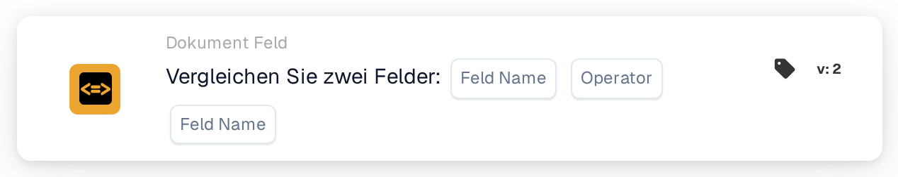

# Vergleichen Sie zwei Felder

<figure><figcaption>
Version 2
</figcaption></figure>

## **Zweck:**

Diese Workflow-Karte ist darauf ausgelegt, Aktionen zu automatisieren, indem sie die Werte zweier angegebener Dokumentfelder vergleicht. Sie ermöglicht eine dynamische Entscheidungsfindung auf Basis von Felddaten und stellt sicher, dass Workflows auf Grundlage von Vergleichen zwischen verschiedenen Dokumentwerten ausgeführt werden.

## **Bestandteile der Karte:**

1. **Feldname (1)**
   * **Beschreibung:** Gibt das erste zu vergleichende Dokumentfeld an.
   * **Detail:** Dieser muss exakt mit dem Bezeichner des ersten Feldes innerhalb des Dokuments übereinstimmen.
2. **Operator**
   * **Beschreibung:** Legt die Art des Vergleichs fest, der zwischen den beiden Feldern durchgeführt wird.
   * **Optionen:**
     * **Gleich (=):** Prüft, ob die Werte der beiden Felder gleich sind.
     * **Ungleich (≠):** Stellt sicher, dass sich die Werte der beiden Felder unterscheiden.
     * **Größer als (>):** Bestätigt, dass der Wert des ersten Feldes größer als der des zweiten Feldes ist.
     * **Größer oder gleich (≥):** Überprüft, dass der Wert des ersten Feldes gleich oder größer als der des zweiten Feldes ist.
     * **Kleiner als (<):** Prüft, ob der Wert des ersten Feldes kleiner als der des zweiten Feldes ist.
     * **Kleiner oder gleich (≤):** Stellt sicher, dass der Wert des ersten Feldes kleiner oder gleich dem des zweiten Feldes ist.
3. **Feldname (2)**
   * **Beschreibung:** Gibt das zweite Dokumentfeld an, das mit dem ersten Feld verglichen wird.
   * **Detail:** Dieser sollte exakt mit dem Bezeichner des zweiten Feldes innerhalb des Dokuments übereinstimmen.

## **Funktionalität:**

**Bedingungsauswertung:** Das System wertet aus, ob die Werte in den beiden angegebenen Feldern die durch den Operator definierte Vergleichsbedingung erfüllen.

**Ausführung der Aktion:**

* **Bedingung erfüllt (True):**\
  Stimmen die Werte der beiden Felder mit der Vergleichsbedingung überein, löst das System die zugehörigen Aktionen aus. Diese Aktionen können das Aktualisieren von Datensätzen oder das Auslösen von Warnungen umfassen.
* **Bedingung nicht erfüllt (False):**\
  Stimmen die Werte der beiden Felder nicht mit der angegebenen Bedingung überein, werden je nach Konfiguration der Workflows alternative oder keine Aktionen ausgeführt.

## **Einrichtung und Konfiguration:**

* Benutzer konfigurieren die Karte, indem sie die beiden zu vergleichenden Felder aus einer Liste der im System verfügbaren Felder auswählen. Der Operator wird aus einer Dropdown-Liste der verfügbaren Vergleichsoptionen ausgewählt.

## **Fazit:**

Die Workflow-Karte "Compare Two Fields" ist ein unverzichtbares Werkzeug, um Daten zwischen Feldern innerhalb von Dokumenten zu vergleichen. Indem sie Aktionen auf Basis von Feldvergleichen automatisiert, hilft diese Karte, die Entscheidungsfindung zu optimieren, unterstützt die Datenvalidierung und steigert die Workflow-Automatisierung.

<!-- workflow-card-practical-example-20261021 -->

## Praxisbeispiel

**Verwendungszweck:** Überprüfen Sie, ob eine kopierte Referenz mit der Originalreferenz übereinstimmt.

**Konfiguration:** Wählen Sie die Textfelder `purchase_order_number` und `confirmed_order_number` und den Gleichheitsoperator aus.

**Erwartetes Ergebnis und Gegenbeispiel:** Die Werte `PO-DEMO-001` und `PO-DEMO-001` bestehen. Ein zweiter Wert von `PO-DEMO-002` schlägt fehl.

Dies ist eine beispielhafte Konfiguration und ein erwartetes Ergebnis. Verwenden Sie in Ihrer Testorganisation konfigurierte Felder, Benutzer und Gruppen. Es wird nicht behauptet, dass dieses Beispiel ausgeführt wurde.
