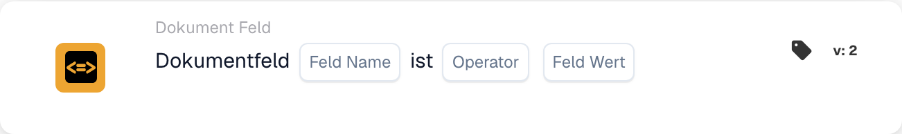

# Dokumentfeld mit Referenzwert vergleichen

<figure><figcaption>
Kartenfelder in der angezeigten Version. Die Platzhalter sind noch nicht ausgefüllt.
</figcaption></figure>

## **Zweck:**

Diese Workflow-Karte ist darauf ausgelegt, Aktionen zu automatisieren, indem sie den Wert eines angegebenen Dokumentfelds mit einem Referenzwert oder einer Bedingung vergleicht. Sie sorgt für eine dynamische und präzise Entscheidungsfindung in Workflows auf Basis der Validierung von Dokumentdaten.

## **Bestandteile der Karte:**

1. **Feldname**
   * **Beschreibung:** Gibt den Namen des auszuwertenden Dokumentfelds an.
   * **Detail:** Dieser muss exakt mit dem Bezeichner des Feldes innerhalb des Dokuments übereinstimmen.
2. **Operatoren**
   * **Beschreibung:** Legt die Art des Vergleichs fest, der zwischen dem Feldwert und dem Referenzwert durchgeführt wird.
   * **Optionen:**
     * **Gleich (=):** Prüft, ob der Feldwert mit dem Referenzwert übereinstimmt.
     * **Ungleich (≠):** Stellt sicher, dass sich der Feldwert vom Referenzwert unterscheidet.
     * **Größer als (>):** Bestätigt, dass der Feldwert größer als der Referenzwert ist.
     * **Größer oder gleich (≥):** Überprüft, dass der Feldwert gleich oder größer als der Referenzwert ist.
     * **Kleiner als (<):** Prüft, ob der Feldwert kleiner als der Referenzwert ist.
     * **Kleiner oder gleich (≤):** Stellt sicher, dass der Feldwert kleiner oder gleich dem Referenzwert ist.

## **Funktionalität:**

* **Bedingungsauswertung:** Das System prüft, ob der Wert des Dokumentfelds in Bezug auf seine zugehörige Spalte die durch den Operator und den Referenzwert angegebene Vergleichsbedingung erfüllt.
* **Ausführung der Aktion:**
  * **Bedingung erfüllt (True):**\
    Erfüllt der Wert des Dokumentfelds die angegebene Bedingung (z. B. ist er gleich dem Referenzwert), löst das System die zugehörigen Aktionen aus. Dazu können das Aktualisieren von Datensätzen, das Fortführen des Workflows oder das Erzeugen von Benachrichtigungen gehören.
  * **Bedingung nicht erfüllt (False):**\
    Erfüllt der Wert des Dokumentfelds die angegebene Bedingung nicht, werden je nach Workflow-Konfiguration alternative oder keine Aktionen ausgeführt.

## **Einrichtung und Konfiguration:**

* Der Benutzer wählt den Feldnamen des relevanten Dokuments aus und wählt den Operator aus dem Dropdown-Menü. Anschließend gibt der Benutzer den Referenzfeldwert an, um die Konfiguration abzuschließen.

## **Fazit:**

Die Workflow-Karte "DocField Comparison Validation" ist ein robustes Werkzeug für die dynamische Dokumentverarbeitung. Indem sie Aktionen auf Basis von Feldvergleichen automatisiert, optimiert diese Karte Workflows, erhöht die Genauigkeit und unterstützt datengestützte Entscheidungen.

<!-- workflow-card-practical-example-20261021 -->

## Praxisbeispiel

**Wann zu verwenden:** Überprüfen Sie Rechnungen über einem definierten Betrag.

**Konfiguration:** Wählen Sie das numerische Feld `net_total`, den Operator `>` und den Referenzwert `1000`.

**Erwartetes Ergebnis und Gegenbeispiel:** Ein Wert von `1200` gilt. `1000` und `900` schlagen fehl, weil der Vergleich unbedingt größer als ist.

Dies ist eine beispielhafte Konfiguration und ein erwartetes Ergebnis. Verwenden Sie in Ihrer Testorganisation konfigurierte Felder, Benutzer und Gruppen. Es wird nicht behauptet, dass dieses Beispiel ausgeführt wurde.
