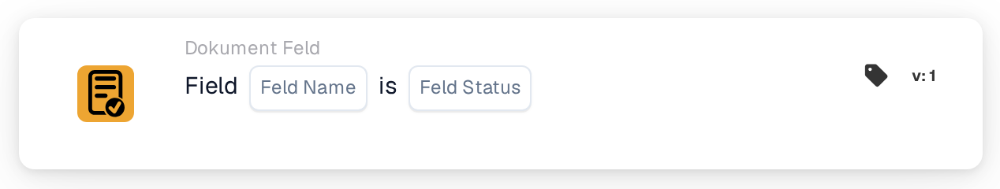
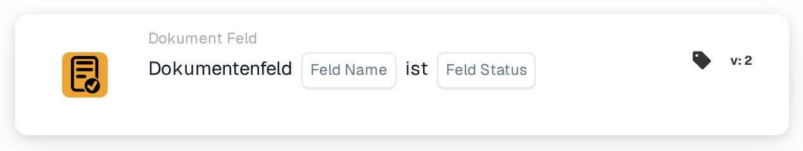

# Vorhandensein und Inhalt eines Dokumentfelds prüfen

<figure><figcaption>
Version 1
</figcaption></figure>

<figure><figcaption>
Version 2
</figcaption></figure>

## **Zweck:**

Diese Workflow-Karte ist darauf ausgelegt, Aktionen auf Basis des Vorhandenseins oder Zustands eines angegebenen Feldes innerhalb eines Dokuments zu automatisieren. Indem sie auswertet, ob das Feld leer ist, fehlt oder befüllt ist, ermöglicht sie es Workflows, Dokumente präzise und genau zu verarbeiten.

## **Bestandteile der Karte:**

1. **Feldname**
   * **Beschreibung:** Gibt den Namen des auszuwertenden Feldes an.
   * **Detail:** Dieser muss exakt mit dem im Dokument verwendeten Bezeichner übereinstimmen, um eine genaue Felderkennung sicherzustellen.
2. **Operatoren**
   * **Beschreibung**: Legt die Bedingung fest, die den Workflow auslöst, basierend auf dem Vorhandensein oder Zustand des Feldes.
   * **Optionen**:
     * **Leer/Nicht im Dokument:** Der Workflow wird ausgelöst, wenn das Feld entweder im Dokument fehlt oder vorhanden, aber leer ist.
     * **Im Dokument/Nicht leer:** Der Workflow wird ausgelöst, wenn das Feld im Dokument existiert und einen Wert enthält.

## **Funktionalität:**

* **Zustandserkennung:** Die Karte überwacht das angegebene Feld, um sein Vorhandensein und seinen Zustand auszuwerten.
* **Bedingungsauswertung:**
  * Das System wertet aus, ob sich das angegebene Feld in dem durch den ausgewählten Operator definierten Zustand (Empty/Not in Document oder In Document/Not Empty) befindet.
*

**Ausführung der Aktion:**
* **Bedingung leer/nicht im Dokument:** Stimmt der Zustand des Feldes mit dieser Bedingung überein (d. h. das Feld fehlt im Dokument oder ist vorhanden, aber leer), leitet das System die zugehörigen Aktionen ein. Dazu können das Erzeugen von Warnungen, das Markieren des Dokuments zur Prüfung oder das Anhalten des Workflows gehören.
* **Bedingung im Dokument/nicht leer:** Stimmt der Zustand des Feldes mit dieser Bedingung überein (d. h. das Feld existiert im Dokument und enthält einen Wert), löst das System die zugehörigen Aktionen aus. Dazu können das Aktivieren nachfolgender Workflow-Schritte, das Aktualisieren von Datensätzen oder das Auslösen von Benachrichtigungen gehören.
## **Einrichtung und Konfiguration:**

* Benutzer wählen das Feld aus einer Liste verfügbarer Dokumentfelder aus. Der Operator wird über ein Dropdown-Menü gewählt, das klare Optionen für "Empty/Not in Document" oder "In Document/Not Empty" bietet.

## **Fazit:**

Die Workflow-Karte "Field Presence and State Validation" ist ein wichtiges Werkzeug für Dokumentverarbeitungs-Workflows und stellt eine genaue Behandlung fehlender oder befüllter Felder sicher. Indem sie Aktionen auf Basis von Feldzuständen automatisiert, stärkt diese Karte die Datenintegrität, reduziert Fehler und sorgt dafür, dass Workflows reibungslos und effizient ablaufen.

<!-- workflow-card-practical-example-20261021 -->

## Praxisbeispiel

**Verwendungszweck:** Rechnungen erkennen, deren Rechnungsnummer noch überprüft werden muss.

**Konfiguration:** Wählen Sie für dieses Beispiel das konfigurierte Feld `invoice_id` (Rechnungsnummer) und „Leer/Nicht im Dokument“.

**Erwartetes Ergebnis und Gegenbeispiel:** Ein leeres oder fehlendes Feld erfüllt die Bedingung. Ein befüllter Wert wie `DEMO-001` erfüllt sie nicht. Eine vorhandene, aber fachlich falsche Nummer gilt dadurch nicht als leer; für die Inhaltsprüfung ist eine zusätzliche passende Bedingung erforderlich.

Dies ist eine beispielhafte Konfiguration und ein erwartetes Ergebnis. Verwenden Sie in Ihrer Testorganisation konfigurierte Felder, Benutzer und Gruppen. Es wird nicht behauptet, dass dieses Beispiel ausgeführt wurde.

## Admin-Beispielvideo

Wann die Karte hilft, wo sie unter „Und → Dokumentenfeld“ liegt und wie sie fehlende Rechnungsnummern erkennt. Die Beispiele zeigen erwartete Ergebnisse.



[Video mit deutschen Untertiteln öffnen](https://docbits-videos.fra1.cdn.digitaloceanspaces.com/settings-assistant/workflow-card-field-status-admin/v1/de-theme-v4.html)

[Transkript lesen](https://docbits-videos.fra1.cdn.digitaloceanspaces.com/settings-assistant/workflow-card-field-status-admin/v1/de.txt)
