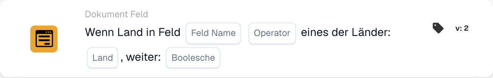

# Land im Feld mit einer Länderliste vergleichen

<figure><figcaption>
Kartenfelder in der angezeigten Version. Die Platzhalter sind noch nicht ausgefüllt.
</figcaption></figure>

Nutzen Sie diese Bedingung, wenn ein zusätzlicher Verarbeitungsschritt für Dokumente aus ausgewählten Ländern gelten soll, zum Beispiel Deutschland und Frankreich. Die Karte vergleicht das Land aus einem Dokumentfeld mit einer konfigurierten Länderliste.

**Ort:** Standard-Workflow → zusätzliche Bedingungen (Und) → Dokument Feld. Konfigurieren Sie die nachfolgende Aktion getrennt unter Dann.

## Konfiguration — Version 2

| Einstellung | Wert |
| --- | --- |
| Feld | Ein vorhandenes Textfeld mit dem Ländernamen |
| Operator | `is` |
| Länder | `Germany, France` |
| Fortsetzungswert | `true` |

<!-- workflow-card-practical-example-20261021 -->

## Praxisbeispiel

| Landwert im Feld | Erwartete Bedingung |
| --- | --- |
| `Germany` | Erfüllt |
| `France` | Erfüllt |
| `United States` | Nicht erfüllt |

Die Ländernamen in Codeformat sind feste Eingabewerte für dieses Beispiel.

## Grenzen und Prüfungen

`false` kehrt den Vergleich nicht um. Auch ein passendes Land erzeugt mit dieser Einstellung kein positives Bedingungsergebnis. Wählen Sie für die Gegenbedingung `isnot` mit `true`.

Behandeln Sie fehlende Felder und leere Länderwerte gesondert; sie können einen Status für fehlende Daten statt einer normalen Nichtübereinstimmung liefern.

Die Quellcodeprüfung des Entwicklungsstands vom 22. Oktober 2026 zeigt bei ISO-Eingaben wie `DE` und `DEU` einen Umwandlungsfehler. Die Beispiele verwenden deshalb vollständige Ländernamen. Prüfen Sie die Verarbeitung von ISO-Codes für Ihre installierte Version separat.
