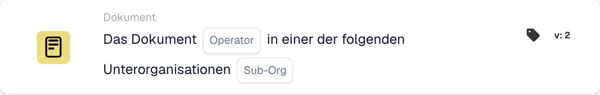

# Dokument

Die **Dokument**-Karten im **Karte hinzufügen**-Picker des Workflow-Builders (öffnen über die **Und**-Gruppe → **Karte hinzufügen**):

<figure><figcaption>
Verfügbare Karten der ausgewählten Kategorie. Füllen Sie die Platzhalter vor der Verwendung aus.
</figcaption></figure>

<!-- workflow-card-example-condition_sub_org_is_isnot_in_list-20261021 -->

### Dokument in einer von mehreren Unterorganisationen

<figure><figcaption>
Kartenfelder in der angezeigten Version. Die Platzhalter sind noch nicht ausgefüllt.
</figcaption></figure>

`CONDITION_SUB_ORG_IS_ISNOT_IN_LIST` · Version 2

Wählen Sie eine der konfigurierten Unterorganisationen `Demo North` und `Demo South` aus. Ein Dokument, das zu einer der ausgewählten Einheiten gehört, wird bestanden. `Demo Default` schlägt fehl. Dadurch wird die Unterorganisation des Dokuments überprüft. es ändert es nicht.
