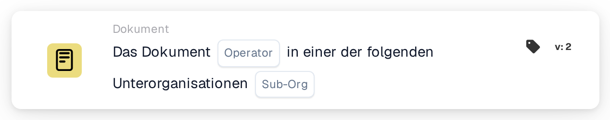

# Dokument nach Unterorganisation aus einer Liste prüfen

<figure><figcaption>
Version 2
</figcaption></figure>

## Zweck:

Diese Workflow-Karte prüft, ob ein Dokument zu einer von mehreren Unterorganisationen gehört. Statt das Dokument mit einer einzelnen Unterorganisation zu vergleichen, vergleicht sie es mit einer Liste. So deckt eine Karte eine ganze Gruppe von Unterorganisationen ab, die gleich behandelt werden sollen. Je nach Ergebnis wird der Workflow mit der True- oder der False-Bedingung fortgesetzt.

Für den Vergleich mit genau einer Unterorganisation kann die Karte **Document Operator for Sub-Organizations** verwendet werden.

## Bestandteile der Karte:

1. **Operator**
   * **Beschreibung:** Legt fest, ob das Dokument zu einer der aufgeführten Unterorganisationen gehören soll oder zu keiner von ihnen.
   * **Optionen:**
     * **Is:** Die Bedingung ist erfüllt, wenn die Unterorganisation des Dokuments eine der aufgeführten Unterorganisationen ist.
     * **Is Not:** Die Bedingung ist erfüllt, wenn die Unterorganisation des Dokuments nicht in der Liste steht.
2. **Sub-org**
   * **Beschreibung:** Die Liste der Unterorganisationen, mit denen das Dokument verglichen wird.
   * **Detail:** Es können eine oder mehrere Unterorganisationen der Organisation ausgewählt werden. Verglichen wird die Unterorganisation, der das Dokument zugeordnet ist.

## Funktionalität:

* **Bedingungsauswertung:** Das System liest die Unterorganisation des Dokuments und prüft, ob sie eine der auf der Karte ausgewählten Unterorganisationen ist.
* **Ausführung der Aktion:**
  * **Bedingung erfüllt (True):**\
    Mit **Is** steht die Unterorganisation des Dokuments in der Liste, mit **Is Not** steht sie nicht darin. Der Workflow wird mit der True-Bedingung fortgesetzt, zum Beispiel um das Dokument an das zuständige Team dieser Unterorganisationen weiterzuleiten oder Regeln anzuwenden, die nur für sie gelten.
  * **Bedingung nicht erfüllt (False):**\
    Ist die Bedingung nicht erfüllt, wird der Workflow mit der False-Bedingung fortgesetzt, zum Beispiel um allgemeine Regeln anzuwenden oder das Dokument anders weiterzuleiten.
* **Fehlende Daten:** Ist das Dokument keiner Unterorganisation zugeordnet oder auf der Karte keine Unterorganisation ausgewählt, wertet die Karte die Bedingung nicht aus. Sie meldet die fehlenden Daten im Workflow-Protokoll, statt den Workflow mit der False-Bedingung fortzusetzen.

## Einrichtung und Konfiguration:

* Die Karte kann aus der Kategorie **Dokument** hinzugefügt werden. Danach können der Operator (**Is** oder **Is Not**) und im Feld **Sub-org** die Unterorganisationen gewählt werden, gegen die geprüft wird. Zuletzt wird die Fortsetzungsbedingung (True oder False) festgelegt, die den nächsten Schritt im Workflow bestimmt.

## Fazit:

Die Workflow-Karte „Document Operator for Sub-Organizations one of“ deckt mit einer Bedingung mehrere Unterorganisationen gleichzeitig ab. Das hält Workflows kurz, wenn mehrere Unterorganisationen dieselben Verarbeitungsregeln haben, und stellt sicher, dass Dokumente im richtigen organisatorischen Kontext bearbeitet werden.
