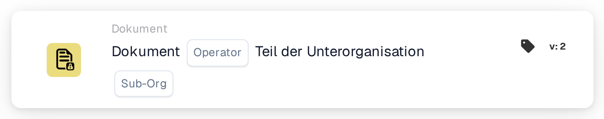

# Dokument nach Unterorganisation prüfen

<figure><figcaption>
Version 2
</figcaption></figure>

## Zweck:

Diese Workflow-Karte wertet aus, ob ein Dokument Teil einer bestimmten Unterorganisation ist. Basierend auf dieser Auswertung kann der Workflow entweder fortgesetzt werden oder unterschiedliche Aktionen auslösen, je nachdem, ob das Dokument der angegebenen Unterorganisation zugeordnet ist oder nicht.

## Bestandteile der Karte:

1. **Operator**
   * **Beschreibung:** Legt fest, ob das Dokument Teil der angegebenen Unterorganisation sein muss oder nicht.
   * **Optionen:**
     * **Is:** Das Dokument muss Teil der angegebenen Unterorganisation sein, damit die Bedingung erfüllt ist.
     * **Ist nicht:** Das Dokument darf nicht Teil der angegebenen Unterorganisation sein, damit die Bedingung erfüllt ist.
2. **Unterorg**
   * **Beschreibung:** Gibt die Unterorganisation an, mit der das Dokument verglichen werden soll.
   * **Detail:** Dieser sollte mit dem Bezeichner der Unterorganisation übereinstimmen. Der Vergleich prüft, ob das Dokument zur angegebenen Unterorganisation gehört.

## Funktionalität:

* **Bedingungsauswertung:** Das System wertet aus, ob das Dokument Teil der angegebenen Unterorganisation ist. Diese Auswertung prüft die Unterorganisation des Dokuments anhand der vom Benutzer angegebenen Unterorganisation.
* **Ausführung der Aktion:**
  * **Bedingung erfüllt (True):**\
    Ist das Dokument Teil der angegebenen Unterorganisation, wird der Workflow mit der True-Bedingung fortgesetzt. Dies kann weitere Aktionen auslösen, etwa das Weiterleiten des Dokuments an eine bestimmte Abteilung, das Anwenden unterorganisationsspezifischer Regeln oder das Aktivieren von Funktionen, die auf diese Unterorganisation zugeschnitten sind.
  * **Bedingung nicht erfüllt (False):**\
    Ist das Dokument nicht Teil der angegebenen Unterorganisation, wird der Workflow mit der False-Bedingung fortgesetzt. Dies ermöglicht es, alternative Aktionen auszuführen, etwa das Senden von Benachrichtigungen, das Anhalten des Workflows oder das Anwenden allgemeiner Regeln außerhalb des Geltungsbereichs der Unterorganisation.

## Einrichtung und Konfiguration:

* Benutzer konfigurieren die Karte, indem sie das Dokumentfeld auswählen, das das Dokument enthält, und die zu prüfende Unterorganisation angeben. Anschließend wird der Operator aus einer Dropdown-Liste gewählt, um festzulegen, ob das Dokument Teil der angegebenen Unterorganisation sein muss oder nicht. Zuletzt legen die Benutzer die Fortsetzungsbedingung (True oder False) fest, die den nächsten Schritt im Workflow bestimmt.

## Fazit:

Die Workflow-Karte "Document in Sub-organization" ist ein hilfreiches Werkzeug, um Aktionen darauf basieren zu lassen, ob ein Dokument zu einer bestimmten Unterorganisation gehört. Indem sie sicherstellt, dass Dokumente gemäß den unterorganisationsspezifischen Regeln verarbeitet werden, verbessert diese Karte die Workflow-Effizienz und stellt sicher, dass Aktionen im korrekten organisatorischen Kontext ausgeführt werden.

<!-- workflow-card-practical-example-20261021 -->

## Praxisbeispiel

**Verwendungszweck:** Leiten Sie Dokumente weiter, die zu einer Geschäftseinheit gehören.

**Konfiguration:** Wählen Sie die Unterorganisation `Demo North` und den Gleichheitsoperator aus.

**Erwartetes Ergebnis und Gegenbeispiel:** Ein Dokument in `Demo North` besteht. Ein Dokument in `Demo South` schlägt fehl.

Dies ist eine beispielhafte Konfiguration und ein erwartetes Ergebnis. Verwenden Sie in Ihrer Testorganisation konfigurierte Felder, Benutzer und Gruppen. Es wird nicht behauptet, dass dieses Beispiel ausgeführt wurde.
