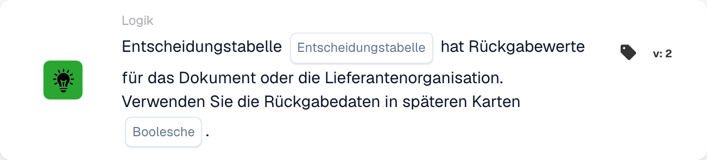

# Entscheidungstabelle liefert Ergebnisse

<figure><figcaption>
Kartenfelder in der angezeigten Version. Die Platzhalter sind noch nicht ausgefüllt.
</figcaption></figure>

## **Zweck:**

Diese DocBits-Karte prüft, ob eine angegebene Entscheidungstabelle für ein bestimmtes Dokument Rückgabewerte enthält, und bestimmt, ob die zurückgegebenen Daten in nachfolgenden Workflow-Schritten verwendet werden sollen. Sie stellt sicher, dass sich Workflows dynamisch an die Ergebnisse der Entscheidungstabelle anpassen können.

## **Funktionalität:**

* **Validierung der Entscheidungstabelle:** Diese Karte überprüft, ob die ausgewählte Entscheidungstabelle Rückgabewerte für das verarbeitete Dokument liefert.
* **Auswahl der Entscheidungstabelle:** Benutzer geben den Namen der zu prüfenden Entscheidungstabelle an.
* **Rückgabedaten verwenden:** Benutzer können mit einer **Boolescher Wert**-Einstellung festlegen, ob die Rückgabedaten in späteren Karten verwendet werden sollen:
  * **True:** Die Rückgabedaten sind verfügbar und werden in nachfolgenden Workflow-Schritten verwendet.
  * **False:** Die Rückgabedaten werden nicht verwendet, und der Workflow wird ohne sie fortgesetzt.

## **Verwendung:**

Diese Karte eignet sich ideal für Workflows mit bedingter Logik oder Entscheidungsfindung auf Basis vordefinierter Regeln in einer Entscheidungstabelle. Sie sorgt für eine nahtlose Integration der Ausgaben der Entscheidungstabelle in Workflow-Prozesse.

## **Beispiel-Szenario:**

* Ein Benutzer konfiguriert die Karte so, dass sie die Entscheidungstabelle **„Regeln zur Rechnungsbearbeitung“** auf Rückgabewerte prüft. Der **Boolescher Wert** ist auf **True** gesetzt, was angibt, dass die Rückgabedaten (z. B. Freigabeanforderungen) in späteren Karten genutzt werden, um Workflow-Entscheidungen zu steuern.

Durch die Verwendung der Karte "Decision Table Check" können Organisationen die Flexibilität von Workflows erhöhen, die regelbasierte Verarbeitung optimieren und Konsistenz bei der Entscheidungsfindung über automatisierte Workflows hinweg sicherstellen.
