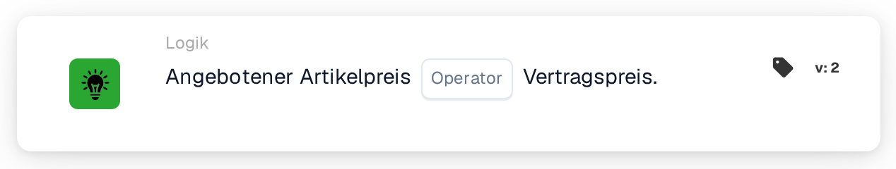
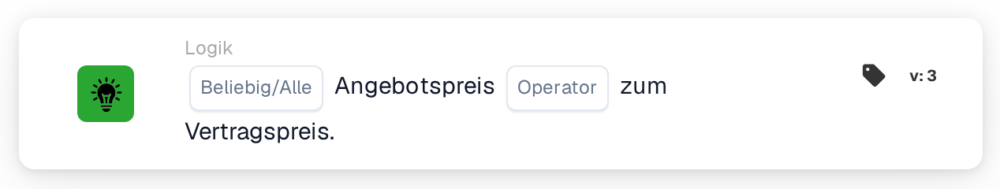

# Angebotener Artikelpreis

<figure><figcaption>
Version 2
</figcaption></figure>

<figure><figcaption>
Version 3
</figcaption></figure>

## **Zweck:**

Diese DocBits-Karte vergleicht den Angebotspreis eines Artikels mit seinem Vertragspreis und ermöglicht es Workflows, Aktionen basierend darauf auszulösen, ob die beiden Werte übereinstimmen oder sich unterscheiden. Es trägt dazu bei, die Preiskonsistenz und die Einhaltung der Vertragsbedingungen sicherzustellen.

## **Funktionalität:**

* **Preisvergleich:** Diese Karte bewertet, ob der angegebene Artikelpreis die angegebene Bedingung im Verhältnis zum Vertragspreis erfüllt.
* **Operatoren:** Folgende Bedingungen können angewendet werden:
  * **Gleich (=):** Prüft, ob der angegebene Preis mit dem vertraglich vereinbarten Preis übereinstimmt.
  * **Ungleich (≠):** Stellt sicher, dass der angegebene Preis vom vertraglich vereinbarten Preis abweicht.

## **Verwendung:**

Diese Karte ist besonders nützlich in Beschaffungs-, Vertriebs- oder Vertragsmanagement-Workflows, bei denen es wichtig ist, zu überprüfen, ob die angebotenen Preise mit den vereinbarten Vertragsbedingungen übereinstimmen, bevor mit der Genehmigung oder Auftragsabwicklung fortgefahren wird.

## **Beispielszenario:**

* Ein Benutzer konfiguriert die Karte so, dass sie prüft, ob der in **angebotene Preis gleich (=)** dem **vertraglich vereinbarten Preis** ist. Wenn die Preise übereinstimmen, geht der Workflow zur Genehmigung über; Ist dies nicht der Fall, wird eine Benachrichtigung zur manuellen Überprüfung ausgelöst, um die Diskrepanz zu beheben.

Mithilfe der Karte „Angebotsartikelpreis vs. Vertragspreis“ können Unternehmen Preisrichtlinien durchsetzen, Vertragseinhaltung gewährleisten und Fehler bei Finanztransaktionen reduzieren.

## Version 3: Alle oder Alle

Version 3 fügt `match_any` und `match_all` hinzu. Für jede ist mindestens eine erfolgreiche vergleichbare Zeile erforderlich. Bei „All“ muss jede verglichene Zeile den ausgewählten Operator erfüllen. Version 2 behält alle bei. Eine nicht festgelegte Auswahl in Version 3 ist standardmäßig „Alle“ und wird protokolliert. In keiner vergleichbaren Zeile fehlen Daten, kein erfolgreicher Abgleich. Siehe [Angebotsvergleichskarten](../../cards-overview/quote-comparison-guide.md) für gemischte Ergebnisse, übersprungene Zeilen und Tests.
