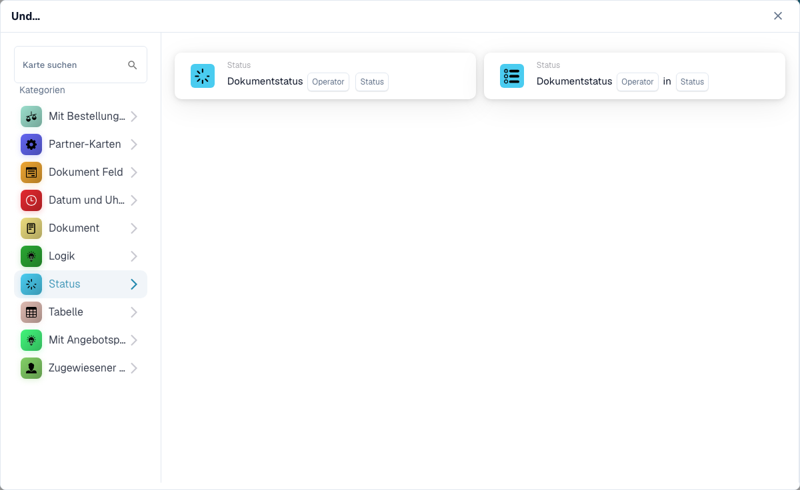

# Status

Die **Status**-Karten im **Karte hinzufügen**-Picker des Workflow-Builders (öffnen über die **Und**-Gruppe → **Karte hinzufügen**):

<figure><figcaption>
Die Karten der Kategorie <strong>Status</strong>.
</figcaption></figure>
