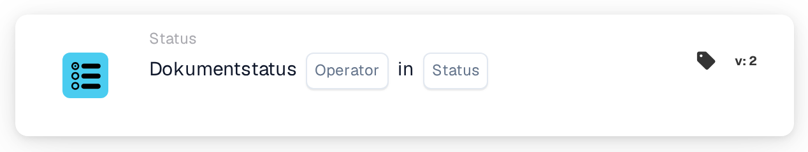

# Bedingungsliste für den Dokumentstatus

<figure><figcaption>
Version 2
</figcaption></figure>

**Zweck**

Diese Karte ist darauf ausgelegt, Workflow-Aktionen auf Basis des aktuellen Status eines Dokuments zu steuern, wobei eine bedingte Logik verwendet wird, um bestimmte Prozesse entweder auszulösen oder einzuschränken. Sie stellt sicher, dass Dokumente nur dann durch Workflows laufen, wenn sie vordefinierte Statuskriterien erfüllen.

**Bestandteile der Karte**

1. **Operator**
   * **Beschreibung**: Bestimmt, wie der Dokumentstatus anhand einer angegebenen Bedingung ausgewertet wird.
   * **Optionen**:
     * **is**: Löst die zugehörigen Aktionen aus, wenn der aktuelle Status des Dokuments mit einem der angegebenen Status übereinstimmt.
     * **ist nicht**: Löst die Aktionen aus, wenn der Status des Dokuments mit keinem der angegebenen Status übereinstimmt.
2. **Status (Liste)**
   * **Beschreibung**: Listet die spezifischen Status auf, mit denen der aktuelle Status des Dokuments verglichen wird.
   * **Beispiele**: "Fehler", "Exportfehler", "Bereit zur Validierung", "Bereit zur Überprüfung", "Genehmigung ausstehend", "Zweite Genehmigung ausstehend". Diese stellen verschiedene Phasen oder Zustände dar, in denen sich ein Dokument innerhalb eines Workflow-Prozesses befinden kann.

**Funktionalität**

* **Statuserkennung**: Identifiziert automatisch den aktuellen Status eines Dokuments, während es sich durch den Workflow des ERP-Systems bewegt.
* **Bedingungsauswertung**: Wendet den gewählten Operator (is oder is not) auf den Status des Dokuments im Vergleich zu den aufgeführten Status an:
  * Bei **is** wird geprüft, ob der Status des Dokuments mit einem Status in der Liste übereinstimmt.
  * Bei **ist nicht** wird geprüft, ob der Status des Dokuments nicht in der Liste erscheint.
* **Ausführung der Aktion**: Je nach Ergebnis der Bedingungsauswertung:
  * **True**: Führt vordefinierte Aktionen oder Workflows aus, wenn die Bedingung erfüllt ist.
  * **False**: Überspringt die Aktion oder löst alternative Workflows aus, wenn die Bedingung nicht erfüllt ist.
* **Workflow-Integration**: Integriert sich nahtlos in andere Workflow-Komponenten und stellt sicher, dass die Dokumentbearbeitung systemweit koordiniert ist.

**Benutzerinteraktionen**

* **Einrichtung und Konfiguration**: Benutzer konfigurieren die Karte, indem sie den Operator auswählen und die relevanten Status angeben. Diese Einrichtung kann einfache Dropdown-Menüs oder Kontrollkästchen zur Auswahl von Status und Operatoren umfassen.
* **Überwachung und Verwaltung**: Benutzer können die Aktivität der Karte über ein Dashboard verfolgen, das Einblicke in die überwachten Statusbedingungen und die darauf basierenden Aktionen bietet.
* **Fehlerbehandlung und Warnungen**: Unterstützt das Einrichten von Warnungen bei Prozessfehlern oder Abweichungen bei den erwarteten Dokumentstatus und ermöglicht so schnelle Reaktionen auf betriebliche Probleme.

#### Fazit

Die Workflow-Karte "Document Status Condition" ist unverzichtbar, um sicherzustellen, dass Dokumente entsprechend ihrem aktuellen Status korrekt verarbeitet werden, und stärkt so Kontrolle und Effizienz innerhalb des ERP-Systems. Eine klare Dokumentation dieser Karte im Systemhandbuch hilft den Benutzern, sie effektiv einzusetzen und zu verwalten und ihre Funktionalität zu nutzen, um reibungslose und konforme Dokument-Workflows aufrechtzuerhalten. Diese Karte ist besonders nützlich für die Verwaltung von Dokumentlebenszyklen und stellt sicher, dass nur Dokumente, die bestimmte Kriterien erfüllen, in nachfolgende Phasen von Geschäftsprozessen übergehen.

<!-- workflow-card-practical-example-20261021 -->

## Praxisbeispiel

**Wann nutzen:** Eine gemeinsame Prüfung auf die erste oder zweite Freigabestufe anwenden.

**Wo:** Standard-Workflow-Designer → Und → Status.

**Konfiguration:** Wählen Sie in Version 2 den Operator „ist“ (`is`) und in der Mehrfachauswahl Genehmigung ausstehend (`validated_pending_approval`) sowie Zweite Genehmigung ausstehend (`approved_pending_second_approval`). Prüfen Sie nach dem Schließen der Auswahl beide Einträge auf der Karte.

**Erwartetes Ergebnis und Gegenbeispiel:** Einer der ausgewählten Status genügt. Ein exportierter Beleg erfüllt diese Bedingung nicht. Ein Beleg muss nicht zwei Status gleichzeitig besitzen.

Die Beispiele beschreiben erwartete Ergebnisse. Verwenden Sie die in Ihrer Organisation tatsächlich konfigurierten Felder und angebotenen Werte.

## Admin-Beispielvideo

Wann einer von mehreren Belegstatus passen darf und wie ich die Statusliste als Bedingung einrichte. Die Beispiele zeigen erwartete Ergebnisse.



[Video mit deutschen Untertiteln öffnen](https://docbits-videos.fra1.cdn.digitaloceanspaces.com/settings-assistant/workflow-card-document-status-list-admin/v1/de-theme-v4.html)

[Transkript lesen](https://docbits-videos.fra1.cdn.digitaloceanspaces.com/settings-assistant/workflow-card-document-status-list-admin/v1/de.txt)
