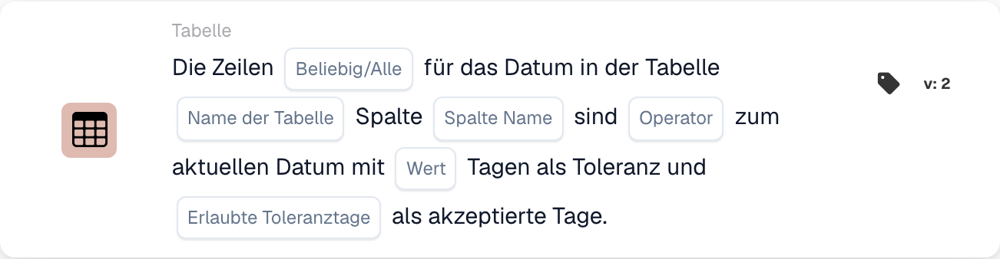

# Tabelle

Die **Tabelle**-Karten im **Karte hinzufügen**-Picker des Workflow-Builders (öffnen über die **Und**-Gruppe → **Karte hinzufügen**):

<figure><figcaption>
Verfügbare Karten der ausgewählten Kategorie. Füllen Sie die Platzhalter vor der Verwendung aus. Einzelne Beschriftungen dieser Kartenversion sind in der Oberfläche noch unübersetzt oder fachlich ungenau. Die Erläuterungen auf dieser Seite verwenden die passenden Begriffe.
</figcaption></figure>

<!-- workflow-card-example-condition_table_column_exists-20261021 -->

### Die Dokumententabelle enthält eine Spalte

<figure><figcaption>
Kartenfelder in der angezeigten Version. Die Platzhalter sind noch nicht ausgefüllt.
</figcaption></figure>

`CONDITION_TABLE_COLUMN_EXISTS` · Version 2

Wählen Sie Tabelle `lines`, Spalte `article_number` und den Operator „Existenz“ aus. Eine gefüllte Tabelle, die diese Spalte enthält, besteht den Wert; Dieselbe Tabelle ohne die Spalte schlägt den Existenzvergleich fehl. Eine fehlende oder leere Tabelle kann zu einem Ergebnis fehlender Daten führen und ist kein Beweis für einen erfolgreichen negativen Vergleich.

<!-- workflow-card-example-condition_compare_table_date_to_current_date-20261021 -->

### Termine in einer Tabelle gegen das Referenzdatum

<figure><figcaption>
Kartenfelder in der angezeigten Version. Die Platzhalter sind noch nicht ausgefüllt.
</figcaption></figure>

`CONDITION_COMPARE_TABLE_DATE_TO_CURRENT_DATE` · Version 2

Vergleichen Sie für das Referenzdatum `2026-10-21` Tabelle `lines`, Spalte `delivery_date`, später als, alle und Null-Tage-Toleranz. Zeilen mit Datum `2026-10-22` und `2026-10-23` erfüllen den Vergleich. Eine mit `2026-10-20` datierte Zeile führt dazu, dass „Alle“ scheitern. Testen Sie fehlende und ungültige Daten separat.
