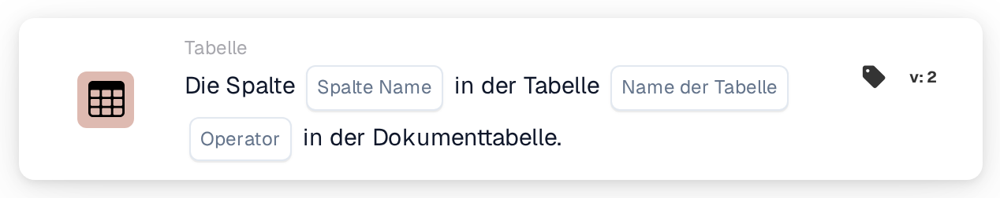

# Spalte in Tabelle vorhanden

<figure><figcaption>
Version 2
</figcaption></figure>

## Zweck:

Diese Workflow-Karte prüft, ob eine Dokumenttabelle eine bestimmte Spalte enthält. Sie kann verwendet werden, um Folgekarten nur für Dokumente auszuführen, deren Tabelle die benötigten Daten enthält, zum Beispiel eine Spalte für das Lieferdatum oder die Artikelnummer, oder um Dokumente mit einem anderen Tabellenaufbau anders weiterzuleiten. Je nach Ergebnis wird der Workflow mit der True- oder der False-Bedingung fortgesetzt.

## Bestandteile der Karte:

1. **Spalte Name**
   * **Beschreibung:** Der Name der Spalte, nach der die Karte sucht.
   * **Detail:** Der Spaltenname wird ohne Unterscheidung von Groß- und Kleinschreibung verglichen.
2. **Name der Tabelle**
   * **Beschreibung:** Der Name der Dokumenttabelle, die geprüft wird.
   * **Detail:** Der Tabellenname wird ohne Unterscheidung von Groß- und Kleinschreibung verglichen.
3. **Operator**
   * **Beschreibung:** Legt fest, ob die Spalte in der Tabelle vorhanden sein soll oder nicht.
   * **Optionen:**
     * **Ist:** Die Bedingung ist wahr, wenn die Tabelle die Spalte enthält.
     * **Ist nicht:** Die Bedingung ist wahr, wenn die Tabelle die Spalte nicht enthält.

## Funktionalität:

* **Bedingungsauswertung:** Die Karte sucht die Dokumenttabelle mit dem angegebenen Namen und prüft, ob die erste Zeile dieser Tabelle eine Spalte mit dem angegebenen Namen hat. Die gefundene Spalte bzw. die stattdessen vorhandenen Spalten werden im Workflow-Protokoll vermerkt.
* **Ausführung der Aktion:**
  * **True-Bedingung:**\
    Mit **Ist** ist die Spalte in der Tabelle vorhanden, mit **Ist nicht** nicht. Der Workflow wird mit der True-Bedingung fortgesetzt, zum Beispiel um einen Vergleich auf dieser Spalte auszuführen.
  * **False-Bedingung:**\
    Ist die Bedingung nicht erfüllt, wird der Workflow mit der False-Bedingung fortgesetzt.
* **Fehlende Daten:** Die Karte wertet die Bedingung nicht aus und meldet die fehlenden Daten im Workflow-Protokoll, wenn auf der Karte kein Spaltenname oder kein Tabellenname festgelegt ist, wenn das Dokument keine Tabelle mit dem angegebenen Namen hat oder wenn diese Tabelle keine Zeilen hat oder ihre erste Zeile keine Spalten enthält.
* **Fehler:** Ist kein Operator oder ein anderer Operator als **Ist** oder **Ist nicht** festgelegt, meldet die Karte einen Konfigurationsfehler.

## Einrichtung und Konfiguration:

* Die Karte kann aus der Kategorie **Tabelle** hinzugefügt werden. Danach können der Spaltenname, der Tabellenname und der Operator (**Ist** oder **Ist nicht**) festgelegt werden. Zuletzt wird die Fortsetzungsbedingung (True oder False) festgelegt, die den nächsten Schritt im Workflow bestimmt.

## Fazit:

Die Workflow-Karte „Column Exists in Table“ prüft den Aufbau einer Dokumenttabelle, bevor ihre Daten verwendet werden. Vor anderen Tabellenkarten platziert, hilft sie sicherzustellen, dass diese Karten nur für Dokumente laufen, die die erwartete Spalte enthalten.
