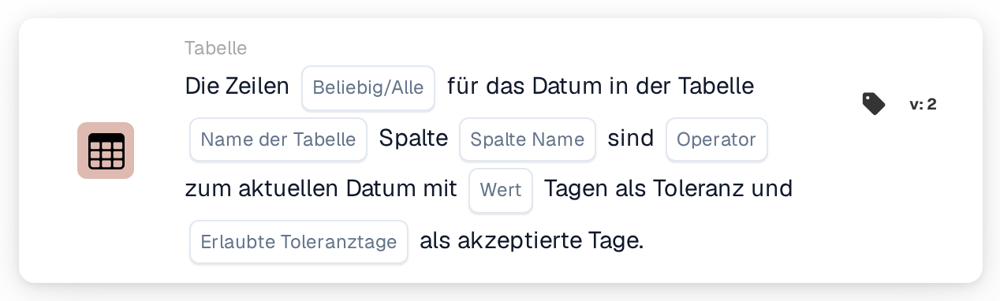

# Tabellendatum mit aktuellem Datum vergleichen

<figure><figcaption>
Version 2
</figcaption></figure>

Wie das Toleranzfenster berechnet wird, mit Beispielen wie „heute oder morgen“, wird unter [Date Tolerances](../date-tolerances.md) erklärt.

## Zweck:

Diese Workflow-Karte vergleicht ein Datum in jeder Zeile einer Dokumenttabelle, zum Beispiel ein Lieferdatum, mit dem aktuellen Datum. Es kann eine Toleranz in Tagen festgelegt werden, und es lässt sich auswählen, welche Wochentage zählen, sodass zum Beispiel nur Werktage verwendet werden. Die Karte kann verwendet werden, um zu prüfen, ob die Daten auf einem Dokument in der Vergangenheit liegen, heute sind, innerhalb weniger Tage liegen oder in der Zukunft liegen. Je nach Ergebnis wird der Workflow mit der True- oder der False-Bedingung fortgesetzt.

## Bestandteile der Karte:

1. **Beliebig/Alle**
   * **Beschreibung:** Legt fest, ob eine Zeile oder jede Zeile der Tabelle die Bedingung erfüllen soll.
   * **Optionen:**
     * **Irgendeine:** Die Bedingung ist wahr, wenn mindestens eine Zeile die Bedingung erfüllt.
     * **Alle:** Die Bedingung ist nur wahr, wenn jede Zeile die Bedingung erfüllt.
2. **Name der Tabelle**
   * **Beschreibung:** Der Name der Dokumenttabelle, die die Datumswerte enthält.
3. **Spalte Name**
   * **Beschreibung:** Die Spalte der Tabelle, die das Datum enthält.
4. **Operator**
   * **Beschreibung:** Legt fest, wie das Datum in der Tabelle unter Berücksichtigung der Toleranz mit dem aktuellen Datum verglichen wird.
   * **Optionen:**
     * **Entspricht:** Das Datum liegt innerhalb des Toleranzbereichs um das aktuelle Datum.
     * **Ungleich:** Das Datum liegt außerhalb des Toleranzbereichs.
     * **Größer als:** Das Datum liegt nach dem Toleranzbereich.
     * **Größer oder gleich:** Das Datum liegt innerhalb des Toleranzbereichs oder danach.
     * **Weniger als:** Das Datum liegt vor dem Toleranzbereich.
     * **Weniger oder gleich:** Das Datum liegt innerhalb des Toleranzbereichs oder davor.
5. **Wert**
   * **Beschreibung:** Die Toleranz in Tagen.
   * **Detail:** Der Toleranzbereich reicht diese Anzahl Tage vor und nach dem aktuellen Datum. Gezählt werden nur die unter **Erlaubte Toleranztage** ausgewählten Tage. Ist kein Wert festgelegt, wird eine Toleranz von 0 Tagen verwendet, sodass der Bereich nur das aktuelle Datum umfasst.
6. **Erlaubte Toleranztage**
   * **Beschreibung:** Die Wochentage, die als akzeptierte Tage gelten.
   * **Optionen:** Montag bis Sonntag, mehrere Tage können ausgewählt werden.

## Funktionalität:

* **Bedingungsauswertung:** Die Karte liest für jede Zeile der ersten Tabelle mit dem angegebenen Namen das Datum in der ausgewählten Spalte und vergleicht es mit dem aktuellen Datum (dem Datum in UTC). Der Toleranzbereich wird berechnet, indem die angegebene Anzahl Tage vom aktuellen Datum aus vorwärts und rückwärts gezählt wird. Nicht ausgewählte Wochentage werden nicht mitgezählt, der Bereich erstreckt sich also über sie hinaus, und sie bleiben innerhalb des Bereichs. Bei einer Toleranz von 2 Tagen, nur Montag bis Freitag ausgewählt und einem Freitag als aktuellem Datum reicht der Bereich zum Beispiel von Mittwoch bis zum darauffolgenden Dienstag.
* **Akzeptierte Tage:** Zusätzlich zum Vergleich sollte das Datum jeder Zeile auf einen der ausgewählten Wochentage fallen. Eine Zeile erfüllt die Bedingung nur, wenn beide Prüfungen bestanden sind. Die Ergebnisse aller Zeilen werden dann mit **Irgendeine** oder **Alle** zusammengefasst.
* **Ausführung der Aktion:**
  * **True-Bedingung:**\
    Die Datumswerte erfüllen den ausgewählten Operator und fallen auf akzeptierte Tage, für eine oder alle Zeilen. Der Workflow wird mit der True-Bedingung fortgesetzt.
  * **False-Bedingung:**\
    Ist die Bedingung nicht erfüllt, wird der Workflow mit der False-Bedingung fortgesetzt, zum Beispiel um das Dokument zur manuellen Prüfung zu senden.
* **Fehlende Daten:** Die Karte wertet die Bedingung nicht aus und meldet die fehlenden Daten im Workflow-Protokoll, wenn auf der Karte kein Tabellenname, kein Spaltenname oder keine akzeptierten Tage festgelegt sind, wenn das Dokument keine Tabelle mit dem angegebenen Namen hat, wenn einer Zeile der Tabelle die Spalte fehlt oder wenn die Tabelle keine Zeilen hat. Ist keine Option für **Beliebig/Alle** festgelegt, vermerkt die Karte dies im Protokoll und verwendet **Alle**.
* **Fehler:** Kann ein Wert in der Datumsspalte nicht als Datum gelesen werden, endet die Karte mit einem Fehler.

## Einrichtung und Konfiguration:

* Die Karte kann aus der Kategorie **Tabelle** hinzugefügt werden. Danach können **Irgendeine** oder **Alle**, der Tabellenname, der Spaltenname, der Operator, die Toleranz in Tagen und die akzeptierten Wochentage festgelegt werden. Zuletzt wird die Fortsetzungsbedingung (True oder False) festgelegt, die den nächsten Schritt im Workflow bestimmt.

## Fazit:

Die Workflow-Karte „Table Date to Current Date“ prüft Datumswerte von Positionen gegen den heutigen Tag, mit einer Toleranz, die auf Werktage oder eine beliebige andere Auswahl von Wochentagen beschränkt werden kann. So lassen sich Dokumente mit zu frühen, zu späten oder auf nicht akzeptierte Tage fallenden Datumswerten kennzeichnen.
