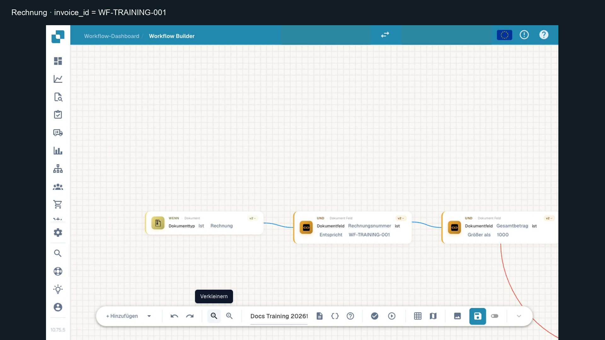
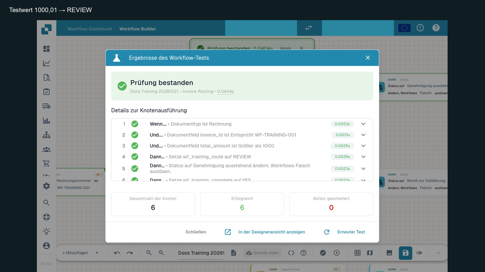

# Karten verstehen und zuverlässig konfigurieren

Wählen Sie eine Karte nach ihrer Aufgabe und ihrem Datenumfang. **Field is** prüft das Vorhandensein beziehungsweise den Leerzustand eines Felds; **Docfield is** vergleicht seinen Wert. Dokumentzuweisung, Aufgabe und Benachrichtigung sind unterschiedliche Wirkungen. Eine allgemeine Kategoriebezeichnung ersetzt keine Beschreibung der konkreten Kartenversion.

## Was eine vollständige Kartenreferenz erklärt

| Bestandteil | Zu beantwortende Frage |
| --- | --- |
| Identität | Wie heißt die Karte in der Oberfläche? Welche technische ID, Version und When/And/Then-Rolle hat sie? |
| Voraussetzungen | Welche Lizenz, Berechtigungen und Dokumentdaten sind erforderlich? |
| Eingaben | Welcher Parameter erwartet welchen Typ, Wert, Standard und erlaubte Auswahl? |
| Datenumfang | Liest die Karte ein Dokumentfeld, eine Tabellenzeile, alle Positionen oder eine organisationsweit geteilte Variable? |
| Ergebnisse | Was bedeutet Erfolg, falsche Bedingung oder Fehler? Welche Daten erhält die nächste Karte? |
| Nebenwirkungen | Werden Dokumente, Aufgaben oder externe Systeme verändert? Was simuliert der Testmodus? |
| Beispiele | Welche vollständige Konfiguration und Eingabe erzeugt welches Ergebnis? |
| Grenzen und Versionen | Was passiert bei fehlenden Daten, exakten Grenzwerten und älteren Karten? |

## Ausgefülltes Beispiel: Docfield is

**Technischer Typ:** `condition_docfield_operator_value` · **Version:** 2 · **Rolle:** And. Ein Dokument mit definiertem Layout und dem zu prüfenden Feld ist erforderlich.

| Eingabe | Konfiguration im Beispiel |
| --- | --- |
| Field Name | `total_amount`, der technische Feldschlüssel, nicht die übersetzte Beschriftung |
| Operator | `gt` / Größer als |
| Field Value | `1000`, ohne Währungssymbol |

Die Karte liest das Feld des aktuellen Dokuments und vergleicht es mit dem konfigurierten Wert. Sie setzt keinen Status, erstellt keine Aufgabe und exportiert nicht. Im Advanced Workflow führt ein wahrer Vergleich über Success, ein regulär falscher Vergleich über Failed Condition und eine fehlerhafte Auswertung über Error weiter. Im Standard Workflow beendet eine nicht erfüllte Bedingung die lineare Folge.

Die tatsächlich geprüften Fälle sind: **1785** → Success; **999** und **1000** → Failed Condition; **1000,01** → Success; fehlender oder ungültiger Zahlenwert → Error. In den JSON-Dateien werden Dezimalpunkte verwendet. Diese Ergebnisse gelten für die gezeigte Zahlenkonfiguration; sie beschreiben nicht pauschal alle Datentypen und Operatoren.

Die Karte ist von expliziten Toleranzkarten zu unterscheiden. Auch Gleichheits- und inklusive Vergleichsoperatoren dürfen nicht allein aus dem Verhalten von `gt` abgeleitet werden. Prüfen Sie die benötigte Kombination mit eigenen Grenzfällen.

## Beispielkarte und beobachteten Weg zuordnen

<figure><figcaption>
Einstieg und Begrenzung des v2-Geschäftsfalls. Die Betragskarte erscheint auch in der folgenden überlappenden Ansicht. Bild aus dem bestehenden deutschen Lernvideo, Stufe 2.
</figcaption></figure>

Die deutsche Oberfläche zeigt **Gesamtbetrag**, **Größer als** und `1000`. Der zugehörige technische Schlüssel ist `total_amount`; er steht auch im tatsächlichen Knotenlog. Die davorliegende Trainingsnummer-Prüfung begrenzt den Beispielablauf.

<figure><figcaption>
Separat ausgeführter Grenzfall 1000,01: sechs erfolgreiche Knoten, REVIEW und simulierte Statusaktion. Die Eingabeabbildung mit 1785.00 gehört zu einem anderen Übungsfall. Für die Abnahme immer Eingabe und Antwort desselben Falls gemeinsam prüfen. Bild aus dem bestehenden deutschen Lernvideo, Stufe 2.
</figcaption></figure>

Das Ergebnisbild bestätigt den getrennten Grenzfall 1000,01 und die danach erreichten simulierten Aktionen. Die Bedingung selbst erstellt keine Aufgabe und liefert keinen Beleg an ein Exportziel. Der [bereits veröffentlichte Film Stufe 2](https://docbits-videos.fra1.cdn.digitaloceanspaces.com/settings-assistant/workflow-learning-step-02-admin/v1/de.html) zeigt die Kartenkonfiguration ab etwa 0:18 und die Grenzfälle ab etwa 0:48.

## Geeignete Folgeschritte

Verbinden Sie Erfolg mit einer Prüfroute, die falsche Bedingung mit einer Standardroute und Fehler mit einer Datenkorrektur. [Der vollständige Geschäftsfall](advanced-workflow-case-study.md) zeigt die konfigurierte Karte, die Folgekarten und tatsächliche Testergebnisse. Die [Ausführungsanleitung](workflow-execution-model.md) erklärt Speichern und Aktivierung; die [Fehlerdiagnose](workflow-troubleshooting.md) hilft bei abweichenden Ergebnissen.

## WF-05: Übung und Abnahme

Beschreiben Sie Run Workflow und eine PO-Vergleichskarte nach demselben Raster. Ergänzen Sie Parameter, Defaults aus dem geprüften Code, Ergebnispfade, Nebenwirkungen und Versionsgrenzen. Prüfen Sie insbesondere inaktives Ziel, fehlende Daten und die Prozentbasis.

[Lernweg](workflow-learning-path.md)
