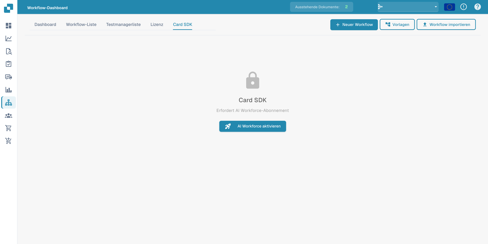
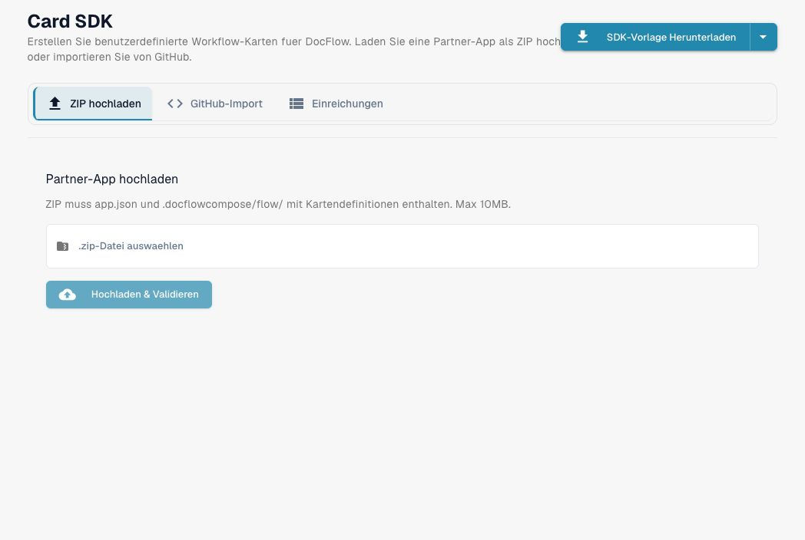
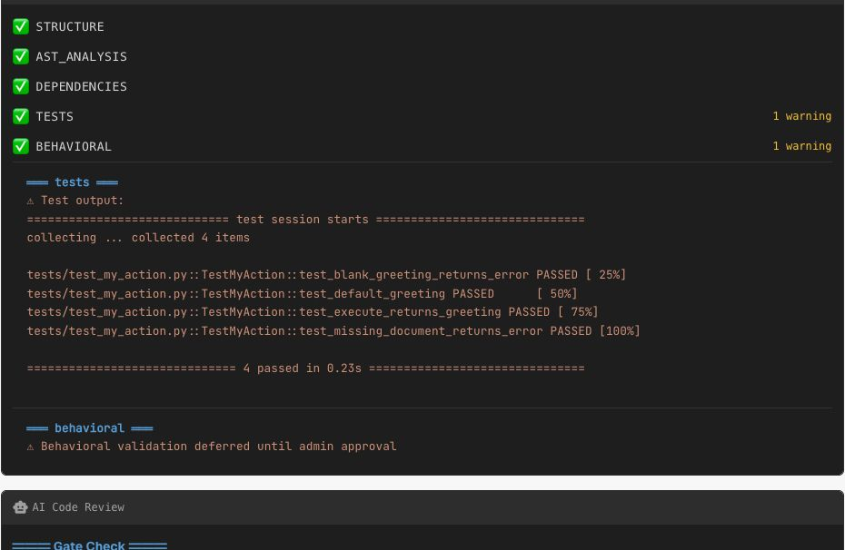
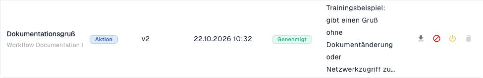
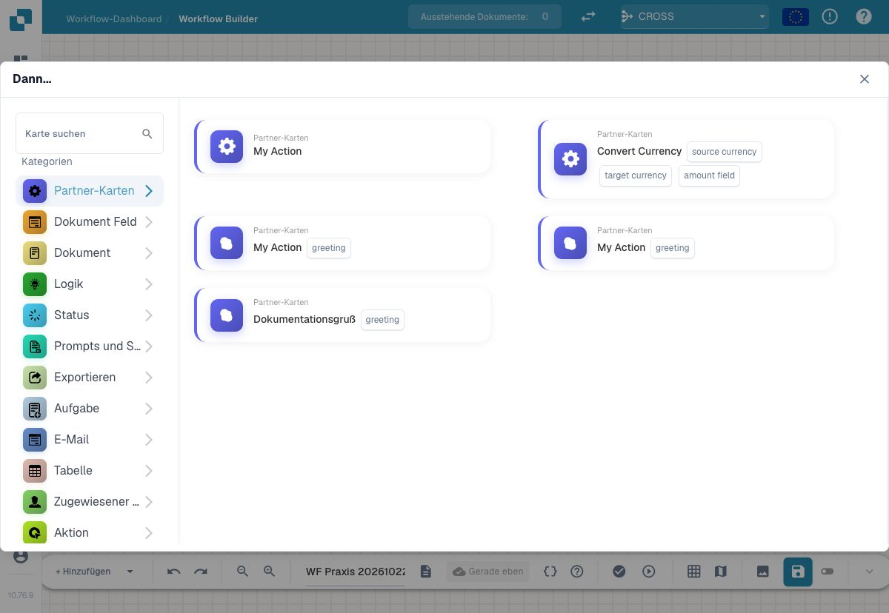

# Card SDK

Mit dem **Card SDK** können Partner und Entwickler eigene Workflow-Karten für DocFlow erstellen. Sie verpacken eine Karte als Partner-App und laden sie hoch oder importieren sie direkt aus GitHub.

<figure><figcaption><p>Card SDK im deutschen Workflow-Dashboard mit dem Hinweis auf das erforderliche Abonnement.</p></figcaption></figure>

Der Zugriff auf das Card SDK setzt die entsprechende Freischaltung voraus. Ohne diese zeigt die Registerkarte den Abonnementhinweis aus der Abbildung.

## Funktionsweise

- **SDK-Vorlage herunterladen** — starten Sie mit der offiziellen Vorlage, die die erwartete Struktur enthält.
- **ZIP hochladen** — das ZIP muss `app.json` und einen Ordner `.docflowcompose/flow/` mit den Kartendefinitionen enthalten (max. 10 MB). Upload &#x26; Validate prüft das Paket, bevor es akzeptiert wird.
- **GitHub-Import** — eine Kartendefinition direkt aus einem GitHub-Repository importieren.
- **Einreichungen** — den Status der von Ihnen eingereichten Karten verfolgen.

Nach Validierung und Annahme erscheinen Ihre eigenen Karten in der **Karte hinzufügen**-Bibliothek neben den eingebauten Karten.

## Eine eigene Karte vollständig vorbereiten

Beginnen Sie mit einer eigenen Testorganisation und einer Karte ohne Versand, Netzwerkzugriff oder Dokumentänderungen. Für das folgende Beispiel genügt eine Aktion, die einen konfigurierten Gruß in ihr Ergebnis und in das Ablaufprotokoll schreibt. So können Sie Paketstruktur, Variablen und Ergebnisse prüfen, bevor Sie fachliche Änderungen ergänzen.

### 1. Zugriff und Organisation prüfen

Öffnen Sie **Workflow-Dashboard → Card SDK** als berechtigter Administrator. Prüfen Sie bei einem Abonnementhinweis sowohl den vorhandenen Tarif als auch die Modulfreigabe unter **Einstellungen → Module → Dokumentintegration → AI Workforce**. Ein bereits vorhandenes Abonnement und ein eingeschaltetes Modul sind getrennte Zustände. Prüfen Sie nach dem Neuladen, dass **SDK-Vorlage herunterladen**, **ZIP hochladen**, **GitHub-Import** und **Einreichungen** weiterhin erreichbar sind.

<figure><figcaption><p>Nach der Freischaltung sind die SDK-Werkzeuge verfügbar. Der Upload erwartet ein ZIP mit app.json und den Kartendefinitionen; die Auswahl einer Datei führt die Karte noch nicht aus.</p></figcaption></figure>

### 2. Mit der aktuellen SDK-Vorlage beginnen

Laden Sie die Vorlage aus Ihrer Organisation herunter. Sie enthält die SDK-Klassen, Schema-Dateien und Tests passend zur angebotenen Schnittstelle. Prüfen Sie insbesondere die Organisations- und Kontaktangaben in `app.json`, bevor Sie das Paket weitergeben. Verwenden Sie für eine eigene Übung eindeutige App- und Karten-IDs, damit eine vorhandene Einreichung nicht versehentlich aktualisiert wird.

```text
app.json
.docflowcompose/flow/actions/my_action.json
src/my_action.py
tests/test_my_action.py
locales/en.json
locales/de.json
sdk/api/sdk/
pyproject.toml
```

`entry_point` im Kartenmanifest zeigt auf die Python-Datei; `class_name` muss exakt zum Klassennamen passen. Ein Argument wie `greeting` gehört in `args`. Die Karte liest es über `self.get_variable("greeting", "Hello")`. Ein Dokumentfeld gleichen Namens ersetzt dieses Kartenargument nicht.

### 3. Ein Ergebnis ohne fachliche Nebenwirkung zurückgeben

Das Beispiel verwendet dieselbe Schnittstelle wie die heruntergeladene Vorlage:

```python
from api.sdk.base import PartnerCard
from api.sdk.context import ExecutionContext
from api.sdk.result import CardResult


class MyAction(PartnerCard):
    """Return a greeting without changing a document."""

    def execute(self, context: ExecutionContext) -> CardResult:
        greeting = self.get_variable("greeting", "Hello")
        if not greeting.strip():
            return CardResult.error(message="Greeting must not be empty")
        context.log(
            f"Running with greeting: {greeting}",
            translation_key="running_with_greeting",
            params={"greeting": greeting},
        )
        if context.document_id is None:
            return CardResult.error(
                message="No document available",
                translation_key="no_document_available",
            )
        return CardResult.success(
            message=f"{greeting}!",
            translation_key="greeted_user",
            params={"greeting": greeting},
            greeted=True,
        )
```

Pflegen Sie `running_with_greeting`, `no_document_available` und `greeted_user` in den Sprachdateien. Ein unveränderter technischer Schlüssel und seine übersetzte Anzeige sind unterschiedliche Dinge. Das Beispiel schreibt weder Dokumentfelder noch Aufgaben und sendet keine Anfrage an ein externes System.

### 4. Das tatsächliche Paket testen

Richten Sie die Umgebung nach der Anleitung der heruntergeladenen Vorlage ein. Führen Sie die Tests aus dem Paketverzeichnis mit den dort mitgelieferten SDK-Klassen aus:

```sh
PYTHONPATH=.:sdk python -m pytest -q
```

Prüfen Sie mindestens den konfigurierten Gruß, den Standardwert und den fehlenden Dokumentkontext. Vergleichen Sie dabei nicht nur „erfolgreich“, sondern Nachricht, Ergebnisdaten, Übersetzungsschlüssel, Parameter und die Anzahl der Logeinträge. Ein Test, der nur einen Teil der Nachricht sucht, kann einen falschen Rückgabewert übersehen.

### 5. Hochladen, Prüffassung kontrollieren und importieren

Packen Sie `app.json` und `.docflowcompose/flow/` gemeinsam mit Implementierung, Tests und Ressourcen in das ZIP. Wählen Sie die Datei unter **ZIP hochladen** und starten Sie **Hochladen & Validieren**. Lesen Sie die Struktur-, Code-, Abhängigkeits- und Testergebnisse sowie die nachfolgende Codeprüfung. Unterscheiden Sie bestandene Prüfungen, Warnungen und noch ausstehende Laufzeitprüfungen.

<figure><figcaption><p>Tatsächliche Prüfung des eigenen Minimalpakets in Dev am 22. Oktober 2026: vier Tests bestanden. Die grüne Behavioral-Zeile ist beim Upload noch kein Laufzeitnachweis; die Warnung erläutert die zurückgestellte Prüfung.</p></figcaption></figure>

Die Oberfläche zeigt auch Testausgabe als Warnung an. Lesen Sie den Inhalt: Vier bestandene Tests sind etwas anderes als ein fehlgeschlagener Test. Die Codeprüfung dieses Minimalpakets empfahl zusätzlich Sprachdateien für die Logmeldungen; ohne diese bleiben die englischen Rückfalltexte erhalten. Lokalisierte Kartentitel allein übersetzen keine Lognachrichten.

Bei **Download Improved** erhalten Sie eine geänderte Fassung. Vergleichen Sie deren tatsächliche Dateien und führen Sie ihre Tests erneut aus. Eine Änderung der erwarteten Loganzahl muss beispielsweise zur Implementierung passen. Übernehmen Sie keine Änderung allein deshalb, weil die vorherige Prüffassung grün war. Korrigieren Sie ein nicht bestandenes Paket und lassen Sie die korrigierte Fassung erneut prüfen.

Erst die geprüfte Fassung wird über **Import Card** importiert. Prüfen Sie danach unter **Einreichungen** die tatsächliche Karte, ihre Version und ihren Status. Nehmen Sie die Karte anschließend in einen eigenen inaktiven Trainingsworkflow auf und prüfen Sie die konfigurierten Argumente sowie ihren Ergebnisweg. Ein erfolgreicher Upload allein belegt weder Annahme noch Ausführung.

### 6. Admin-Genehmigung und Kartenauswahl prüfen

Nach dem Import ist die Karte zunächst nur validiert. Ein berechtigter Administrator genehmigt die konkrete Kartenversion; dabei erfolgt die zurückgestellte Laufzeitprüfung. Die Annahme des Beispielpakets wurde in Dev am 22. Oktober 2026 erfolgreich geprüft: **Dokumentationsgruß**, Kartenversion **v2**, Status **Genehmigt**. Die App-Versionsnummer und die Kartenversion sind unterschiedliche Angaben.

<figure><figcaption><p>Die konkret genehmigte Kartenversion unter Einreichungen.</p></figcaption></figure>

Öffnen Sie in einem eigenen inaktiven Advanced Workflow **Hinzufügen → Dann … → Partner-Karten**. Prüfen Sie dort die konkrete Karte. Die Auswahl zeigt im Beispiel den konfigurierbaren Parameter `greeting`. Die Aufnahme belegt die Verfügbarkeit; das bloße Öffnen der Bibliothek führt die Karte noch nicht aus.

<figure><figcaption><p>Die angenommene eigene Karte ist tatsächlich in der Kartenbibliothek verfügbar.</p></figcaption></figure>

### 7. Die genehmigte Karte tatsächlich ausführen

Zusätzlich wurde die genehmigte **v2** einmal gezielt an einem eigenen synthetischen Trainingsbeleg ausgeführt. Der Trainingsworkflow blieb inaktiv. Sowohl seine Dokumenttyp-Bedingung als auch die Partnerkarte waren im echten Dokumentlauf erfolgreich. Mit `greeting=Hallo` enthielt das Kartenprotokoll `Running with greeting: Hallo` und die Erfolgsmeldung `Hallo!`. Dokumentfelder, Tabellenzustand, Dokumentstatus und Zuständigkeit wurden davor und danach verglichen und blieben gleich.

Der Dienst ergänzt im Laufprotokoll die Ergebnis- und Laufzeitausgabe. Diese zusätzlichen Einträge sind von den im Pakettest gezählten Aufrufen von `context.log` zu unterscheiden. Der reale Lauf bestätigt dieses reine Grußbeispiel; daraus folgt keine Prüfung zusätzlicher Netzwerk-, Aufgaben- oder Dokumentaktionen einer erweiterten Partnerkarte.

## Abnahme des SDK-Beispiels

| Fall | Erwarteter Nachweis |
| --- | --- |
| `greeting=Hi`, Dokument vorhanden | Erfolg, Nachricht `Hi!`, `greeted=true`, genau ein übersetzbarer Logeintrag |
| Kein Kartenargument, Dokument vorhanden | Standardwert `Hello` und entsprechendes Ergebnis |
| Kein Dokument vorhanden | Fehler mit `no_document_available`; keine Dokumentänderung |
| Gruß besteht nur aus Leerzeichen | Fehler `Greeting must not be empty` vor der weiteren Verarbeitung |
| Überarbeitete Download-Fassung | Dieselben fachlichen Tests bestehen mit deren tatsächlichem Code |
| Import und Auswahl | Konkrete Version unter Einreichungen und tatsächliche Karte in der Auswahl |
| Tatsächlicher Lauf mit `greeting=Hallo` | Dokumenttyp-Bedingung und Partnerkarte erfolgreich; `Hallo!`; Geschäftsdaten unverändert |

Für fachliche Erweiterungen ergänzen Sie gezielte Fehlerfälle und dokumentieren jede reale Nebenwirkung. Weiter mit [Ergebnispfaden und Kontrollknoten](masterclass/control-nodes.md), [API-Aufrufen](masterclass/api-response-contract.md) und [Regressionstests](workflow-regression-tests.md).
