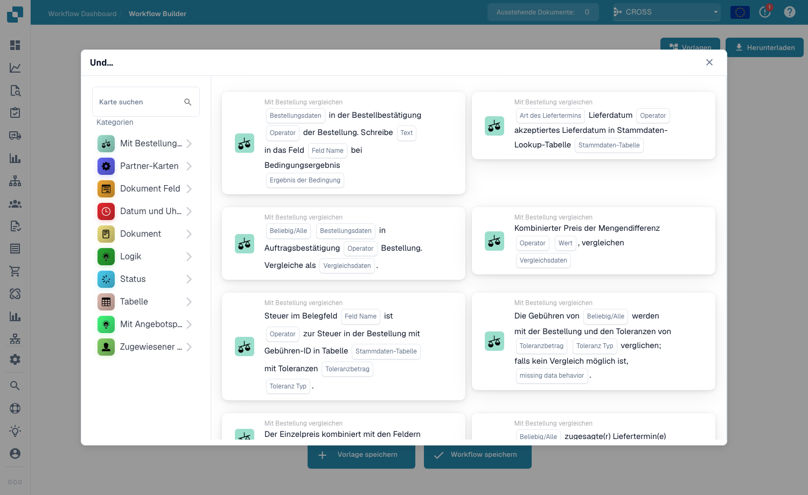

# Karten

Karten sind die Bausteine jedes Arbeitsablaufs. Sie kombinieren sie in den Gruppen **Wann / Und / Dann**, um zu beschreiben, wann ein Workflow ausgeführt wird und was er tut. In diesem Abschnitt werden die verfügbaren Karten und ihre Funktionen erläutert.

<figure><figcaption>
Die <strong>Add Card</strong>-Bibliothek — die Karten sind nach Kategorie geordnet.
</figcaption></figure>

## Kartengruppen

* **Wann** – die Auslöserkarten, die einen Workflow starten (z. B. Dokumenttyp, Dokumenttyp einer von).
* **Und** – Bedingungskarten, die ebenfalls erfüllt sein müssen, bevor die Aktionen ausgeführt werden. Dazu gehören _Vergleich mit Bestellung_ (PO-Abgleich), _Dokumentenfeldvergleiche, _Datum und Uhrzeit_, _Logik_, _Status_, _Tabelle_ und _Zuständiger_-Bedingungen.
* **Dann** – Aktionskarten, die die Arbeit erledigen: Felder festlegen, genehmigen/ablehnen, Status ändern, exportieren, Aufgaben erstellen, Dokumente zuweisen, Tabellen bearbeiten und Aktionen ausführen (API aufrufen, HTTPS-Anfrage senden, Workflow ausführen, KI-Berechnungen).

## Kartenreferenzhandbücher

Eine vollständige Referenz zu jeder Karte und ihren Optionen finden Sie auf den _vollständigen Anleitungsseiten_ in diesem Abschnitt (Bedingungskarten, PO-Zuordnungskarten, Zuweisungs- und Benutzerkarten, Aufgabenkarten, Feld- und Tischkarten sowie die Aktionskarten).

## Karten kombinieren

Um bewährte Kartenkombinationen zur Lösung gängiger Geschäftsszenarien zu sehen, lesen Sie die **Leitfäden für Workflow-Muster**.

[Logikkarten: vollständige Referenz](cards-overview/logic-cards-guide.md).
