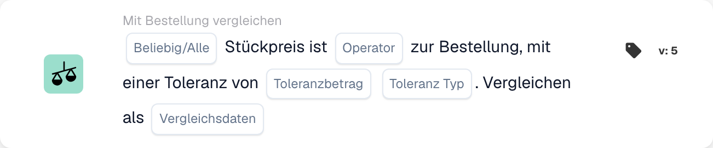

# Kartenversionen und Verfügbarkeit

<figure><figcaption>
Kartenfelder in der angezeigten Version. Die Platzhalter sind noch nicht ausgefüllt.
</figcaption></figure>

Eine Karte in einem gespeicherten Workflow behält ihre Karten-ID und -Version. Eine neuere Vorlage kann Felder hinzufügen oder das Verhalten ändern, ohne jeden zuvor gespeicherten Workflow zu ändern. Überprüfen Sie die Version auf der tatsächlichen Karte, bevor Sie Anweisungen für eine neuere Version anwenden.

## Bevor Sie eine gespeicherte Karte ändern

1. Zeichnen Sie die Felder und das aktuelle Ergebnis anhand repräsentativer Testdaten auf.
2. Vergleichen Sie die Version mit der Referenz, einschließlich Standardeinstellungen und Verhalten bei fehlenden Daten.
3. Aktualisieren oder ersetzen Sie die Karte nur über die unterstützte Builder-Aktion und überprüfen Sie ihre Einstellungen erneut.
4. Validieren Sie das Diagramm und testen Sie Fälle von Bestehen, Nichtbestehen und fehlenden Daten, bevor Sie den geänderten Workflow aktivieren.

Bearbeiten Sie einen gespeicherten technischen Kartentyp nicht nur, um seine Schreibweise zu korrigieren. Bestehende Workflows können von dieser Kennung abhängen. Eine nicht unterstützte Version ist ein Ausführungsfehler und keine falsche Geschäftsbedingung.

## Wenn eine dokumentierte Karte fehlt

Überprüfen Sie mit Ihrem Administrator die ausgewählte Gruppe „Wann“, „Und“ oder „Dann“, die Kategorie, den Builder „Standard“ oder „Erweitert“, die aktivierten Module, Berechtigungen und die bereitgestellte Version. Eine in einer technischen Integration oder einer neueren Referenz erwähnte Karte ist nicht unbedingt für Ihre Organisation aktiviert. Erstellen oder importieren Sie keine erratene Kartendefinition, um eine fehlende Vorlage zu umgehen.

Die in einigen Entwicklungsmaterialien beschriebenen zusätzlichen Kalenderbedingungen sind nicht in jeder Version ein auswählbarer Satz. Der Document-Variable-Setter wird auch ohne eine allgemein vordefinierte UI-Vorlage implementiert. Nutzen Sie die in Ihrer Umgebung tatsächlich verfügbaren Karten und fordern Sie vorher eine Klärung an, wenn eine Karte nicht verfügbar ist.

## Referenzen, die von der Version abhängen

- [Karten exportieren](export-cards-guide.md): Ergebnisstatus und sofortiger bzw. in der Warteschlange befindlicher Export.
- [PO-Vergleichskarten](po-comparison-versions-guide.md): Vergleichsrichtung und Toleranzbasis.
- [Angebotsvergleichskarten](quote-comparison-guide.md): Alle/Alle und es fehlen vergleichbare Preise.
- [Logikkarten](logic-cards-guide.md): Tags, Organisationsvariablen und Eingabetypen.

Verwenden Sie [Workflow-Protokolle](../workflow-logs.md), um zwischen Erfolg, einer falschen Bedingung, fehlenden Daten, einem Konfigurationsfehler und einer übersprungenen Karte zu unterscheiden. Dokumentstatus und Karteneinstellungen mit einem Testergebnis aufzeichnen; Ein Screenshot des Kartenwählers allein lässt noch kein Laufzeitverhalten erkennen.
