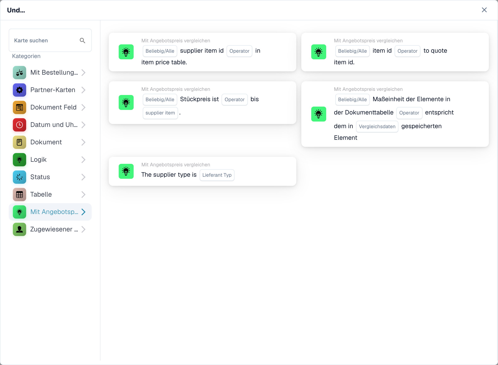

# Angebotsvergleichskarten

<figure><figcaption>
Verfügbare Karten der ausgewählten Kategorie. Füllen Sie die Platzhalter vor der Verwendung aus. Einzelne Feldbeschriftungen dieser Kartenversion sind in der Oberfläche derzeit noch englisch. Die Erläuterungen auf dieser Seite sind übersetzt.
</figcaption></figure>

Diese Und-Bedingungen verwenden die im Dokument verfügbaren Angebots- oder Lieferantenartikeldaten. Konfigurieren und testen Sie sie, nachdem die erforderlichen Angebotsdaten geladen wurden. Eine übereinstimmende Artikelkennung allein beweist nicht, dass der Preis oder die Maßeinheit korrekt sind.

## Wählen Sie den Scheck aus

| Kartentyp | Überprüfung und Konfiguration |
| --- | --- |
| `CONDITION_QUOTES_ITEM_NUMBER_COMPARISON` | Prüft die Artikelkennung anhand der Artikelpreisdaten. Wählen Sie die von der Karte angebotenen Vergleichs- und Alle/Alle-Felder aus. |
| `CONDITION_SPECIFY_SUPPLIER_TYPE` | Vergleicht den Lieferantentyp aus den Angebotsdaten mit `supplier_type`. Hierbei handelt es sich um eine Lieferantenklassifizierungsprüfung, nicht um einen Preisvergleich. |
| `CONDITION_QUOTE_SUPPLIER_ITEM_NUMBER_EXISTS` | Prüft, ob die Artikel-ID des Lieferanten in den Artikelpreisdaten vorhanden ist oder nicht; Wählen Sie den Operator und Alle/Alle. Fehlende Angebots- oder Artikeldaten müssen im Protokoll untersucht werden. |
| `CONDITION_QUOTE_PRICE_MATCH` | Vergleicht einen Stückpreis mit dem ausgewählten Lieferantenpreis: `ManagedPrice` oder `LastPrice`. Wählen Sie „Alle/Alle“ und den numerischen Vergleichsoperator. Zeilen ohne vergleichbare Nummer auf einer Seite werden übersprungen und protokolliert; Ist keine Zeile vergleichbar, meldet die Karte fehlende Belegdaten. |
| `CONDIITON_UNIT_OF_MEASURE_EQUAL` | Prüft die Maßeinheit anhand der zugehörigen Daten. Der technische Typ enthält einen Rechtschreibfehler; Ändern Sie es nicht im gespeicherten Workflow-JSON. Ein in verschiedenen Einheiten ausgedrückter Preis bedarf gesonderter Aufmerksamkeit. |
| `CONDITION_ITEM_QUOTES_TO_CONTRACTED_PRICE` | Vergleicht angebotene und vertraglich vereinbarte Preise. Version 3 fügt Any/All hinzu; siehe unten. |

Sichtbare Beschriftungen können je nach Release und UI-Sprache unterschiedlich sein. Wählen Sie anhand der tatsächlichen Prüfung aus, nicht nur anhand des Kategorienamens. Beispielsweise kann der angebotene Artikelpreis unter „Logik“ angezeigt werden, während die anderen Angebotsprüfungen unter „Mit Angebotspreis vergleichen“ angezeigt werden.

## Angegebener Artikelpreis: Version 3

Wählen Sie den Gleichheits- oder Ungleichheitsoperator und ob jede verglichene Linie oder jede verglichene Linie diesen erfüllen muss:

- `match_any`: Eine erfolgreiche Vergleichslinie ist ausreichend.
- `match_all`: Jede verglichene Zeile muss den ausgewählten Operator erfüllen.

Version 2 behält das Verhalten „Alle“ bei. Eine nicht festgelegte Einstellung „Alle/Alle“ in Version 3 greift auf „Alle“ zurück und wird protokolliert. Eine Karte ohne vergleichbare Zeilen meldet fehlende Daten; Das Fehlen eines Preises ist kein Beweis für Gleichheit oder Ungleichheit. Untersuchen Sie übersprungene Zeilen und deren fehlende Seite im Protokoll.

Beispielsweise liefern zwei vergleichbare Linien bei Gleichheit die Ergebnisse „wahr“ und „falsch“. Alle Pässe; Alles scheitert. Bei Ungleichheit ändert sich zuerst das Vergleichsergebnis für jede Zeile, und „Any/All“ kombiniert dann diese Ergebnisse. Das endgültige All-Ergebnis wird nicht invertiert, um Any zu implementieren.

## Testfälle

Verwenden Sie genaue Artikel- und Lieferanten-IDs, die beabsichtigte Preisquelle und passende Einheiten. Testen Sie, dass alle Zeilen übereinstimmen, ein gemischtes Ergebnis, keine vergleichbaren Preise, fehlende Angebotsdaten und eine falsche Lieferanten-ID. Überprüfen Sie sowohl das Vergleichsergebnis als auch die übersprungenen Zeilen. Halten Sie die Genehmigung bzw. Ausfuhr hinter den tatsächlich erforderlichen betriebswirtschaftlichen Prüfungen zurück; Eine erfolgreiche Identifikatorprüfung ist keine vollständige Beschaffungsvalidierung.

Siehe [PO Matching](../and/compare-with-purchase-order/po-matching-complete-guide.md) für Bestellvergleiche und [Workflow-Protokolle](../workflow-logs.md) für die Fehlerbehebung.
