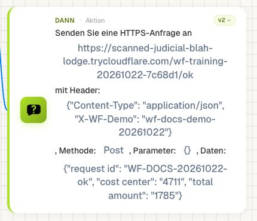
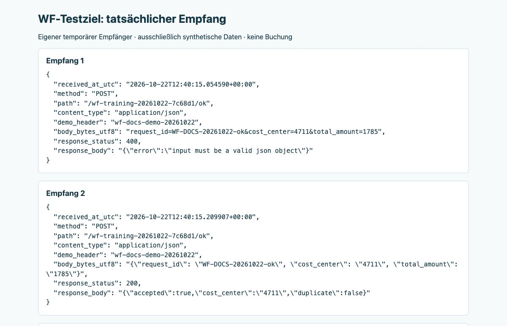
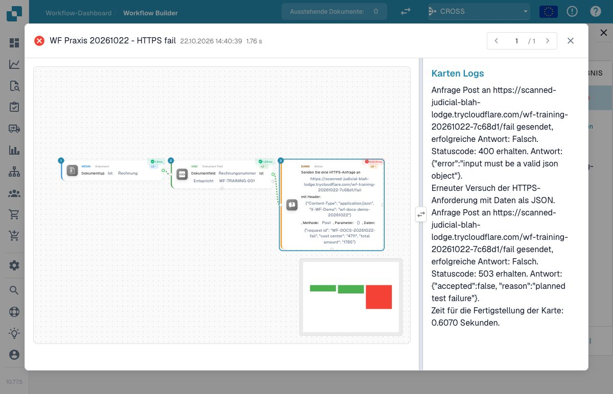
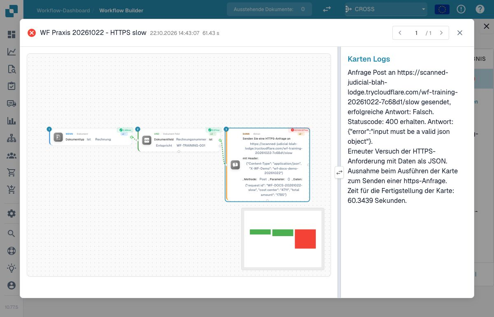

# P1: API-Aufruf und Weiterverwendung der Antwort prüfen

**Call API**, Version 2, ergänzt den konfigurierten Pfad um die DocBits-API-Basis und verwendet den aktuellen Organisationskontext. **Send HTTPS Request**, Version 2, verwendet eine externe URL und eigene Header. Ein vollständig fremder URL-Wert ist kein austauschbarer Call-API-Pfad. Beide Karten simulieren im Advanced-Test den Versand.

Die geprüfte HTTPS-Aktion protokolliert Status und Antworttext, stellt aber keinen frei benannten JSON-Antwortspeicher für Folgekarten bereit. Call API wertet den Antworttext über eine Bool-Konvertierung aus. HTTP 200, ein gültiger JSON-Body und eine fachlich erfolgreiche Folgeaktion sind daher getrennte Nachweise. Erfinden Sie keine Zugriffssyntax wie `api.response.cost_center`.

Für `{"cost_center":"4711"}` aus einem Fremdsystem vereinbaren Sie einen ausdrücklich unterstützten Rückschreibweg oder Callback in ein Dokumentfeld. Prüfen Sie das gespeicherte Feld und lesen Sie es im dafür vorgesehenen Folgelauf. Für direkten Antwortdatentransfer ist eine Karte oder Erweiterung mit dokumentiertem Ausgabevertrag erforderlich. JSON in der Kartenkonfiguration bestätigt außerdem nicht automatisch die tatsächlich gesendeten JSON-Bytes.

Verwenden Sie ein eigenes Testziel und prüfen Sie Methode, Header, tatsächlichen Body, Status und Antwortschema. Nehmen Sie 4xx, 5xx, Timeout, ungültiges JSON und doppelte Auslösung ab. Wiederholen Sie Schreibaufrufe erst, nachdem ein möglicher erster Empfang geprüft wurde. Die Platzhalter in der Parametertabelle benötigen Ihr eigenes Ziel. Die Screenshots darunter zeigen dagegen eine tatsächlich verwendete, anschließend abgeschaltete Testadresse.

## Einen Aufruf am eigenen Testziel nachweisen

Verwenden Sie ein eigenes Testziel, das die tatsächlich eingegangene Methode, den Pfad und den Body protokolliert. Konfigurieren Sie die Karte mit passenden Headern und einem synthetischen Kennzeichen für genau diesen Versuch. Maskieren Sie Schlüssel und Authentifizierungswerte in geteilten Aufnahmen.

Prüfen Sie zuerst, ob Call API einen internen Pfad erwartet oder Send HTTPS Request eine vollständige externe URL. Vergleichen Sie die konfigurierte Eingabe mit dem tatsächlichen Empfang. Eine grüne Simulation ist dafür kein Ersatz.

Kontrollieren Sie anschließend den konkret unterstützten Umgang mit der Antwort. Wenn die Karte lediglich Status und Text protokolliert, steht einer Folgekarte dadurch noch kein frei benanntes JSON-Objekt zur Verfügung. Prüfen Sie einen erforderlichen Rückschreibweg ausdrücklich, statt `api.response.cost_center` oder eine andere nicht belegte Zugriffssyntax zu verwenden.

Nehmen Sie 4xx, 5xx, Timeout und ungültige Antwortdaten als getrennte Fälle auf. Prüfen Sie bei einem Timeout vor einer Wiederholung, ob das Ziel den ersten Request bereits empfangen hat. Für Schreibvorgänge muss eine Wiederholung fachlich kontrolliert werden; ein veränderter Requestname allein verhindert keine doppelte Wirkung.

Halten Sie Kartenkonfiguration, tatsächlich empfangenen Request, Antwort und nachfolgenden gelesenen Wert zusammen fest. Wo kein automatischer Ausgabevertrag existiert, gehört genau diese Grenze in das Abnahmeprotokoll.

## Tatsächlich geprüft: JSON-Header, zwei Requests und eine Antwort ohne Rückschreibwirkung



Die inaktive Übungsregel war zusätzlich auf die eigene Rechnungsnummer `WF-TRAINING-001` begrenzt. Nur diese statischen synthetischen Daten wurden versendet; der Callback-Kontext blieb ausgeschaltet:

```json
{"request_id":"WF-DOCS-20261022-ok","cost_center":"4711","total_amount":"1785"}
```

Als Header waren `Content-Type: application/json` und `X-WF-Demo: wf-docs-demo-20261022` gesetzt. Der Demo-Header ist ein sichtbares Versuchskennzeichen und kein Zugangsschlüssel. Die Kartenbeschriftung stellt Unterstriche teilweise als Leerzeichen dar; vergleichen Sie deshalb den tatsächlichen Eingabewert und die empfangenen Bytes.



Beim ersten Request enthielt der Body **Formulardaten**, obwohl der Header JSON ankündigte. Das Ziel lehnte ihn mit HTTP `400` und `input must be a valid json object` ab. Auf genau diese Antwort reagierte die geprüfte Karte mit einem automatischen zweiten Versand als JSON. Der zweite Eingang erhielt HTTP `200` und `{"accepted":true,"cost_center":"4711","duplicate":false}`. Ein einmaliger Workflow-Aufruf bedeutete hier also zwei HTTP-Requests. Eine beliebige 400-Antwort ist damit nicht als allgemeiner Wiederholungsmechanismus belegt.

Nach dem Lauf enthielt der Beleg weiterhin kein Feld `cost_center`. Alle Geschäftsfelder, Tabellen und der Dokumentstatus waren unverändert. Die empfangene JSON-Antwort wurde protokolliert, aber nicht automatisch als Dokumentfeld oder frei benanntes Antwortobjekt für Folgekarten bereitgestellt.



Beim absichtlichen Fehlerfall antwortete der zweite Request mit HTTP `503`; die HTTPS-Karte erhielt `error`. Der ausgewählte Ausführungsendpunkt antwortete dennoch mit HTTP `200`, `success=true` und `outcome=executed`. Prüfen Sie deshalb das gespeicherte Lauf- und Kartenergebnis, bevor Sie den fachlichen Erfolg bestätigen.



Beim verzögerten Ziel war auch der zweite Request tatsächlich angekommen. Die Karte brach nach ungefähr 60 Sekunden mit `ReadTimeout` ab; der Empfänger versuchte seine Antwort erst nach 65 Sekunden. Dieser Fall wurde anschließend über das gespeicherte Laufprotokoll und den Empfang abgeglichen. Es gab keinen erneuten Versand dieses Timeout-Versuchs.

| Tatsächlicher Fall | Kartenresultat und Beobachtung |
| --- | --- |
| JSON-Header, erster Body als Formulardaten | HTTP 400 löst bei der genannten Fehlermeldung den zusätzlichen JSON-Request aus |
| JSON-Request, HTTP 200 mit JSON-Antwort | `success`; kein automatisches Dokumentfeld `cost_center` |
| JSON-Request, HTTP 503 | `error`, obwohl der Ausführungsendpunkt die Ausführung bestätigt |
| JSON-Request, HTTP 200 mit `WF_TEST_INVALID_JSON` | `success`; diese Kartenfassung erzwingt kein gültiges Antwort-JSON |
| Bewusst wiederholter `request_id` des Erfolgsfalls | Wieder empfangen; erst das Testziel meldet `duplicate=true` |
| Verzögerte Antwort nach 65 Sekunden | Request angekommen, Karte nach etwa 60 Sekunden mit Lesetimeout abgebrochen |

Die fünf ausgewählten Läufe erzeugten insgesamt zehn eingegangene Requests. Die Geschäftsfelder, Tabellen und der Status des eigenen Trainingsbelegs blieben in allen fünf Fällen unverändert. [Empfangsjournal, Fallübersicht und eigener Testempfänger herunterladen](../../../.gitbook/assets/wf-practice-20261022-https-evidence-de.zip). Die temporäre Adresse ist kein Dienst für Ihre Integration; verwenden Sie ein eigenes Testziel.

## Karten und Beispielparameter

Die Werte zeigen einzelne Kartenparameter, keinen importierbaren Gesamtworkflow. YOUR_* muss durch eine eigene Testauswahl ersetzt werden. Die versteckte Aufrufer-ID verwaltet der Designer. Katalogstand: Dev, DocFlow 2.10.38, 21. Oktober 2026; verfügbare Versionen und Freigaben in Ihrer Organisation separat prüfen.

### `call_api` · v2

Identität: `6ca5e621-af72-4f55-aa2e-b3caa288722a`

| Parameter | Typ / Auswahl | Beispiel |
| --- | --- | --- |
| `params` | `params:str` | `"{}"` |
| `api_endpoint` | `api_endpoint:str` | `"YOUR_RELATIVE_API_PATH"` |
| `data` | `data:str` | `"{}"` |
| `method` | `put / post / delete / get` | `"get"` |

### `action_https_request` · v2

Identität: `18d06ca4-3aca-4e49-b75c-566ade2fcb10`

| Parameter | Typ / Auswahl | Beispiel |
| --- | --- | --- |
| `data` | `data` | `"{}"` |
| `params` | `params` | `"{}"` |
| `url` | `url:str` | `"https://training.example.invalid/status"` |
| `headers` | `headers:str` | `"{}"` |
| `method` | `put / post / delete / get` | `"get"` |

## Fachliche Prüffälle

| Fall | Eingabe / Aufbau | Erwartung |
| --- | --- | --- |
| API-01 | Advanced Test | simuliert; kein Zustellnachweis |
| API-02 | HTTPS: HTTP 400 mit genannter JSON-Fehlermeldung / HTTP 503 | Zusätzlichen JSON-Versand beachten; endgültiges Kartenresultat prüfen |
| API-03 | timeout | Empfang vor Wiederholung prüfen |
| API-04 | {"cost_center":"4711"} | kein automatisches api.response.cost_center |
| API-05 | Derselbe request_id bewusst erneut | Erneuter Empfang; Deduplizierung des Ziels prüfen |
| API-06 | HTTP 200 mit ungültigem JSON | HTTPS v2 bleibt im geprüften Fall erfolgreich; Schema separat prüfen |

## Prüfstand und Aussagegrenzen

Die HTTPS-Praxisnachweise stammen aus echten ausgewählten Läufen auf Dev vom 22. Oktober 2026, mit Kartenversion 2 und deutscher Oberfläche 10.77.5. Der Empfänger verarbeitete ausschließlich die angegebenen synthetischen Werte. Die Ergebnisse belegen diese HTTPS-Karte und die genannten Fälle. Ein Call-API-Aufruf, eine fachliche Buchung oder ein Callback mit Rückschreiben wurde damit nicht getestet.

[Weiter im Lernweg](../workflow-learning-path.md) · [Übungspaket](../workflow-training-kit.md)
