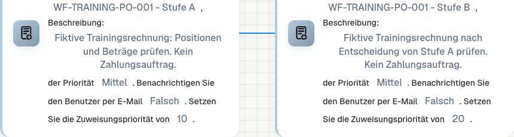
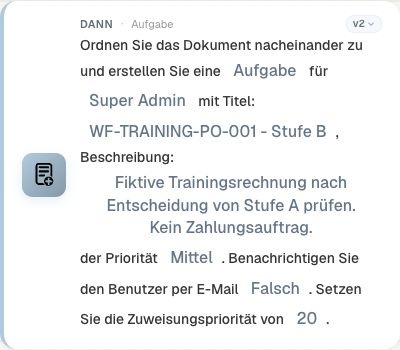
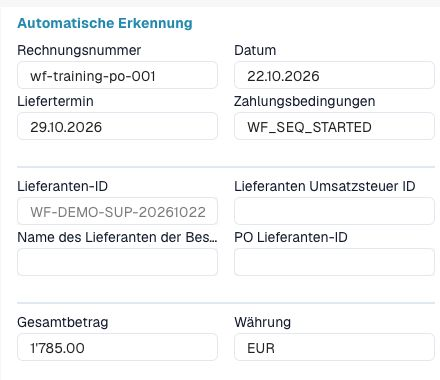
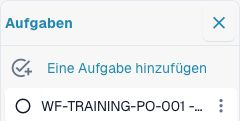
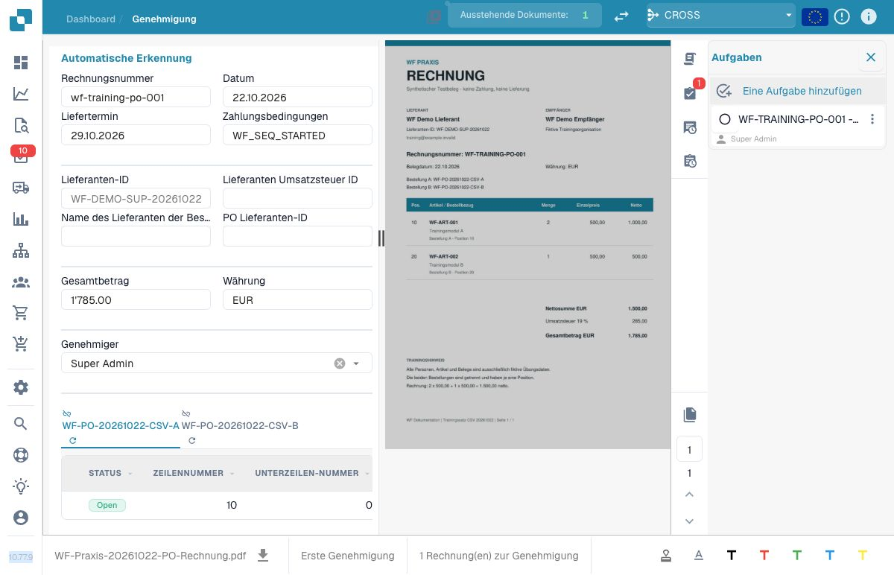

# P1: Zuweisung, Aufgabe und sequenzielle Freigabe unterscheiden

Eine **Dokumentzuweisung** bestimmt die aktuelle Zuständigkeit. Eine **Aufgabe** ist ein eigener Arbeitsauftrag. Eine **Benachrichtigung** informiert. Keine dieser drei Wirkungen ist bereits eine persönliche Genehmigung. Eine Gruppenzuweisung beweist auch nicht die Zustimmung jedes Gruppenmitglieds.

Bei sequenziellen Karten werden Empfänger und Reihenfolge für den Freigabeprozess gesammelt. Das Beispiel verwendet Prüfer A mit Reihenfolgewert 10 und Prüfer B mit 20. Die geprüfte Abschlusslogik beginnt mit dem kleineren Wert. Der Übergang zu B entsteht durch die verarbeitete Benutzerentscheidung im Freigabeprozess, nicht durch das bloße Weiterlaufen eines Wait-Knotens im Designer.

Vermeiden Sie eine unmittelbare Zuweisung im selben Lauf, wenn Sie den ersten sequenziellen Empfänger erwarten: Die geprüfte Abschlusslogik kann die erste sequenzielle Zuweisung überspringen, sobald das Dokument bereits direkt zugewiesen wurde. Bei Aufgaben werden `task_type`, Priorität, Empfänger und `send_email` unabhängig konfiguriert. Lassen Sie den Mailversand für reine Übungen deaktiviert.

Die fachliche Abnahme benötigt A→Genehmigung→B→Genehmigung sowie Ablehnung durch A, fehlenden Empfänger und erneutes Auslösen. Nach Ablehnung darf kein Abschluss-Export erfolgen; eine blockierte Empfängerauflösung darf nicht als abgeschlossene Freigabe erscheinen. Prüfen Sie Dokumentzuständigkeit und Aufgabenbestand getrennt. Designer-Simulationen belegen keinen echten Benutzerübergang.

## Einen Übergang von A nach B tatsächlich beobachten

Legen Sie vor der Konfiguration fest, ob Sie die Zuständigkeit ändern, eine Aufgabe erzeugen oder eine persönliche Entscheidung verarbeiten wollen. Verwenden Sie hierfür die jeweils passende Karte; die drei Wirkungen sind nicht gleichbedeutend.

Konfigurieren Sie in einer eigenen Testorganisation A mit Reihenfolge 10 und B mit 20. Notieren Sie vor dem Lauf die erwartete Aufgabe, den Ausgangsstatus und den vorgesehenen Übergang. Prüfen Sie die Empfänger anhand ihrer tatsächlich gespeicherten Auswahl.

Kontrollieren Sie zunächst die Aufgabe bei A. Verarbeiten Sie anschließend mit dem dafür vorgesehenen Testbenutzer eine tatsächliche Entscheidung. Prüfen Sie danach den neuen Dokumentzustand und den Übergang zu B. Das bloße Erzeugen einer Aufgabe oder Ändern eines Statuswerts ersetzt diese Entscheidung nicht.

Nehmen Sie Ablehnung durch A und einen fehlenden oder ungültigen Empfänger als getrennte Fälle ab. Legen Sie fest, ob die Rückfallroute eine andere Zuständigkeit erhält oder den Vorgang zur Korrektur stoppt. Wiederholen Sie denselben Anlass und prüfen Sie, ob weitere Aufgaben entstanden sind.

Der vorhandene [Rechnungs-/Exportfall](../invoice-approval-export-tutorial.md) bildet die Grundlage. Der Mehrpersonenfall benötigt zusätzlich den konkreten Nachweis beider Stufen und ihrer persönlichen Entscheidungen.

## Tatsächlich ausgeführter Übergang A → B

Am 22. Oktober 2026 wurde die fiktive Rechnung `WF-TRAINING-PO-001` mit 1.785,00 EUR brutto verwendet. Zwei bereits vorhandene Dev-Testkonten übernehmen die Rollen A und B. Die eigenen sequenziellen Aufgabenkarten in Version 2 verwenden Reihenfolge 10 und 20, mittlere Aufgabenpriorität und jeweils `send_email=false`.

<figure><figcaption>
Die Zuweisungspriorität legt hier die Reihenfolge fest; „Mittel“ ist die davon getrennte Aufgabenpriorität. Der Ausschnitt lässt persönliche Kontonamen aus.
</figcaption></figure>

<figure><figcaption>
Stufe B ist vollständig konfiguriert, wird beim Start aber zunächst nur vorgemerkt.
</figcaption></figure>

Der Trainingsworkflow ist auf diese Rechnungsnummer und den Status `validated_pending_approval` begrenzt. Ein zusätzlicher Vergleich verlangt den ursprünglichen Zahlungshinweis „Keine Zahlung - Trainingsbeleg“; danach setzt die Übung den Marker `WF_SEQ_STARTED`. Ein normaler Statuswechsel löste den Workflow aus. Nach dem Ereignis wurde nur diese eigene Regel wieder deaktiviert. Ein solcher Trainingsmarker gehört in ein dafür vorgesehenes eigenes Feld; Zahlungsbedingungen produktiver Rechnungen dürfen dafür nicht zweckentfremdet werden.

<figure><figcaption>
Belegzustand vor der persönlichen Entscheidung. Der Rechnungsbetrag ist unverändert; der Marker stammt aus dem gestarteten Trainingsworkflow.
</figcaption></figure>

<figure><figcaption>
Vor Entscheidung A bestand genau eine offene Aufgabe. Die schmale Oberfläche kürzt ihren Titel ab; der gespeicherte Datensatz wurde zusätzlich als „WF-TRAINING-PO-001 - Stufe A“, offen und A zugeordnet geprüft. Der Personenbereich ist ausgespart.
</figcaption></figure>

Prüfer A wählte an seiner Aufgabe **Als erledigt markieren**. Erst danach klickte er in seiner normalen Genehmigungsansicht auf **Approve**. Dieser Knopf blieb in der deutschen Oberfläche englisch beschriftet. Anschließend wurde der eigene Beleg erneut geöffnet und der gespeicherte Zustand kontrolliert:

| Nachweis | Vor A | Nach persönlicher Genehmigung von A |
| --- | --- | --- |
| Zuständigkeit des Dokuments | Prüfer A | Prüfer B, generisches Testkonto „Super Admin“ |
| Dokumentstatus | `validated_pending_approval` | `validated_pending_approval` |
| Gespeicherte persönliche Entscheidungen | Keine | Genau eine Genehmigung durch A, mit Entscheidungszeitpunkt |
| Aufgabe A | `open`, danach persönlich `done` | `done` |
| Aufgabe B | Vorgemerkt, noch keine Aufgabe | Neu angelegt, `open` |
| Export | Nicht erfolgt | Nicht erfolgt |

<figure><figcaption>
Nach A liegt dieselbe Rechnung bei B. Die linke Auswahl und der Aufgabenbereich zeigen das generische zweite Testkonto. Die gespeicherte Entscheidung von A und die vollständigen Aufgabentitel wurden zusätzlich getrennt gelesen.
</figcaption></figure>

Der Praxisnachweis mit gespeicherter Trainingsvorlage enthält die Zustände und den tatsächlichen Entscheidungszeitpunkt. Dieses historische Archiv endet beim Übergang A→B dieser PO-Rechnung. Der folgende zusätzliche Nachweis verwendet einen getrennten eigenen Dokumenttyp und ergänzt persönliche B-Entscheidung, Ablehnung und Wiederholung. Aus dem erfolgreichen Übergang A→B folgt deshalb noch keine vollständige Freigabe oder erfolgreiche Exportzustellung.


Praxisnachweis mit gespeicherter Trainingsvorlage


## Beide Entscheidungen, Ablehnung und Wiederholung zusätzlich prüfen

Ein zweiter, isolierter Praxisfall verwendete den eigenen Trainingsdokumenttyp und den Beleg `WF-TRAINING-001` mit 1.785,00 EUR. Er ist von der oben abgebildeten PO-Rechnung getrennt. Die persönlichen Entscheidungen wurden mit den tatsächlich authentifizierten Testkonten über die normalen Schnittstellen ausgeführt. Die native Feldansicht dieses eigenen Dokumenttyps blieb leer; der ergänzende Nachweis ist deshalb kein vollständiger Klickablauf in dieser Belegansicht.

| Tatsächlich ausgeführter Fall | Beobachtetes Ergebnis |
| --- | --- |
| A erledigt seine Aufgabe und genehmigt persönlich | A-Entscheidung gespeichert; A-Aufgabe `done`, neue B-Aufgabe `open`; Status weiter `validated_pending_approval` |
| B erledigt seine Aufgabe und genehmigt persönlich | Persönliche Freigabereihenfolge A, dann B; Status `exported` |
| Empfang nach B | Keine neue Zustellung: Das eigene Ziel war bereits als erfolgreich exportiert vermerkt. `exported` allein beweist keinen neuen HTTP-Empfang. |
| Zwei getrennte Rückkehrereignisse | Je eine offene A-Aufgabe, keine offene B-Aufgabe; dieselbe A-Aufgabe wiederverwendet |
| A lehnt anschließend persönlich ab | Beleg und A-Aufgabe `rejected`; keine offene Aufgabe, keine neue B-Aufgabe, keine zusätzliche Exportzustellung |

Geschäftsfelder und Tabellen blieben während dieser Vergleiche unverändert. Die zwei Rückkehrereignisse belegen diesen konkreten Ablauf; gleichzeitige Nachrichten und allgemeine Idempotenz sind damit nicht geprüft. Die eigene Regel und Exportkonfiguration sind wieder inaktiv. Der zusätzliche vollständige Ergebnisnachweis trennt persönliche Entscheidungen, Aufgaben, Status und tatsächliche Zustellung.


zusätzliche vollständige Ergebnisnachweis


## Fehlenden und unbekannten Empfänger prüfen

Drei zusätzliche **Advanced-Tests** verwenden dieselbe sequenzielle Aufgabenkarte v2 und vollständige Dokumentdaten. Nur der Empfängerparameter unterscheidet sich:

| Eingabe | Tatsächlicher Knotenpfad | Ergebnis |
| --- | --- | --- |
| Empfänger nicht gesetzt | `error` | `missing_variable` |
| Unbekannte Testbenutzer-ID | `error` | Allgemeine Meldung `error` |
| Vorhandenes berechtigtes Testkonto | `success` | Karte erfolgreich |

Die drei tatsächlichen Testergebnisse wurden mit unverändertem Dokument- und Aufgabenbestand abgeglichen. Sie belegen die Empfängerprüfung in der Simulation; eine neue reale Aufgabe und eine persönliche Entscheidung sind damit nicht nachgewiesen. Verbinden Sie den Fehlerausgang mit der vorgesehenen Korrekturroute und prüfen Sie diese gesondert. Der bisherige Praxisnachweis enthält noch keine tatsächlich ausgeführte Rückfallzuweisung.


drei tatsächlichen Testergebnisse


## Karten und Beispielparameter

Die Werte zeigen einzelne Kartenparameter, keinen importierbaren Gesamtworkflow. YOUR_* muss durch eine eigene Testauswahl ersetzt werden. Die versteckte Aufrufer-ID verwaltet der Designer. Katalogstand: Dev, DocFlow 2.10.38, 21. Oktober 2026; verfügbare Versionen und Freigaben in Ihrer Organisation separat prüfen.

### `action_assign_doc_to_user_sequential` · v2

Identität: `859b2ea5-27a9-41e4-b7f1-3cf8812b9343`

| Parameter | Typ / Auswahl | Beispiel |
| --- | --- | --- |
| `user` | `user:int` | `"YOUR_TEST_USER_ID"` |
| `value` | `value:int` | `10` |

### `action_create_task_for_user_sequential` · v2

Identität: `548b3583-6a96-483f-8c66-7871d5b067fa`

| Parameter | Typ / Auswahl | Beispiel |
| --- | --- | --- |
| `description` | `description:str` | `"WF-TRAINING-001"` |
| `task_type` | `task / notification` | `"task"` |
| `priority` | `high / medium / low` | `"medium"` |
| `send_email` | `send_email:bool` | `false` |
| `value` | `value:int` | `20` |
| `user` | `user:int` | `"YOUR_TEST_USER_ID"` |
| `title` | `title:str` | `"WF-TRAINING-001"` |

## Fachliche Prüffälle

| Fall | Eingabe / Aufbau | Erwartung |
| --- | --- | --- |
| ASSIGN-01 | A:10; B:20 | A → Genehmigen → B → Genehmigen |
| ASSIGN-02 | A → Ablehnen | EXPORT=NO |
| ASSIGN-03 | recipient=∅ | Rückfallroute |
| ASSIGN-04 | RUN-1 → RUN-2 | Doppelverarbeitung prüfen |
| ASSIGN-05 | direct + sequential | ersten Empfänger prüfen |

## Prüfstand und Aussagegrenzen

Parameter und Verhalten wurden gegen Dev-Katalog und Quellstand abgeglichen. Der oben beschriebene Übergang A→persönliche Genehmigung→B wurde tatsächlich ausgeführt und mit deutscher Oberfläche, Build 10.77.9, aufgenommen. Die drei zusätzlichen Empfängerfälle sind als Advanced-Tests belegt. Der getrennte eigene Dokumenttyp ergänzt beide persönlichen Entscheidungen, die tatsächliche Ablehnung und zwei Wiederholungsereignisse mit fachlichem API-Nachweis. Eine tatsächlich ausgeführte Rückfallroute und ein vollständiger nativer Klickablauf des eigenen Dokumenttyps bleiben gesonderte Abnahmepunkte.

[Weiter im Lernweg](../workflow-learning-path.md) · [Übungspaket](../workflow-training-kit.md)
