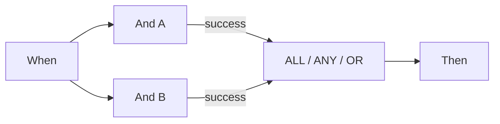

# P0: Wait ALL, Wait ANY und OR richtig verbinden

ALL verlangt einen passenden verbundenen Ausgang von **jeder unterschiedlichen Quelle**. ANY und OR benötigen mindestens eine passende Quelle. Verbinden Sie eine Quelle über Grün und Orange, zählt sie weiterhin einmal. OR erzeugt keine exklusive Verzweigung und beendet andere Aktionen nicht. Auch ANY ist keine Zusage „der schnellste Zweig gewinnt“.

Im geprüften Scheduler warten diese Knoten zunächst auf alle eingehenden Vorgänger. Bleibt eine Quelle wegen eines nicht gewählten Zweigs unerreichbar, überspringt der echte Ablauf die wartende Zusammenführung. Der Testmodus kann sie mit den vorhandenen Ergebnissen trotzdem auswerten. **Ein grüner Teiltest beweist deshalb nicht, dass derselbe Graph im Dokumentlauf weiterläuft.**

Für zwei verpflichtende Prüfungen führen Sie beide Prüfungen tatsächlich aus und verbinden passende Ergebnisse mit ALL. Für alternative Routen in dieser Version verwenden Sie die direkte gemeinsame Then-Abschlusskarte aus dem v2-Geschäftsfall. Diese Zusammenführung ist für gegenseitig ausschließende Routen gedacht; sie ersetzt keine Schranke für mehrere gleichzeitig ausgeführte Aktionen.

Prüfen Sie Quelle, verbundenen Ausgang, gewählten Ausgang und tatsächliche Erreichbarkeit getrennt. Eine Quelle mit Error bleibt ein Fehler im Gesamtlauf, auch wenn ANY/OR anschließend erfolgreich sind. Ein nicht erfülltes ALL besitzt im geprüften Code zusätzlich einen Fehlerhinweis; nur auf seine orange Farbe zu schauen genügt nicht.

## Karten und Beispielparameter

Die Werte zeigen einzelne Kartenparameter, keinen importierbaren Gesamtworkflow. YOUR_* muss durch eine eigene Testauswahl ersetzt werden. Die versteckte Aufrufer-ID verwaltet der Designer. Katalogstand: Dev, DocFlow 2.10.38, 21. Oktober 2026; verfügbare Versionen und Freigaben in Ihrer Organisation separat prüfen.

`node_type`: `all`, `any`, `or`

## Fachliche Prüffälle

| Fall | Eingabe / Aufbau | Erwartung |
| --- | --- | --- |
| MERGE-01 | A=success; B=success | ALL/ANY/OR: join=success |
| MERGE-02 | A=success; B=failed_condition; B→failed_condition: — | ALL: join=failed_condition, workflow=error; ANY/OR: join=success, workflow=failed_condition |
| MERGE-03 | A=success; B=error | ANY/OR: join=success; workflow=error |
| MERGE-04 | A=success; B=nicht erreicht | Test: auswerten; Scheduler: überspringen |
| MERGE-05 | A→success + A→failed_condition; B→success | sources=2 |

## Prüfstand und Aussagegrenzen

Die ausgewählten Karten- und Knotenergebnisse wurden mit synthetischen Daten in Advanced Test geprüft. Die Antworten liegen im Übungspaket. Dokumentaktionen sind simuliert; ein tatsächlicher Dokumentlauf und externe Zustellung sind damit nicht belegt.

[Weiter im Lernweg](../workflow-learning-path.md) · [Übungspaket](../workflow-training-kit.md)
