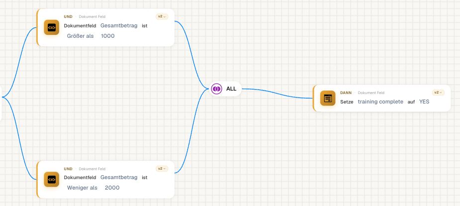
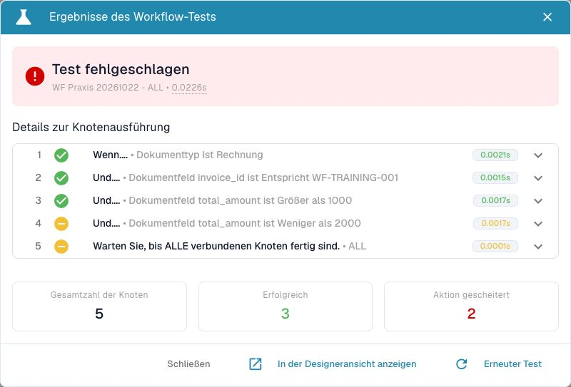
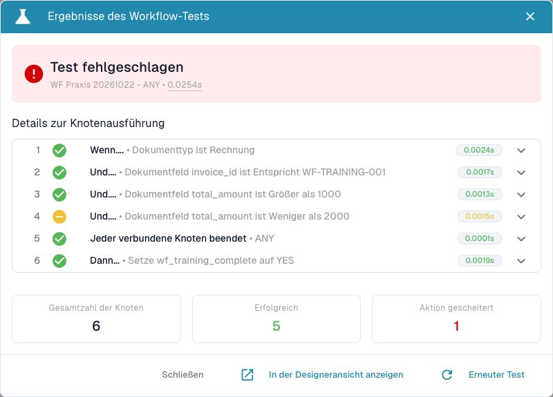
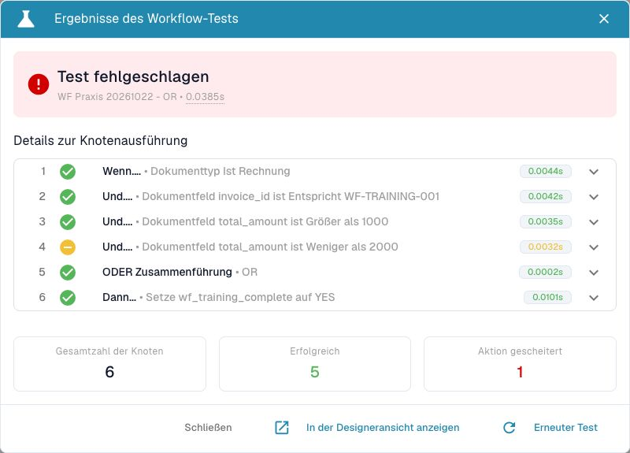
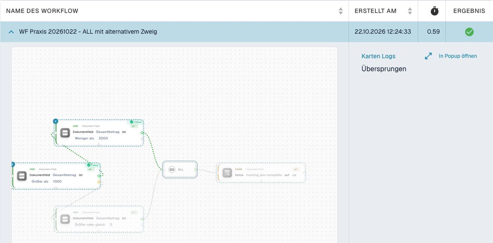
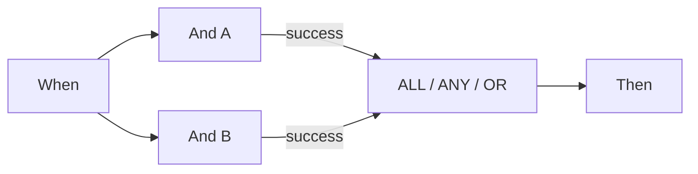

# P0: Wait ALL, Wait ANY und OR richtig verbinden



[Video mit deutschen Untertiteln und Sprechertext](https://docbits-videos.fra1.cdn.digitaloceanspaces.com/settings-assistant/workflow-masterclass-01-admin/v1/de.html)

ALL verlangt einen passenden verbundenen Ausgang von **jeder unterschiedlichen Quelle**. ANY und OR benötigen mindestens eine passende Quelle. Verbinden Sie eine Quelle über Grün und Orange, zählt sie weiterhin einmal. OR erzeugt keine exklusive Verzweigung und beendet andere Aktionen nicht. Auch ANY ist keine Zusage „der schnellste Zweig gewinnt“.

Im geprüften Scheduler warten diese Knoten zunächst auf alle eingehenden Vorgänger. Bleibt eine Quelle wegen eines nicht gewählten Zweigs unerreichbar, überspringt der echte Ablauf die wartende Zusammenführung. Der Testmodus kann sie mit den vorhandenen Ergebnissen trotzdem auswerten. **Ein grüner Teiltest beweist deshalb nicht, dass derselbe Graph im Dokumentlauf weiterläuft.**

Für zwei verpflichtende Prüfungen führen Sie beide Prüfungen tatsächlich aus und verbinden passende Ergebnisse mit ALL. Für alternative Routen in dieser Version verwenden Sie die direkte gemeinsame Then-Abschlusskarte aus dem v2-Geschäftsfall. Diese Zusammenführung ist für gegenseitig ausschließende Routen gedacht; sie ersetzt keine Schranke für mehrere gleichzeitig ausgeführte Aktionen.

Prüfen Sie Quelle, verbundenen Ausgang, gewählten Ausgang und tatsächliche Erreichbarkeit getrennt. Eine Quelle mit Error bleibt ein Fehler im Gesamtlauf, auch wenn ANY/OR anschließend erfolgreich sind. Ein nicht erfülltes ALL besitzt im geprüften Code zusätzlich einen Fehlerhinweis; nur auf seine orange Farbe zu schauen genügt nicht.

<figure><figcaption>
A prüft größer als 1000, B kleiner als 2000. Beide Quellen sind nach demselben Einstieg erreichbar.
</figcaption></figure>

## Mit derselben Eingabe drei Zusammenführungen vergleichen

Bauen Sie zwei voneinander erreichbare Prüfungen auf: A prüft `total_amount > 1000`, B prüft `total_amount < 2000`. Beide starten nach derselben Trainingsnummer-Prüfung. Verbinden Sie ihre Success-Ausgänge mit der Zusammenführung und deren Success-Ausgang mit einer Trainings-Abschlussaktion. Tauschen Sie für den Vergleich ausschließlich ALL, ANY und OR aus.

| Betrag | A | B | ALL | ANY / OR | Beobachtetes Gesamtergebnis im Advanced-Test |
| --- | --- | --- | --- | --- | --- |
| 1785 | wahr | wahr | success | success | success |
| 2500 | wahr | falsch | failed_condition; Abschluss nicht erreicht | success; Abschluss erreicht | ALL: error; ANY/OR: failed_condition |

Diese sechs Vergleiche wurden am 22. Oktober 2026 erneut mit synthetischen Daten im Dev-Advanced-Test ausgeführt. Lesen Sie den Knotenpfad und das Gesamtergebnis getrennt: Eine grüne ANY-/OR-Karte macht eine zuvor falsche Bedingung nicht nachträglich wahr. ALL lieferte im negativen Fall zusätzlich `ALL block: 1/2 sources succeeded (2 edges connected)`.

### Dasselbe Ergebnis im Designer lesen

Bei allen drei folgenden Aufnahmen lautet `total_amount = 2500`. Die vierte Karte trifft nicht zu. ALL beendet den Test ohne Abschlussaktion; ANY und OR erreichen die sechste Karte trotzdem. Der rote Dialogkopf bei ANY und OR fasst die nicht erfüllte Bedingung zusammen und bedeutet hier nicht, dass jede Aktion gescheitert ist. Prüfen Sie die einzelnen Knotensymbole und die erreichte Abschlussaktion.

<figure><figcaption>
ALL: fünf ausgeführte Knoten; keine Abschlussaktion.
</figcaption></figure>

<figure><figcaption>
ANY: sechs ausgeführte Knoten; Zusammenführung und Abschlussaktion erfolgreich.
</figcaption></figure>

<figure><figcaption>
OR: sechs ausgeführte Knoten; Zusammenführung und Abschlussaktion erfolgreich.
</figcaption></figure>

Untersuchen Sie danach einen anderen Aufbau: Zwei alternative Routen können nicht beide erreicht werden. Prüfen Sie den nicht gewählten Vorgänger ausdrücklich. Übertragen Sie das Ergebnis eines isolierten Tests nicht auf das Warten im Dokumentlauf. Für die im Übungspaket verwendeten exklusiven Routen bleibt die direkte gemeinsame Abschlussaktion der dokumentierte Vergleichsaufbau.

### Gegenprobe im echten Dokumentlauf

Am 22. Oktober 2026 wurde derselbe alternative Aufbau mit dem tatsächlich importierten synthetischen Rechnungsbeleg und `total_amount = 1785` ausgeführt. Nach dem Einstieg prüft eine Karte `total_amount > 1000`. Ihr grüner Ausgang erreicht A (`< 2000`); ihr orangefarbener Ausgang würde B (`>= 0`) erreichen. A und B sind mit ALL verbunden. B bleibt in diesem Lauf unerreichbar.

| Prüfweg | Beobachtetes Ergebnis | Fachlicher Abschluss |
| --- | --- | --- |
| Advanced-Test mit demselben Dokument | Fünf protokollierte Knoten; ALL = `failed_condition`; Gesamtergebnis `error` | Nicht erreicht |
| Tatsächlicher manueller Dokumentlauf | Vier erfolgreiche Knoten; Lauf insgesamt `success`; B und ALL übersprungen | Nicht erreicht; Abschlussfeld fehlt auch nach erneutem Laden |

<figure><figcaption>
Grüner Laufkopf, aber kein fachlicher Abschluss: Der ausgewählte ALL-Knoten wurde übersprungen. Die Aufnahme zeigt den betreffenden Graphausschnitt und das gespeicherte Protokoll.
</figcaption></figure>

Prüfen Sie deshalb neben dem Laufkopf die erreichten Knoten und die erwartete Dokumentwirkung. Die Abschlussaktion dieses Trainingsfalls würde ausschließlich ein Trainingsfeld setzen; weder Versand noch Export sind beteiligt.

Notieren Sie zu jeder Verbindung Quellknoten, angeschlossenen Ausgang, tatsächlich gewählten Ausgang und Erreichbarkeit. Zwei Kanten derselben Quelle erzeugen keine zwei unabhängigen Prüfungen.

## Karten und Beispielparameter

Die Werte zeigen einzelne Kartenparameter, keinen importierbaren Gesamtworkflow. YOUR_* muss durch eine eigene Testauswahl ersetzt werden. Die versteckte Aufrufer-ID verwaltet der Designer. Katalogstand: Dev, DocFlow 2.10.38, 21. Oktober 2026; verfügbare Versionen und Freigaben in Ihrer Organisation separat prüfen.

`node_type`: `all`, `any`, `or`

## Fachliche Prüffälle

| Fall | Eingabe / Aufbau | Erwartung |
| --- | --- | --- |
| MERGE-01 | A=success; B=success | ALL/ANY/OR: join=success |
| MERGE-02 | A=success; B=failed_condition; B→failed_condition: — | ALL: join=failed_condition, workflow=error; ANY/OR: join=success, workflow=failed_condition |
| MERGE-03 | A=success; B=error | ANY/OR: join=success; workflow=error |
| MERGE-04 | A=success; B=nicht erreicht | Test: auswerten; Scheduler: überspringen |
| MERGE-05 | A→success + A→failed_condition; B→success | sources=2 |

## Prüfstand und Aussagegrenzen

Die Vergleichsmatrix zu ALL/ANY/OR wurde mit synthetischen Daten in Advanced Test geprüft. Zusätzlich belegt die oben beschriebene Gegenprobe einen gespeicherten tatsächlichen Dokumentlauf mit unerreichbarem Alternativzweig. In diesem Lauf wurde die Abschlussaktion nicht ausgeführt. Die übrigen Advanced-Test-Aktionen bleiben simuliert; externe Zustellung ist nicht belegt.

[Weiter im Lernweg](../workflow-learning-path.md) · [Übungspaket](../workflow-training-kit.md)
