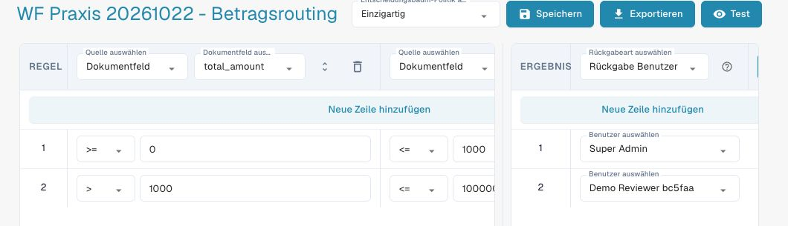
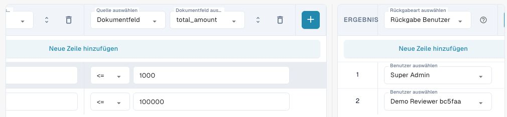
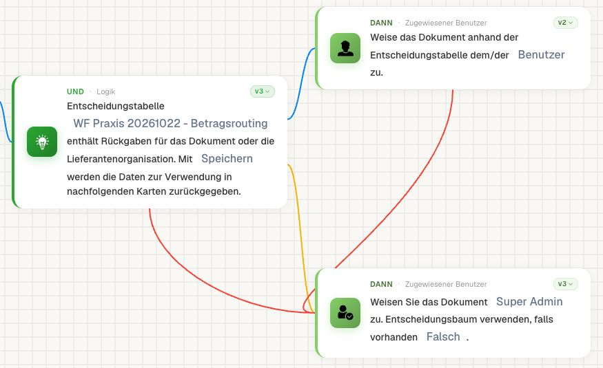
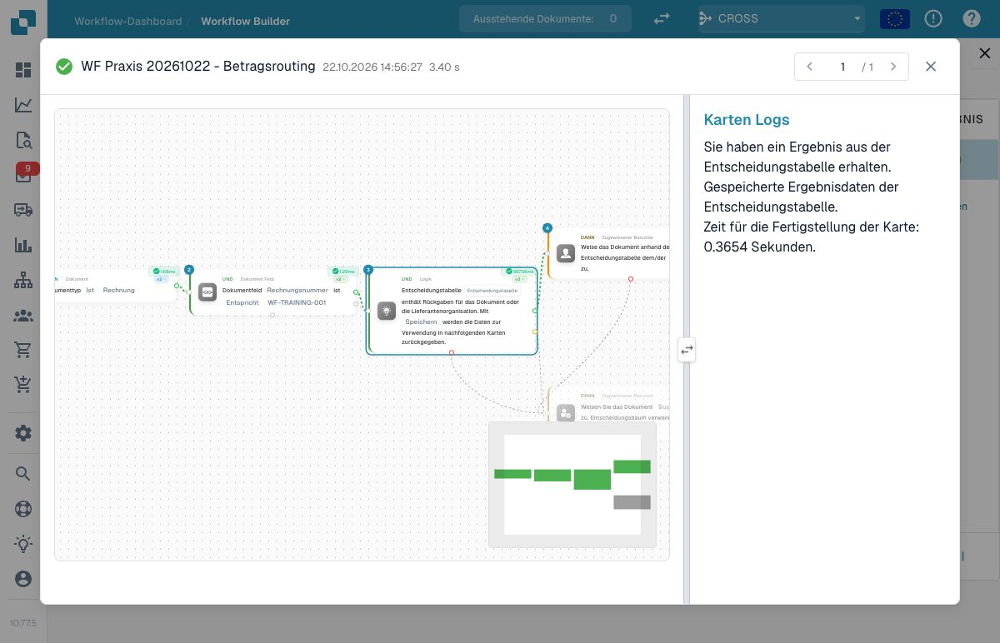
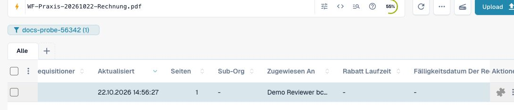
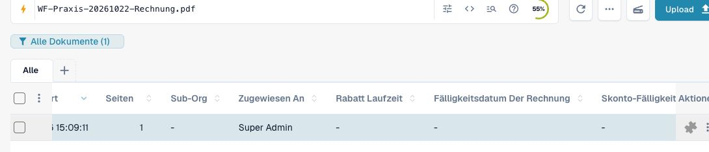
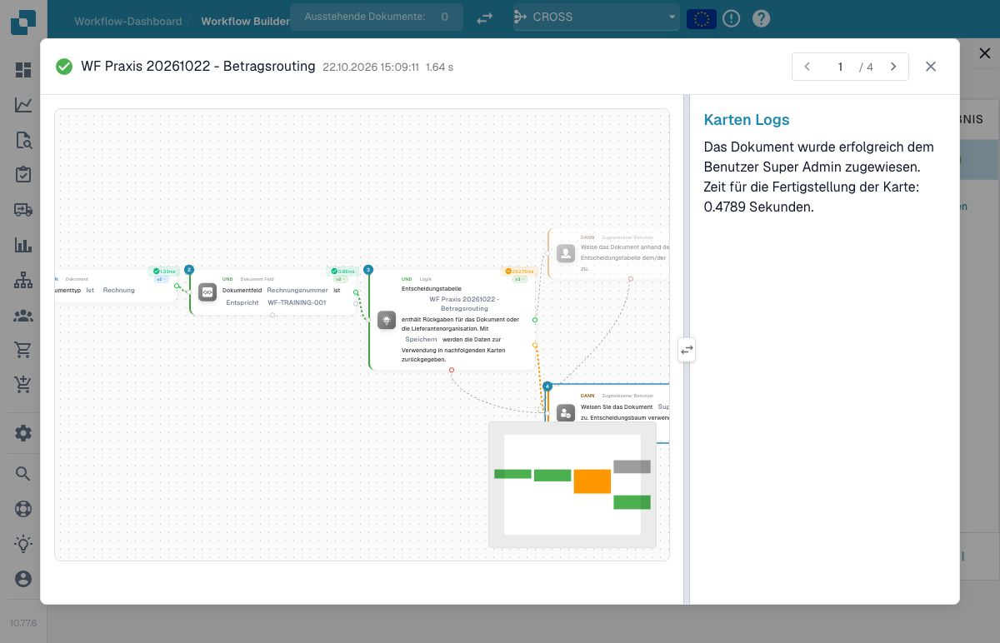

# P1: Entscheidungstabelle bis zur Zuweisung nachvollziehen



[Video mit deutschen Untertiteln und Sprechertext öffnen](https://docbits-videos.fra1.cdn.digitaloceanspaces.com/settings-assistant/workflow-masterclass-06-admin/v1/de.html).

Eine Entscheidungstabelle verbindet Eingabefelder mit typisierten Rückgaben. Das Beispiel verwendet `cost_center=4711` und `total_amount`: bis 1000 soll Prüfer A, darüber Prüfer B zuständig sein. Verwenden Sie zwei überschneidungsfreie Regeln und gültige Benutzer-IDs Ihrer Testorganisation. Die Beispieldatei im Paket beschreibt den Aufbau; sie ist kein zugesicherter Import in einen Tabelleneditor.

Bei **Decision Table has Returns**, Version 3, aktivieren Sie `store_data=wf_store_data`. In Version 2 wird stattdessen die boolesche Speicheroption gelesen. Die nachfolgende Zuweisung benötigt die gespeicherten Rückgaben desselben Laufs. Eine erfolgreiche Tabellenausführung allein bestätigt noch keinen gültigen Benutzer.

Eine Rückgabe für Benutzer besitzt beispielsweise `output_type=user` und `value=101`; 101 ist eine synthetische ID und muss durch einen vorhandenen Testbenutzer ersetzt werden. Wählen Sie anschließend **Assign document based on decision table** mit `assignee_type=user`. In der geprüften Version 2 dieser Aktion wird der letzte passende Rückgabeeintrag gewählt. „Mehrere Treffer“ bedeutet hier nicht automatisch „alle Benutzer freigeben lassen“.

Prüfen Sie genau einen Treffer, keinen Treffer, mehrere Treffer, falschen Rückgabetyp, ungültige Benutzer-ID und deaktiviertes Speichern. Verbinden Sie keinen Treffer und Zuweisungsfehler mit einer bewusst konfigurierten Rückfallroute. Ermitteln Sie Reihenfolge und Trefferregel, statt eine zufällige Tabellenreihenfolge als Geschäftsregel zu verwenden. Die tatsächliche Zuweisung wird am Dokument abgenommen.

Eine Entscheidungstabelle wird durch ihre Prüfkarte tatsächlich beim Tabellendienst ausgewertet. Testmodus ist keine allgemeine Garantie gegen Nebenwirkungen; verwenden Sie ausschließlich eigene Testdaten und prüfen Sie die verwendeten Aktionen.

## Die Rückgabe bis zum Dokument verfolgen

Erstellen Sie für die Übung zwei überschneidungsfreie Betragsregeln. Schreiben Sie vorab auf, welcher Benutzerbezug bei höchstens 1000 und welcher oberhalb 1000 erwartet wird. Prüfen Sie Regelmodus und Trefferverhalten im tatsächlichen Tabelleneditor.

Testen Sie 1000 und 1000.01. Kontrollieren Sie anschließend nicht nur den Tabellentreffer, sondern den tatsächlichen Rückgabetyp und die Einstellung zum Speichern dieses Ergebnisses. Wählen Sie in der nachfolgenden Zuweisung genau die unterstützte Rückgabe. Ein angezeigter Benutzername ist nicht automatisch eine gültige Benutzer-ID.

Führen Sie zusätzlich keinen Treffer, überlappende Regeln, eine ungültige Benutzerreferenz und eine nicht gespeicherte Rückgabe als eigene Fälle. Geben Sie jedem dieser Fälle eine bewusst festgelegte Rückfallroute. Eine zufällige Zeilenreihenfolge ersetzt keine dokumentierte Trefferregel.

Bei einer realen Abnahme prüfen Sie die Zuständigkeit am betroffenen Dokument und den zugehörigen Lauf. Eine simulierte Tabellenantwort belegt diese Änderung nicht. Halten Sie Tabellenstand, zurückgegebenen Wert und nachfolgende Kartenparameter zusammen fest, damit eine spätere Tabellenänderung erneut getestet werden kann.

## Praxisaufbau mit zwei überschneidungsfreien Regeln

Die eigene Übungstabelle **WF Praxis 20261022 – Betragsrouting** verwendet den Modus **Einzigartig** (`unique`). Sie prüft ausschließlich `total_amount`; eine Kostenstellenregel ist in diesem kleineren Praxisaufbau nicht enthalten. Beide Bedingungen einer Zeile müssen zutreffen:

| Regel | Erste Betragsbedingung | Zweite Betragsbedingung | Rückgabeart | Vorhandener Testbenutzer |
| --- | --- | --- | --- | --- |
| 1 | `>= 0` | `<= 1000` | `user` | Super Admin |
| 2 | `> 1000` | `<= 100000` | `user` | Demo Reviewer bc5faa |

Die bewusst begrenzten Bereiche lassen auch einen Fall ohne Treffer zu: Ein gespeicherter Betrag über 100000 ist in dieser Übung keiner der beiden Regeln zugeordnet. Die Entscheidungstabelle liest den gespeicherten Feldwert; kontrollieren Sie diesen nach einer Eingabe oder Normalisierung. Daraus folgt keine allgemeine geschäftliche Betragsobergrenze.

<figure><figcaption>Die gespeicherte eigene Entscheidungstabelle zeigt Einzigartig, die unteren Betragsgrenzen und zwei Benutzer-Rückgaben.</figcaption></figure>

<figure><figcaption>Nach horizontalem Scrollen sind die zweite Bedingung mit den oberen Grenzen 1000 und 100000 sowie dieselben Benutzer-Rückgaben sichtbar.</figcaption></figure>

Die beiden Ausschnitte zeigen denselben gespeicherten Tabellenstand. Scrollen Sie in einer schmalen Ansicht innerhalb des Regelbereichs, damit keine zusätzliche Bedingung übersehen wird. Verwenden Sie im eigenen System vorhandene Testbenutzer; die Namen in der Übung sind keine übertragbaren Benutzerreferenzen.

## Rückgabe speichern und eine Rückfallroute verbinden

<figure><figcaption>Die tatsächliche Prüfkarte v3 speichert die Rückgabe; die nachfolgende Zuweisung v2 liest Benutzer, während die Rückfallkarte v3 einen festen Testadministrator verwendet.</figcaption></figure>

Der Übungsworkflow prüft vor diesen Karten den Dokumenttyp und die eigene Rechnungsnummer `WF-TRAINING-001`. Die Entscheidungskarte v3 verwendet **Speichern** (`wf_store_data`); die nachfolgende Zuweisung v2 verwendet **Benutzer** (`user`). Für keinen Treffer und für einen Fehler ist eine eigene Zuweisung an **Super Admin** verbunden. Auch ein Fehler der normalen Zuweisung führt dorthin. In dieser Rückfallkarte ist **Entscheidungsbaum verwenden** ausdrücklich **Falsch**, damit sie den festen Testbenutzer verwendet.

<figure><figcaption>Der gespeicherte echte Lauf bestätigt den Tabellentreffer und das Speichern seiner Ergebnisdaten.</figcaption></figure>

Der erste tatsächliche Lauf mit 1785 bestand die Typ- und Rechnungsnummerprüfung, erhielt eine Benutzer-Rückgabe, speicherte sie und führte die Zuweisung aus. Danach war am eigenen Dokument `Demo Reviewer bc5faa` als Zuständiger gespeichert. Dokumentfelder, Tabellen und Status blieben bei diesem Zuweisungslauf unverändert. Der graue Rückfallzweig wurde in diesem Erfolgsfall nicht ausgeführt.

<figure><figcaption>Das native Dashboard zeigt den eigenen Trainingsbeleg und die tatsächlich gespeicherte Zuweisung an Demo Reviewer.</figcaption></figure>

## Grenze und Rückfall am eigenen Beleg abnehmen

Die folgenden vier Zuweisungsläufe wurden tatsächlich ausgeführt. Die Regeln und der Modus der Tabelle blieben dabei gleich:

| Gespeicherter Betrag | Entscheidungskarte | Tatsächlich ausgeführte Zuweisung | Zuständiger am Beleg |
| --- | --- | --- | --- |
| 1785 | `success` | Benutzer aus der gespeicherten Rückgabe | Demo Reviewer |
| 1000 | `success` | Benutzer aus der gespeicherten Rückgabe | Super Admin |
| 1000.01 | `success` | Benutzer aus der gespeicherten Rückgabe | Demo Reviewer |
| 100001 | `failed_condition`, kein Treffer | Feste Rückfallkarte | Super Admin |

<figure><figcaption>Beim Betrag ohne Tabellentreffer bestätigt das native Dashboard die Zuweisung an Super Admin.</figcaption></figure>

<figure><figcaption>Der gespeicherte Lauf zeigt den Nichttreffer, die nicht ausgeführte normale Zuweisung und die erfolgreich ausgeführte Rückfallkarte.</figcaption></figure>

Der Rückfalllauf ist insgesamt grün, obwohl die Entscheidungskarte keinen Treffer lieferte: Der ausdrücklich verbundene Rückfallzweig wurde erfolgreich ausgeführt. Prüfen Sie deshalb sowohl den genommenen Pfad als auch die gespeicherte Zuständigkeit.

Für diese Routingproben wurde ausschließlich der eigene synthetische Beleg verwendet. Seine temporären Beträge passten zwischenzeitlich nicht zu den Summen der PDF; es gab keine Freigabe und keinen Export. Nach der Aufnahme wurde der Betrag auf 1785 zurückgestellt. Während der vier eigentlichen Zuweisungsläufe blieben sämtliche Dokumentfelder, Tabellen und der Status unverändert. Tatsächliche Fallübersicht und Tabellen-Aufbauvorlage herunterladen.


Tatsächliche Fallübersicht und Tabellen-Aufbauvorlage


## Karten und Beispielparameter

Die Werte zeigen einzelne Kartenparameter, keinen importierbaren Gesamtworkflow. YOUR_* muss durch eine eigene Testauswahl ersetzt werden. Die versteckte Aufrufer-ID verwaltet der Designer. Katalogstand: Dev, DocFlow 2.10.38, 21. Oktober 2026; verfügbare Versionen und Freigaben in Ihrer Organisation separat prüfen.

### `condition_decision_tree_data` · v3

Identität: `c40160ce-805f-4312-8726-51b0fd7af8ec`

| Parameter | Typ / Auswahl | Beispiel |
| --- | --- | --- |
| `decision_table` | `decision_table:str` | `"YOUR_TEST_DECISION_TABLE_ID"` |
| `boolean` | `boolean:bool` | `true` |
| `store_data` | `wf_store_data / wf_do_not_store_data` | `"wf_store_data"` |

### `action_assign_doc_based_on_decision_table` · v2

Identität: `699912a7-2369-47e0-9092-8d027e13752a`

| Parameter | Typ / Auswahl | Beispiel |
| --- | --- | --- |
| `assignee_type` | `user / group` | `"user"` |

## Fachliche Prüffälle

| Fall | Eingabe / Aufbau | Erwartung |
| --- | --- | --- |
| DT-01 | 4711; 1000; store_data=wf_store_data | USER_A |
| DT-02 | 4711; 1000.01; store_data=wf_store_data | USER_B |
| DT-03 | kein Ergebnis / ungültiger Benutzer / falscher Typ | Rückfallroute |
| DT-04 | returns=[USER_A, USER_B]; assign v2 | USER_B |
| DT-05 | store_data=wf_do_not_store_data | keine gespeicherte Rückgabe für Zuweisung |

## Prüfstand und Aussagegrenzen

Die vier oben dokumentierten Zuweisungen wurden am 22. Oktober 2026 auf Dev tatsächlich ausgeführt und anschließend am Dokument geprüft. Die Screenshots stammen aus der deutschen Oberfläche 10.77.5 und 10.77.6. Mehrfachtreffer, ungültige Benutzerreferenzen, falsche Rückgabetypen und ausgeschaltetes Speichern bleiben zusätzliche Abnahmefälle; die vier Betragsprüfungen belegen diese Varianten nicht. Persönliche Freigaben, Aufgaben, E-Mails und Exporte waren nicht Teil dieser Routingläufe.

[Weiter im Lernweg](../workflow-learning-path.md) · [Übungspaket](../workflow-training-kit.md)
