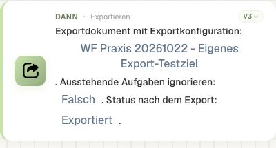
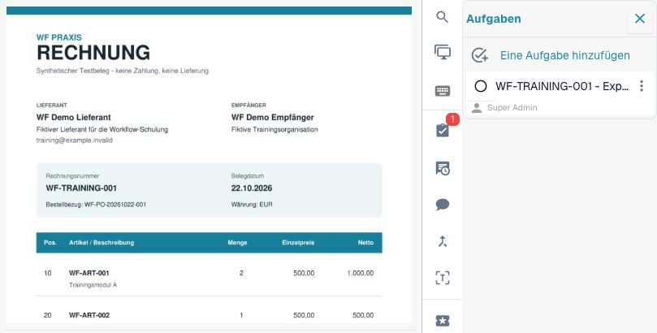
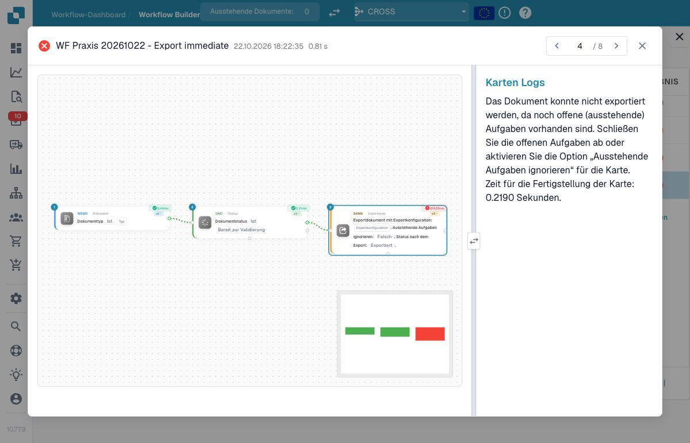
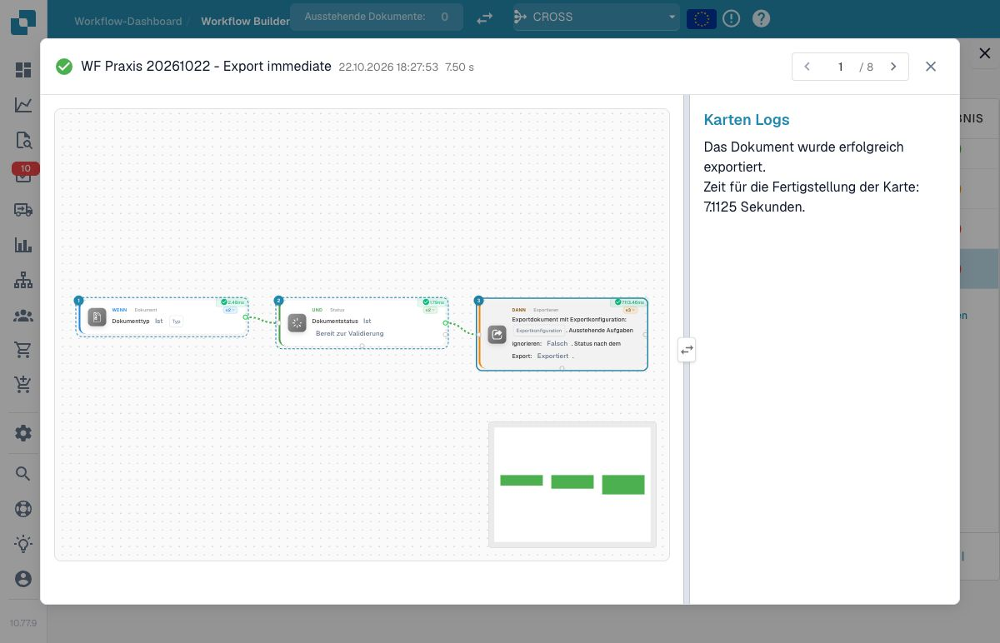
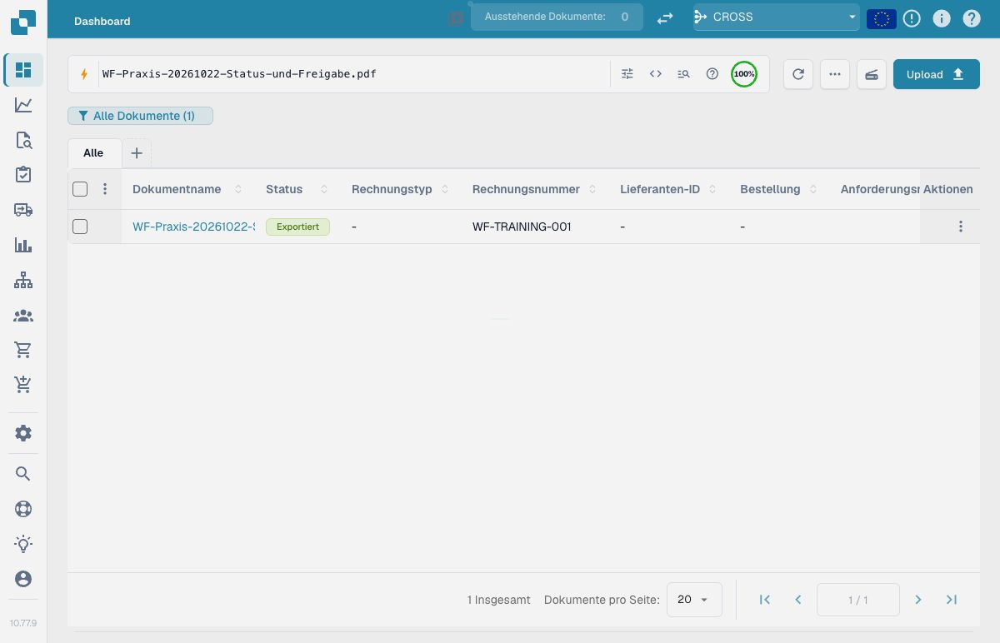
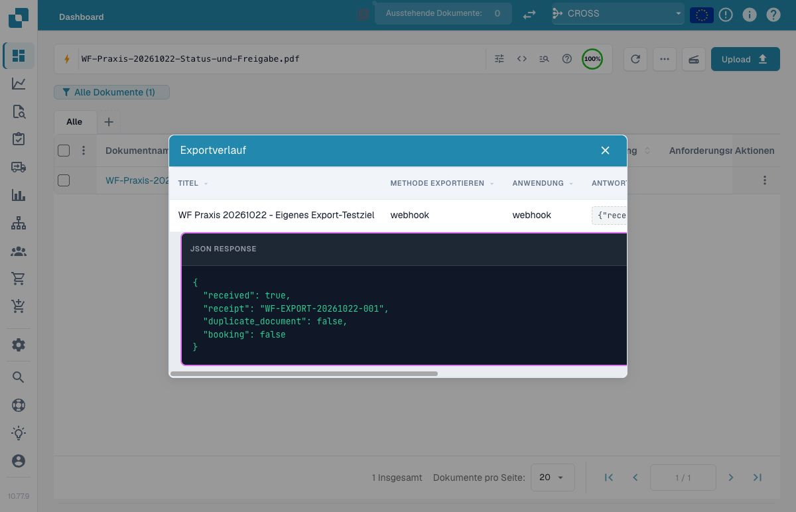
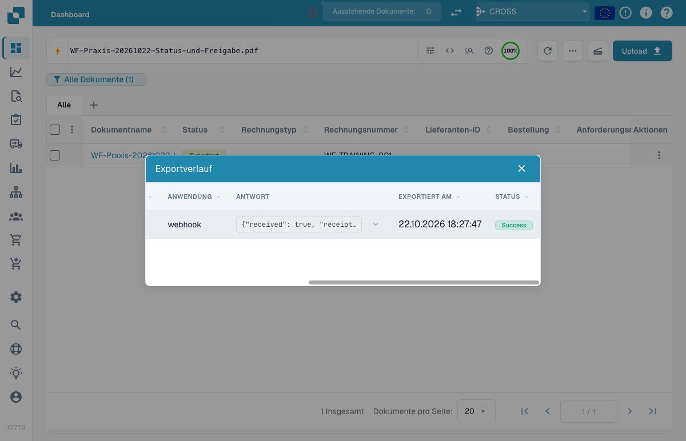
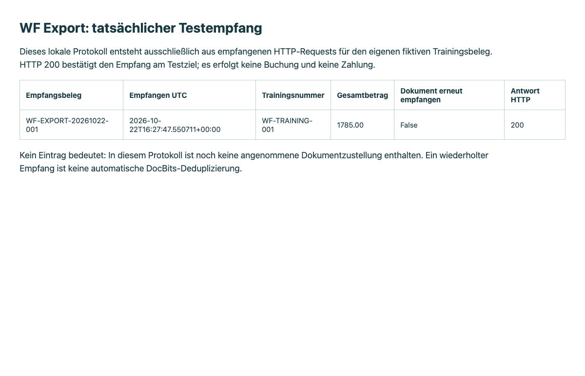
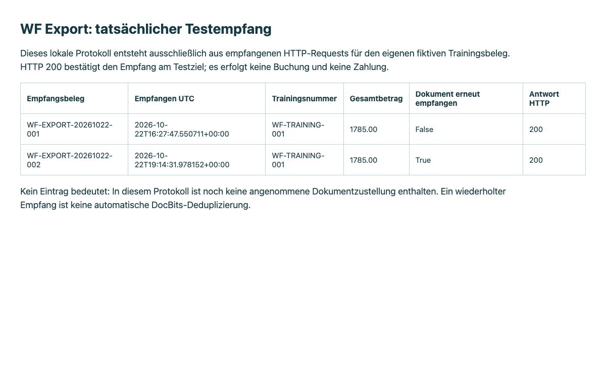

# P1: Exportvarianten, offene Aufgaben und Abschlussstatus

**Start Export** verwendet den eingerichteten Exportweg. **Export with Export Configuration** führt eine ausgewählte Konfiguration aus. Die verzögerte Variante merkt diese Konfiguration für den finalen Export am Ende des aktuellen Laufs vor. Vormerken heißt nicht „nach allen späteren Benutzerfreigaben automatisch senden“.

Die geprüften neuen Versionen bieten `status=finished` oder `status=exported`: finished schließt das Dokument, exported lässt die weitere Bearbeitung zu. Start Export trägt die Auswahl ab v4, konfigurierter und verzögerter Export ab v3. Ältere Versionen verwenden finished. Fehlt die Auswahl in den neuen Versionen, sieht der Code ebenfalls finished vor; ein ungültiger Wert ist ein Konfigurationsfehler.

Mit `ignore_pending_tasks=false` werden offene Aufgaben berücksichtigt. Beim unmittelbaren konfigurierten Export kann der Dienst den Export deshalb verweigern. Die Karte belegt keine automatische Wiederaufnahme nach späterer Erledigung. Klären Sie den erneuten Ausführungsanlass und prüfen Sie vor einem neuen Versand, ob bereits ein Zielbeleg existiert. Aktivieren Sie das Ignorieren nicht als Ersatz für die Freigabe.

Schließen Sie den Export erst an eine ausdrücklich geprüfte Freigabebedingung an. Die Abnahme umfasst offene Aufgabe, erledigte Aufgabe, fehlende Freigabe, erfolgreichen Testziel-Empfang und erneuten Lauf. Unterscheiden Sie Export angefordert, vom Empfänger erhalten und im ERP verarbeitet. Das allgemeine Übungspaket ist offline; der zusätzliche Praxisnachweis unten verwendet einen eigenen temporären Empfänger.

## Offene Aufgabe, Abschluss und Wiederholung vergleichen

Beginnen Sie mit einer eigenen Exportkonfiguration und einem dafür vorgesehenen Empfänger. Notieren Sie Karte, Version, gewählte Exportvariante und gewünschten Abschlussstatus. Prüfen Sie die vorausgehende Freigabebedingung unabhängig von der Exportkarte.

Führen Sie zuerst einen Fall mit offener Aufgabe aus. Halten Sie fest, ob der Export verweigert, für einen späteren Abschnitt vorgemerkt oder tatsächlich zugestellt wurde. Leiten Sie aus einer Verweigerung keine automatische spätere Wiederaufnahme ab.

Erledigen Sie anschließend die erforderliche Aufgabe beziehungsweise verarbeiten Sie die tatsächliche Freigabe. Lösen Sie den festgelegten neuen Anlass aus und vergleichen Sie Exportverlauf, Dokumentstatus und Empfang am Testziel. Die Varianten `finished` und `exported` benötigen eine bewusste Entscheidung zum weiteren Dokumentlebenszyklus.

Wiederholen Sie den Fall und prüfen Sie vor einem erneuten Versand den vorhandenen Zielbeleg. Ein Exportauftrag, ein empfangener HTTP-Request und eine verarbeitete ERP-Buchung sind unterschiedliche Nachweise. Der [vorhandene Rechnungs-/Exportfilm](../invoice-approval-export-tutorial.md) zeigt einen tatsächlichen Testziel-Empfang; die weiteren Exportvarianten und Aufgabenfälle werden getrennt abgenommen.

## Tatsächlicher Aufgaben- und Exportnachweis

Für diese Übung wurde ein eigener Trainingsdokumenttyp mit einer eigenen Webhook-Konfiguration verwendet. Die fiktive Rechnung `WF-TRAINING-001` enthält 1.785,00 EUR brutto. Der Empfänger nimmt ausschließlich diesen einen Trainingsbeleg an, protokolliert den Empfang und antwortet mit einer Empfangsnummer. Er führt keine Buchung aus. Die gemeinsame Exportkonfiguration regulärer Rechnungen wurde nicht verändert.

<figure><figcaption>
Die tatsächlich gespeicherte unmittelbare Exportkarte verwendet die eigene Konfiguration und lässt das Dokument nach erfolgreichem Export mit exported geöffnet.
</figcaption></figure>

Zunächst bestand eine eigene offene Aufgabe beim berechtigten Testkonto. Ihr Mailversand war ausgeschaltet. Der ausgewählte inaktive Workflow wurde tatsächlich am eigenen Beleg ausgeführt; es handelte sich nicht um einen Advanced Test.

<figure><figcaption>
Original-PDF und offene Aufgabe vor dem Exportversuch. Die schmale Aufgabenansicht kürzt den Titel ab; er wurde zusätzlich vollständig als „WF-TRAINING-001 - Exportsperre pruefen“ gelesen.
</figcaption></figure>

<figure><figcaption>
Der Export wurde wegen DOC_PENDING_TASKS verweigert. Die historische Logansicht löst hier die Namen von Dokumenttyp und Konfiguration nicht vollständig auf; die gespeicherte Konfigurations-ID wurde zusätzlich mit der ausgewählten Karte abgeglichen.
</figcaption></figure>

**Beobachtete Einschränkung:** Ein zweiter tatsächlicher Lauf mit `ignore_pending_tasks=true` wurde im geprüften Dev-Stand ebenfalls wegen derselben offenen Aufgabe verweigert. Die Option bewirkte in diesem Fall keinen erfolgreichen Bypass. Auch der Hinweis im Kartenlog, man könne die Option aktivieren, ist deshalb kein Funktionsnachweis. Die eigene Aufgabe wurde anschließend regulär als erledigt gespeichert.

| Ausgeführter Fall | Tatsächliches Ergebnis der Exportkarte | Dokumentstatus danach | Empfang am Testziel |
| --- | --- | --- | --- |
| Offene Aufgabe, Ignorieren ausgeschaltet | `error`, `DOC_PENDING_TASKS` | `ready_for_validation` | Keiner |
| Dieselbe offene Aufgabe, Ignorieren eingeschaltet | `error`, `DOC_PENDING_TASKS` | `ready_for_validation` | Keiner |
| Aufgabe erledigt, neuer ausgewählter Lauf | `success` | `exported` | Ein Request mit 1.785,00 EUR |
| Nochmals derselbe Workflow bei `exported` | Statusbedingung `ready_for_validation` ist falsch; Exportkarte nicht erreicht | `exported` | Weiterhin genau einer |

Geschäftsfelder, Tabellen und Zuständigkeit blieben während dieser vier Exportvergleiche unverändert. Der letzte Fall belegt den konkreten Statusschutz dieses Workflows. Er ist keine allgemeine Idempotenzgarantie und sagt nichts über eine spätere bewusste Statusrücksetzung aus.

<figure><figcaption>
Nach Erledigung der Aufgabe wurde die Karte erfolgreich ausgeführt. Für den Zustellnachweis werden außerdem Exporthistorie und Empfängerprotokoll geprüft.
</figcaption></figure>

<figure><figcaption>
Der tatsächlich gelesene Abschlussstatus lautet exported; das Dokument ist damit nicht als finished geschlossen.
</figcaption></figure>

<figure><figcaption>
Die vom Empfänger zurückgegebene Nummer bindet den Exportverlauf an den angekommenen Request. booking=false bedeutet: Das Testziel hat keine Buchung vorgenommen.
</figcaption></figure>

<figure><figcaption>
Exportzeit und tatsächlicher Erfolgsstatus. Die native Statusanzeige Success bleibt in dieser deutschen Ansicht englisch. Die Historie zeigt Ortszeit, das folgende Empfängerprotokoll UTC.
</figcaption></figure>

<figure><figcaption>
Dieses zusätzliche Testziel-Protokoll stammt aus tatsächlich angenommenen HTTP-Requests. Es bestätigt denselben Empfang um 16:27:47 UTC; eine ERP-Verarbeitung wird damit nicht behauptet.
</figcaption></figure>

Der Praxisnachweis mit Kartenparametern, tatsächlichen Ergebnissen und Empfangsdaten trennt getestete und lediglich vorbereitete Varianten. Dieses historische Archiv endet nach dem unmittelbaren Export und seinem Statusschutz. Der folgende zusätzliche Nachweis belegt den späteren finalen verzögerten Export und `finished`; der alternative Export wurde nicht ausgeführt.


Praxisnachweis mit Kartenparametern, tatsächlichen Ergebnissen und Empfangsdaten


## Verzögerten Export und tatsächliches finished zusätzlich nachweisen

Am selben eigenen Trainingsbeleg wurde anschließend die verzögerte Exportkarte v3 mit der eigenen Konfiguration und `status=finished` durch einen normalen Statusanlass ausgeführt. Der gespeicherte Arbeitslauf erreichte Dokumenttyp, Ausgangsstatus und Exportkarte. Der finale Export erzeugte genau einen neuen HTTP-Request mit Empfangsnummer `WF-EXPORT-20261022-002`; der Beleg erreichte tatsächlich `finished`.

<figure><figcaption>
Ein historischer unmittelbarer und ein späterer verzögerter Empfang. Beim zweiten Request erkennt der Testempfänger denselben Beleg wieder; das ist keine automatische DocBits-Deduplizierung.
</figcaption></figure>

Der Wechsel auf `finished` erzeugte einen zusätzlichen Folgelauf. In diesem passte der Ausgangsstatus nicht mehr; die Exportkarte blieb unerreicht. Es gab keinen dritten Empfang. Für die Abnahme zählen hier ein erfolgreicher Arbeitslauf, ein korrekt abgefangener Folgelauf und eine neue Zustellung; zwei Protokolleinträge bedeuten nicht zwei Übertragungen.

Eine davor ausgeführte vollständige persönliche Freigabe hatte zwar wieder zu `exported`, aber zu keiner neuen Zustellung geführt: Das eigene Ziel war bereits als erfolgreich exportiert vermerkt. Der ausdrücklich ausgewählte finale Export ist ein anderer Ausführungspfad. Vor einer erneuten Anforderung muss deshalb geprüft werden, ob und über welchen Weg ein Ziel bereits beliefert wurde.

Der zusätzliche Abschlussnachweis enthält tatsächliche Ergebnisse und beide Empfangsbelege ohne private Dokumentkennungen. Geschäftsfelder und Tabellen blieben unverändert; die eigene Regel und Konfiguration sind inaktiv, der temporäre Empfänger und Tunnel wurden beendet. Der alternative Export bleibt außerhalb dieses ausgeführten Nachweises.


zusätzliche Abschlussnachweis


## Karten und Beispielparameter

Die Werte zeigen einzelne Kartenparameter, keinen importierbaren Gesamtworkflow. YOUR_* muss durch eine eigene Testauswahl ersetzt werden. Die versteckte Aufrufer-ID verwaltet der Designer. Katalogstand: Dev, DocFlow 2.10.38, 21. Oktober 2026; verfügbare Versionen und Freigaben in Ihrer Organisation separat prüfen.

### `export` · v4

Identität: `757f30ca-ed60-4e04-8131-2779df17f019`

| Parameter | Typ / Auswahl | Beispiel |
| --- | --- | --- |
| `boolean` | `boolean:bool` | `true` |
| `status` | `finished / exported` | `"finished"` |

### `action_export_with` · v3

Identität: `ebcd854d-68b3-4b5f-8d45-1bcf8c675b21`

| Parameter | Typ / Auswahl | Beispiel |
| --- | --- | --- |
| `export_configuration` | `export_configuration:int` | `"YOUR_TEST_EXPORT_CONFIGURATION_ID"` |
| `ignore_pending_tasks` | `ignore_pending_tasks:bool` | `false` |
| `status` | `finished / exported` | `"exported"` |

### `action_export_with_config_deferred` · v3

Identität: `060ef4c8-625f-447c-83c9-2ca3f680d88d`

| Parameter | Typ / Auswahl | Beispiel |
| --- | --- | --- |
| `export_configuration` | `export_configuration:int` | `"YOUR_TEST_EXPORT_CONFIGURATION_ID"` |
| `ignore_pending_tasks` | `ignore_pending_tasks:bool` | `false` |
| `status` | `finished / exported` | `"finished"` |

## Fachliche Prüffälle

| Fall | Eingabe / Aufbau | Erwartung |
| --- | --- | --- |
| EXPORT-01 | status=finished | geschlossen |
| EXPORT-02 | status=exported | weiter bearbeitbar |
| EXPORT-03 | ignore_pending_tasks=false; pending_tasks>0 | Verweigerung möglich; automatische Wiederaufnahme nicht belegt |
| EXPORT-04 | action_export_with_config_deferred | vorgemerkt ≠ empfangen |
| EXPORT-05 | RUN-1 → RUN-2 | destination_records=1 |

## Prüfstand und Aussagegrenzen

Geprüft am 22. Oktober 2026 in Dev, deutsche Oberfläche Build 10.77.9: vier tatsächliche ausgewählte Workflowläufe, offene und erledigte Aufgabe, eine bestätigte Webhook-Zustellung und ein am Statusschutz gestoppter Wiederholungslauf. Persönliche Freigaben werden im [separaten Mehrpersonenfall](assignment-task-sequential.md) geprüft. Der ergänzende isolierte Fall belegt außerdem den tatsächlich ausgeführten finalen verzögerten Export, `finished` und einen am Ausgangsstatus gestoppten Folgelauf. Der alternative Export bleibt bis zu seinem eigenen Nachweis eine Abnahmeanleitung.

[Weiter im Lernweg](../workflow-learning-path.md) · [Übungspaket](../workflow-training-kit.md)
