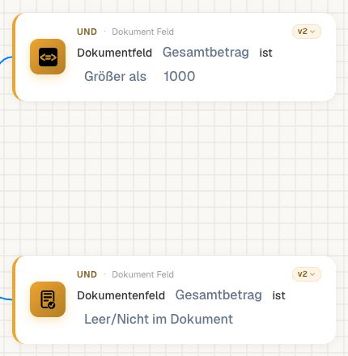
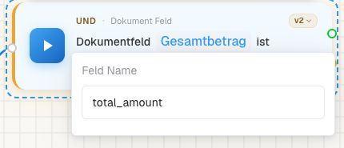
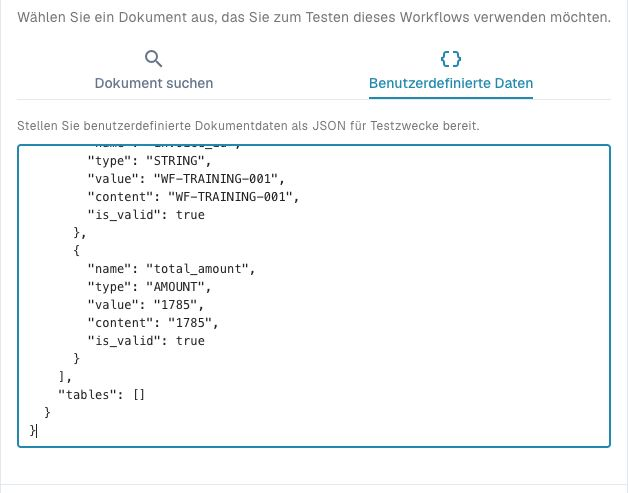
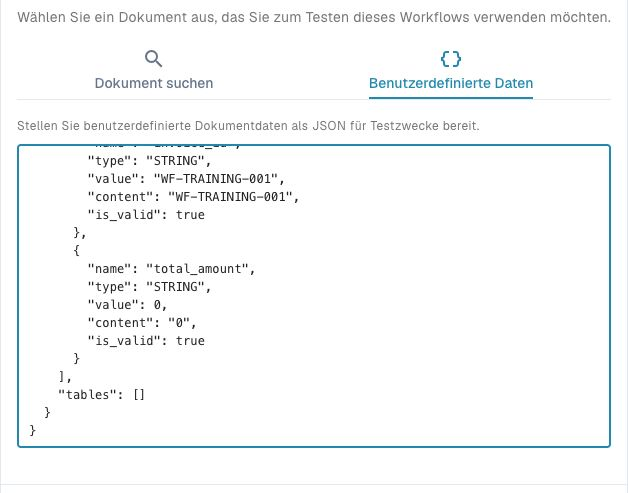
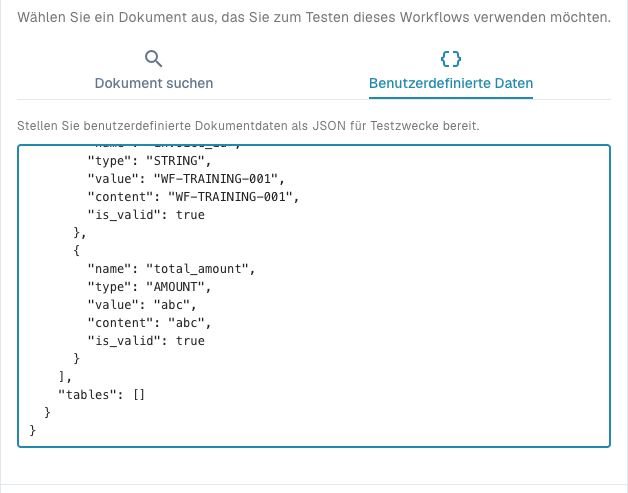
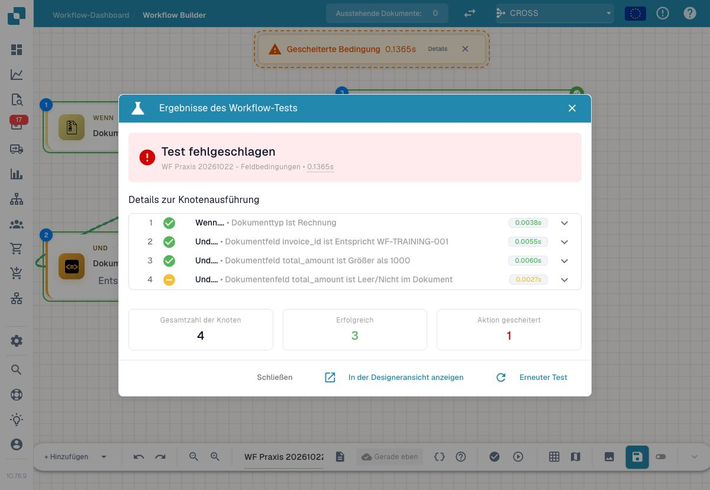
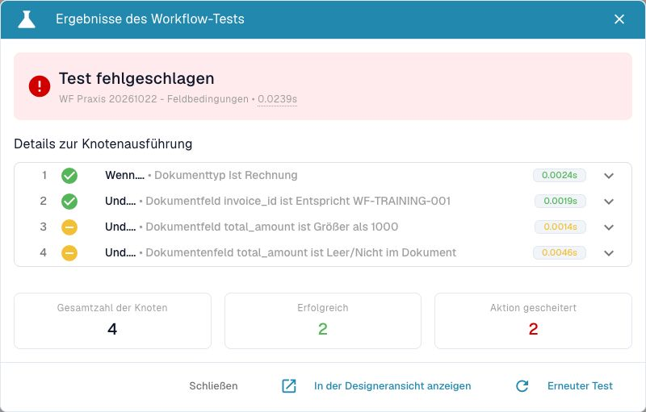
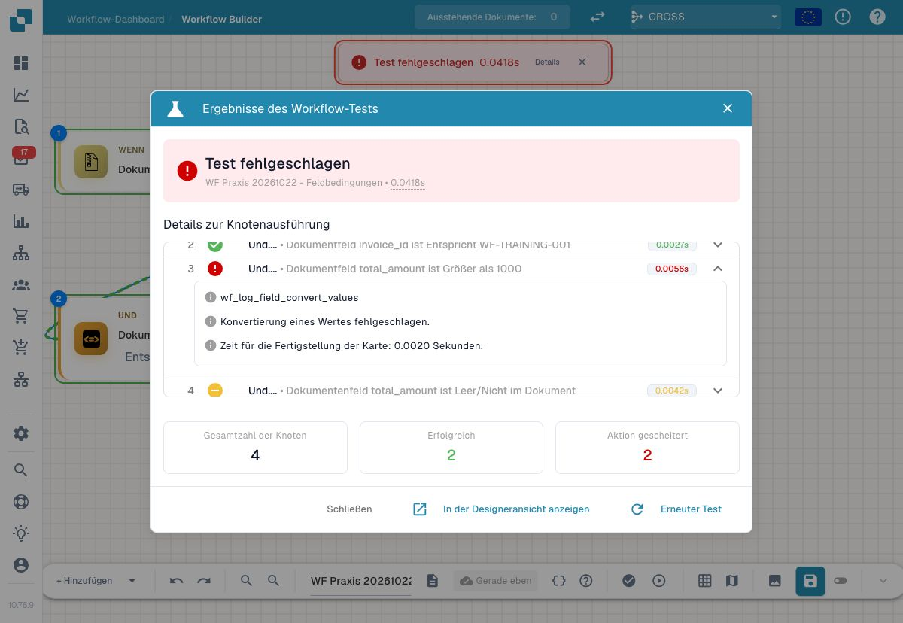

# P1: Field is, Docfield is und zwei Felder vergleichen

Verwenden Sie **Field is** für den Leerzustand, **Docfield is** für den Vergleich mit einem konfigurierten Wert und **Compare two Fields** für zwei Werte desselben Dokuments. Eine Leerprüfung beweist nicht, dass das Feld im Layout existiert oder fachlich korrekt ist.

Für Field is, Version 2, ergeben fehlendes Feld, `null`, leerer Text, nur Leerzeichen und der boolesche Wert `false` den Zustand leer. Die Zahl `0`, der Text `"0"` und der Text `"false"` sind nicht leer. Diese acht Fälle wurden mit vollständigen Dokumentdaten im Dev-Test geprüft. Verwenden Sie eine explizite Checkbox-Bedingung, wenn wahr/falsch die Geschäftsentscheidung ist.

Ein Wert `"1000.01"` mit Feldtyp AMOUNT ist von einem Textfeld gleicher Schreibweise zu unterscheiden. Das v2-Übungspaket verwendet AMOUNT und Dezimalpunkte im JSON. Prüfen Sie technische Feldschlüssel, Layout und Typ gemeinsam. Eine lokalisierte Beschriftung oder ein Währungssymbol ist kein technischer Feldschlüssel beziehungsweise Zahlenwert.

Für Compare two Fields legen Sie linkes Feld, Operator und rechtes Feld fest. Prüfen Sie kompatible Typen und beide Eingaben; ein fehlender oder nicht vergleichbarer Wert ist ein Datenfehler, keine bewiesene Ungleichheit. Wiederholen Sie Positivfall, Negativfall, fehlende Eingabe und den exakten Grenzwert. Das Ergebnisblatt hält Wert, Typ und gewählten Ausgang fest.

## Eine kleine Datentyp-Matrix nachbauen

Verwenden Sie dieselbe Karte und denselben technischen Feldschlüssel. Ändern Sie pro Test ausschließlich den Wert beziehungsweise das Vorhandensein des Feldes. Nehmen Sie dafür vollständige Custom Data aus dem Übungspaket; ein JSON-Objekt nur mit `total_amount` ersetzt den Dokumentkontext nicht.

Prüfen Sie nacheinander: Feld fehlt, `null`, leerer Text, Leerzeichen, boolesches `false`, Zahl `0`, Text `"0"` und Text `"false"`. Halten Sie auch den tatsächlichen Datentyp fest. Der im Lernpaket geprüfte Leertest Field is v2 behandelt die ersten fünf Varianten als leer. Die Zahl 0 sowie die beiden Texte sind dort nicht leer.

Vergleichen Sie danach `total_amount > 1000` mit 999, 1000 und 1000.01. Öffnen Sie die Eingabe, die ausgefüllten Kartenparameter und das Ergebnis nebeneinander. Prüfen Sie bei einem unerwarteten Error sowohl den Feldschlüssel als auch den Typ: `not_found_in_document` trat im dokumentierten numerischen Vergleich auch bei ungültigem Zahlentext auf.

Verwenden Sie Compare two Fields, wenn beide Seiten aus dem Dokument stammen. Ein fester Grenzwert gehört dagegen in die entsprechende Wertkonfiguration. Eine übersetzte Feldbeschriftung ist kein austauschbarer technischer Schlüssel. Bewahren Sie Positiv-, Negativ- und Fehlerfälle getrennt auf.

## Vollständige Eingaben und echte Designer-Ergebnisse

Die zehn vollständigen Testeingaben, den inaktiven Beispielworkflow und die beobachteten Knotenergebnisse herunterladen. Ersetzen Sie vor dem Test beide `YOUR_ORG_ID` durch Ihre eigene Testorganisation. Ein isoliertes Objekt nur mit `total_amount` genügt nicht: Layout, Dokumenttyp und Organisationskontext gehören zur Eingabe. Die Screenshots zeigen den relevanten Feldabschnitt; die vollständigen JSON-Dateien stehen im Download.


Die zehn vollständigen Testeingaben, den inaktiven Beispielworkflow und die beobachteten Knotenergebnisse


Die folgende Konfiguration verwendet zwei unabhängig erreichbare UND-Karten für dasselbe Feld: Zahlenvergleich `> 1000` und Leerprüfung. Beide Karten sind v2. Der technische Schlüssel ist `total_amount`; im Zahlen-Positivfall ist er im Layout und in den Felddaten als `AMOUNT` angegeben.

<figure><figcaption>
Zahlenvergleich und Leerprüfung sind unterschiedliche Prüfungen.
</figcaption></figure>

<figure><figcaption>
Die Anzeige Gesamtbetrag verwendet den technischen Feldschlüssel total_amount.
</figcaption></figure>

<figure><figcaption>
Positivfall des Zahlenvergleichs: expliziter Typ und Wert in der vollständigen Testeingabe.
</figcaption></figure>

### Gültiger Betrag, Null und ungültiger Zahlentext

Die folgenden drei Fälle wurden am 22. Oktober 2026 zusätzlich in der nativen Dev-Oberfläche ausgeführt. Im Layout bleibt `total_amount` als `AMOUNT` definiert. Der Nullfall verwendet in den Felddaten `type=STRING`, aber den JSON-Zahlenwert `0`; diese Metadaten und der tatsächliche JSON-Wert sind getrennt zu lesen. Die Download-Dateien halten diese Unterschiede vollständig fest. Daraus folgt keine allgemeine Gleichheit von STRING- und AMOUNT-Feldern.

| Eingabe `value` | Typ in Felddaten | `> 1000` | Leerprüfung |
| --- | --- | --- | --- |
| `"1785"` | AMOUNT | Wahr | Falsch |
| `0` | STRING | Falsch | Falsch; Null ist hier nicht leer |
| `"abc"` | AMOUNT | Fehler bei der Zahlenkonvertierung | Falsch |

<figure><figcaption>
Grenzfall Null: JSON-Wert, Textinhalt und Feldmetadaten ausdrücklich sichtbar.
</figcaption></figure>

<figure><figcaption>
Gezielter Datenfehler: abc ist kein gültiger Betrag.
</figcaption></figure>

<figure><figcaption>
1785 erfüllt den Zahlenvergleich. Die falsche Leerprüfung macht den Dialogkopf rot; der Zahlenvergleich ist dennoch erfolgreich.
</figcaption></figure>

<figure><figcaption>
0 ist weder größer als 1000 noch leer. Beide gelben Knoten sind reguläre Nichttreffer.
</figcaption></figure>

<figure><figcaption>
abc verursacht einen technischen Konvertierungsfehler. Die Detailansicht unterscheidet ihn vom regulär falschen Leerzustand.
</figcaption></figure>

### Eingabe und gespeicherten Feldwert getrennt prüfen

Benutzerdefinierte Testdaten geben `value` unmittelbar vor. Ein tatsächlicher Schreibweg kann den Inhalt vorher normalisieren. Bei einer zusätzlichen Probe am eigenen INVOICE-Trainingsbeleg enthielt `total_amount.content` nach der Eingabe `-1` weiterhin `-1`, während `total_amount.value` als `1.00` gespeichert war. Diese Probe wurde deshalb nicht als tatsächlich ausgeführter negativer Betragsvergleich gewertet.

Kontrollieren Sie vor einer fachlichen Grenzprüfung den tatsächlich gespeicherten Wert und seine Validierung. Die Beobachtung gilt für den geprüften Schreibweg und die Konfiguration dieses Trainingsbelegs; sie belegt keine allgemeine Regel für negative Beträge oder Gutschriften. Für den Fall ohne Tabellentreffer wurde in der [Routingübung](decision-table-routing.md) stattdessen der bestätigte positive Wert `100001.00` verwendet und anschließend auf `1785.00` zurückgestellt.

## Karten und Beispielparameter

Die Werte zeigen einzelne Kartenparameter, keinen importierbaren Gesamtworkflow. YOUR_* muss durch eine eigene Testauswahl ersetzt werden. Die versteckte Aufrufer-ID verwaltet der Designer. Katalogstand: Dev, DocFlow 2.10.38, 21. Oktober 2026; verfügbare Versionen und Freigaben in Ihrer Organisation separat prüfen.

### `condition_docfield_status` · v2

Identität: `6f346541-faa0-42bd-b1a5-b23282157da1`

| Parameter | Typ / Auswahl | Beispiel |
| --- | --- | --- |
| `field_name` | `field_name:str` | `"total_amount"` |
| `field_status` | `field_empty / field_not_empty` | `"field_empty"` |

### `condition_docfield_operator_value` · v2

Identität: `1c35a5a0-1592-446c-9a61-6abb14d27450`

| Parameter | Typ / Auswahl | Beispiel |
| --- | --- | --- |
| `operator` | `eq / neq / gt / ge / lt / le` | `"gt"` |
| `field_name` | `field_name:str` | `"total_amount"` |
| `field_value` | `field_value:str` | `"1000"` |

### `condition_compare_two_docfield_values` · v2

Identität: `3b3cdc55-6afe-4797-ae8b-9480ec3a8a30`

| Parameter | Typ / Auswahl | Beispiel |
| --- | --- | --- |
| `field_name_right` | `field_name_right:str` | `"expected_amount"` |
| `field_name_left` | `field_name_left:str` | `"total_amount"` |
| `operator` | `eq / neq / gt / ge / lt / le` | `"eq"` |

## Fachliche Prüffälle

| Fall | Eingabe / Aufbau | Erwartung |
| --- | --- | --- |
| FIELD-01 | missing / null / "" / "   " / false | field_empty=success |
| FIELD-02 | 0 / "0" / "false" | field_empty=failed_condition |
| FIELD-03 | AMOUNT 1000; gt 1000 | failed_condition |
| FIELD-04 | AMOUNT 1000.01; gt 1000 | success |
| FIELD-05 | AMOUNT missing / invalid; gt 1000 | error |

## Prüfstand und Aussagegrenzen

Die ausgewählten Karten- und Knotenergebnisse wurden mit synthetischen Daten in Advanced Test geprüft. Die Antworten liegen im Übungspaket. Dokumentaktionen sind simuliert; ein tatsächlicher Dokumentlauf und externe Zustellung sind damit nicht belegt.

[Weiter im Lernweg](../workflow-learning-path.md) · [Übungspaket](../workflow-training-kit.md)
