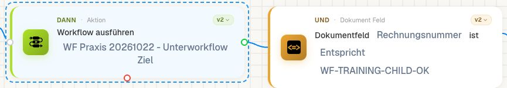
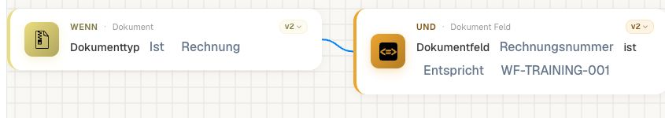
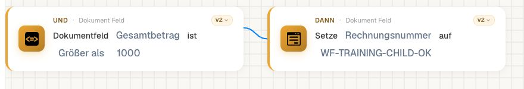
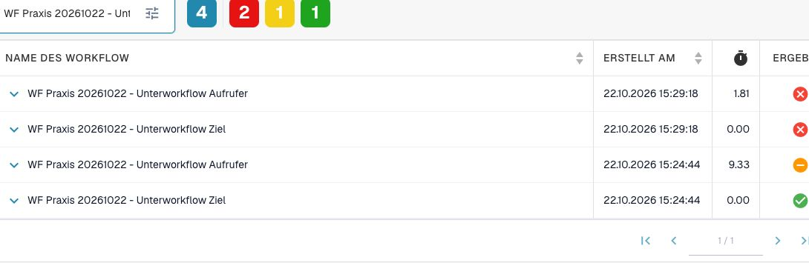
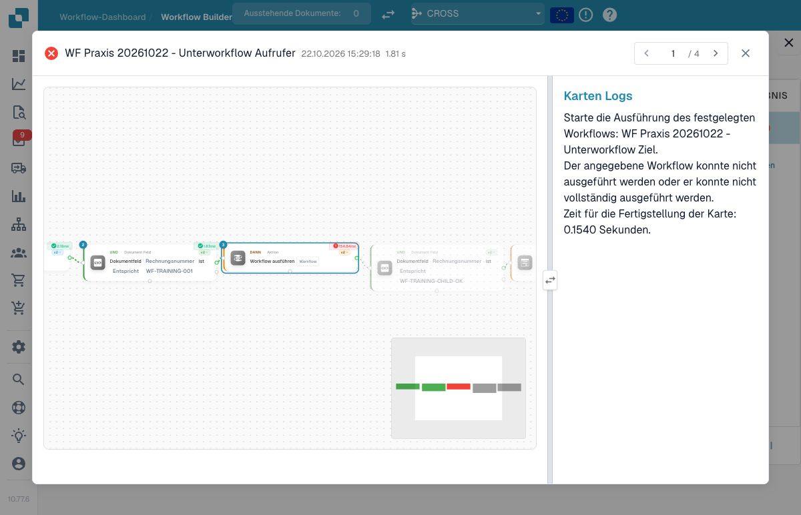
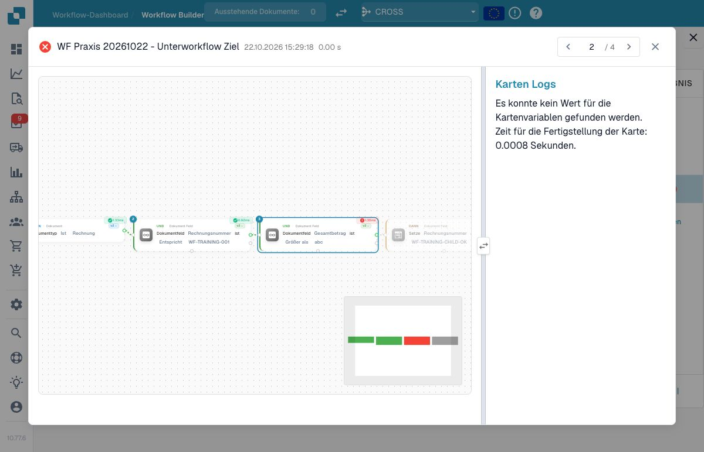

# P0: Run Workflow, Zielbedingungen und Fehler verstehen

**Run Workflow** ruft einen Workflow über seine ID auf und wartet auf dessen Ausführung. Ein Name genügt nicht. Der Designer verwaltet die versteckte ID des aufrufenden Workflows; ändern Sie sie nicht als Geschäftsparameter. Das aktuelle Dokument wird an das Ziel übergeben. Dessen Einstieg und Bedingungen werden erneut ausgewertet.

Der geprüfte ausdrückliche Aufruf erreicht auch einen **inaktiven** Zielworkflow. Inaktiv bedeutet deshalb nicht „durch Run Workflow unaufrufbar“. Im Dev-Test wurden ein inaktives eigenes Ziel, ein Selbstaufruf und eine unbekannte Ziel-ID geprüft. Selbstaufruf und unbekannte ID nahmen den Fehlerweg. Die eingebaute Rekursions- und Kettenbegrenzung ersetzt keine fachliche Begrenzung mehrfacher Aufrufe.

Organisationsvariablen und Dokumentfelder sind von laufbezogenen Rückgaben zu unterscheiden. Der Aufruf überträgt nicht automatisch sämtliche Entscheidungstabellen- oder HTTP-Rückgaben des Elternlaufs. Auch ein im Ziel gespeicherter Dokumentfeldwert war im unten geprüften Fall nicht sofort im Dokumentkontext der nächsten Aufruferkarte sichtbar. Vereinbaren und prüfen Sie den tatsächlich unterstützten Datenübergang ausdrücklich.

Ein grüner Aufruf bestätigt nicht jede fachliche Bedingung des Ziels: Bei Advanced wird ein Zielergebnis ohne technischen Fehler als erfolgreicher Aufruf behandelt; auch `failed_condition` kann darunter fallen. Öffnen Sie den Zielnachweis und prüfen Sie dessen gewählten Weg und Wirkung. Behandeln Sie Fehler im aufrufenden Graphen ausdrücklich; vermeiden Sie A→B→A und wiederholte Aufrufe desselben Ziels.

## Aufrufer und Ziel getrennt abnehmen

Öffnen Sie zuerst den gewünschten eigenen Zielworkflow und notieren Sie dessen gespeicherten Stand sowie seine Einstiegsbedingungen. Wählen Sie genau diesen Workflow in der aufrufenden Karte. Die versteckte Aufruferkennung wird von der Oberfläche verwaltet; ersetzen Sie sie nicht durch eine erfundene ID.

Führen Sie einen passenden und einen nicht passenden Eingabefall aus. Prüfen Sie anschließend die Zielseite: Welche Bedingung hat sie gelesen, welcher Ausgang wurde genommen und welche Folgeaktion wurde erreicht? Bewahren Sie Aufrufer- und Zielergebnis mit demselben Dokumentbezug auf. Ein erfolgreicher Kartenaufruf allein belegt keine fachliche Wirkung des Ziels.

Prüfen Sie die beiden Konfigurationsfehler zusätzlich im Test: Selbstaufruf und nicht verfügbares Ziel. Im dokumentierten synthetischen Prüfsatz wurden dafür `error_card_setup` beziehungsweise `missing_variable` beobachtet. Verwenden Sie diese Meldungen als Hinweis, nicht als allgemeingültigen Text jeder Version.

Ändern Sie ein gemeinsam verwendetes Ziel, testen Sie auch seine Aufrufer erneut. Sichern Sie die Zielkonfiguration und ihre abhängigen Felder oder Variablen gemeinsam mit der Änderung. Ein separates Ziel kann bewusst inaktiv bleiben und trotzdem durch einen ausdrücklichen unterstützten Aufruf erreicht werden; prüfen Sie diesen Weg in der eingesetzten Version.

## Native Zielauswahl und eigene Einstiegsbedingungen

<figure><figcaption>Die tatsächliche Run-Workflow-Karte v2 wählt den eigenen Zielworkflow; die nächste Karte dient ausdrücklich dem Test der unmittelbaren Feldweitergabe.</figcaption></figure>

Im Prüfaufbau wurde **WF Praxis 20261022 – Unterworkflow Ziel** in der nativen Auswahl gewählt und der Aufrufer gespeichert. Anschließend enthielt die geladene Karte die ID dieses eigenen Ziels und als versteckte Aufruferkennung die ID des tatsächlichen Aufrufers. Beide Workflows blieben inaktiv.

<figure><figcaption>Das eigene Ziel beginnt mit Rechnung und begrenzt den Aufruf zusätzlich auf die eigene Trainingsrechnungsnummer.</figcaption></figure>

<figure><figcaption>Das Ziel prüft den Gesamtbetrag gegen 1000 und setzt bei einem Treffer das ausschließlich für diesen Nachweis verwendete Kennzeichen.</figcaption></figure>

Das Ziel prüft **Rechnung**, `invoice_id=WF-TRAINING-001` und `total_amount > 1000`. Danach setzt es im eigenen synthetischen Beleg die Rechnungsnummer auf `WF-TRAINING-CHILD-OK`. Dieser ungewöhnliche Feldwechsel dient nur dazu, den Datenübergang eindeutig zu beobachten; er ist kein fachlicher Rechnungsprozess.

## Tatsächlicher Dokumentlauf: gespeicherter Zielwert und alter Aufruferkontext

Mit dem Betrag 1785 bestand das Ziel alle vier Schritte und speicherte das Kennzeichen. Die Aufrufkarte war erfolgreich. **Die unmittelbar nachfolgende Karte im Aufrufer las jedoch weiterhin `wf-training-001`**, während eine frische Dokumentabfrage bereits `WF-TRAINING-CHILD-OK` zurückgab. Ihr Vergleich mit dem neuen Kennzeichen ergab deshalb `failed_condition`.

Die nach diesem Vergleich angeordnete Rückstellung wurde nicht erreicht. Anschließend wurde die eigene Rechnungsnummer über den normalen Dokument-Update-Weg zurückgestellt; alle übrigen Geschäftsfelder, Tabellen, Status und Zuständigkeit blieben gleich. Der ursprüngliche Versuch wurde nicht erneut ausgeführt.

Für die geprüfte Fassung belegt der erfolgreiche synchrone Aufruf damit **keine sofortige Aktualisierung des Dokumentkontexts im Aufrufer**. Legen Sie fachlich zusammenhängende Aktionen in den tatsächlich geprüften Kontext des Ziels oder lesen Sie gespeicherte Werte in einem frischen Dokumentkontext. Planen Sie eine notwendige Rückstellung nicht ausschließlich hinter einem noch ungeprüften Vergleich des neuen Werts.

## Passenden Ziellauf und Fehlerursache verfolgen

<figure><figcaption>Die gefilterten echten Laufprotokolle zeigen Aufrufer und Ziel sowohl für den Kontextvergleich als auch für den absichtlichen Zielfehler.</figcaption></figure>

Für jeden tatsächlichen Aufruf wurde die `wf_run_id` aus seinem Kartenlog mit der primären `id` des veröffentlichten Zielprotokolls abgeglichen. Die gemeinsame Uhrzeit und ähnliche Namen allein wären dafür kein ausreichender Nachweis. Die angezeigten `0.00 s` in den Zielzeilen belegen keine fehlende Ausführung; die einzelnen Zielkarten und ihre Ergebnisse wurden gesondert geprüft.

| Tatsächliche Zielvariante bei Betrag 1785 | Zielwirkung | Aufrufkarte | Direkte Folgekarte im Aufrufer |
| --- | --- | --- | --- |
| Vergleich `> 1000` | Alle vier Zielkarten erfolgreich; Kennzeichen gespeichert | `success` | Liest den alten Wert; `failed_condition` |
| Vergleich `> 2000` | Bedingung falsch; Kennzeichenaktion nicht ausgeführt | `success` | Kennzeichenvergleich falsch |
| Ungültiger Vergleichsparameter `abc` | Fehler der Zielkarte; Kennzeichenaktion nicht ausgeführt | `error` | Nicht ausgeführt |

<figure><figcaption>Der echte Aufruferlauf zeigt den weitergereichten Zielfehler an Run Workflow; seine Folgeaktionen bleiben unausgeführt.</figcaption></figure>

<figure><figcaption>Im zugehörigen Ziel liegt der Fehler am Vergleichsparameter abc; die native Meldung nennt den fehlenden Wert für die Kartenvariablen.</figcaption></figure>

Nach den Proben wurde die reguläre Zielgrenze wieder auf 1000 gestellt. Beide Workflows blieben inaktiv, die eigene Trainingsnummer und der Betrag 1785 waren wiederhergestellt. Tatsächliche Fallresultate und Zuordnungsmethode herunterladen.


Tatsächliche Fallresultate und Zuordnungsmethode


## Karten und Beispielparameter

Die Werte zeigen einzelne Kartenparameter, keinen importierbaren Gesamtworkflow. YOUR_* muss durch eine eigene Testauswahl ersetzt werden. Die versteckte Aufrufer-ID verwaltet der Designer. Katalogstand: Dev, DocFlow 2.10.38, 21. Oktober 2026; verfügbare Versionen und Freigaben in Ihrer Organisation separat prüfen.

### `run_workflow` · v2

Identität: `bb773bc7-b258-49b9-b0e9-b1c28ac227cb`

| Parameter | Typ / Auswahl | Beispiel |
| --- | --- | --- |
| `hidden_workflow_id` | `hidden_workflow_id` | `"MANAGED_BY_DESIGNER"` |
| `workflow` | `workflow:str` | `"YOUR_TARGET_WORKFLOW_ID"` |

## Fachliche Prüffälle

| Fall | Eingabe / Aufbau | Erwartung |
| --- | --- | --- |
| CHILD-01 | enabled=false; workflow=VALID_ID | call=success |
| CHILD-02 | caller_id=target_id | error |
| CHILD-03 | workflow=UNKNOWN_ID | error |
| CHILD-04 | Advanced target=failed_condition | Aufruf kann erfolgreich sein; Ziel prüfen |

## Prüfstand und Aussagegrenzen

Die ursprünglichen Selbstaufruf- und unbekannte-ID-Fälle stammen aus synthetischen Advanced Tests im Übungspaket. Die drei zusätzlich beschriebenen Aufrufer-/Zielvarianten wurden am 22. Oktober 2026 tatsächlich auf dem eigenen Dev-Trainingsbeleg ausgeführt; die deutschen Screenshots stammen aus Oberfläche 10.77.6. Die Kontextgrenze wurde beobachtet und dokumentiert, nicht durch diese Anleitung im Produkt behoben. Eine externe Zustellung war nicht Teil dieser Läufe.

[Weiter im Lernweg](../workflow-learning-path.md) · [Übungspaket](../workflow-training-kit.md)
