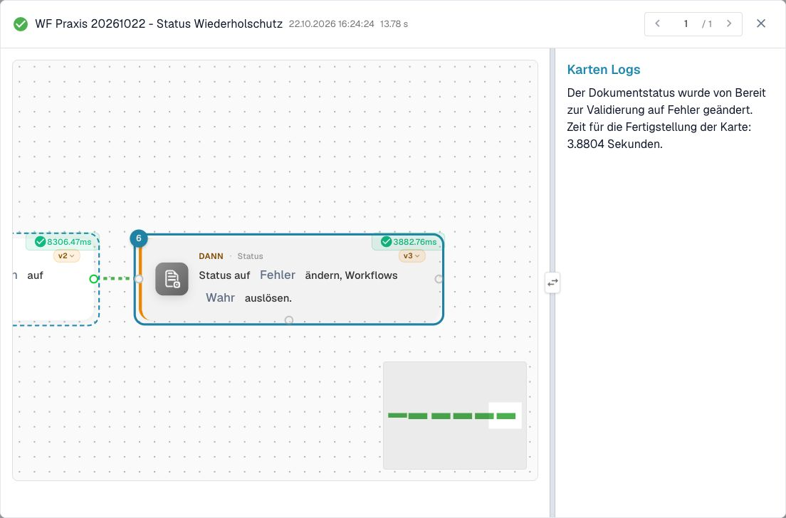
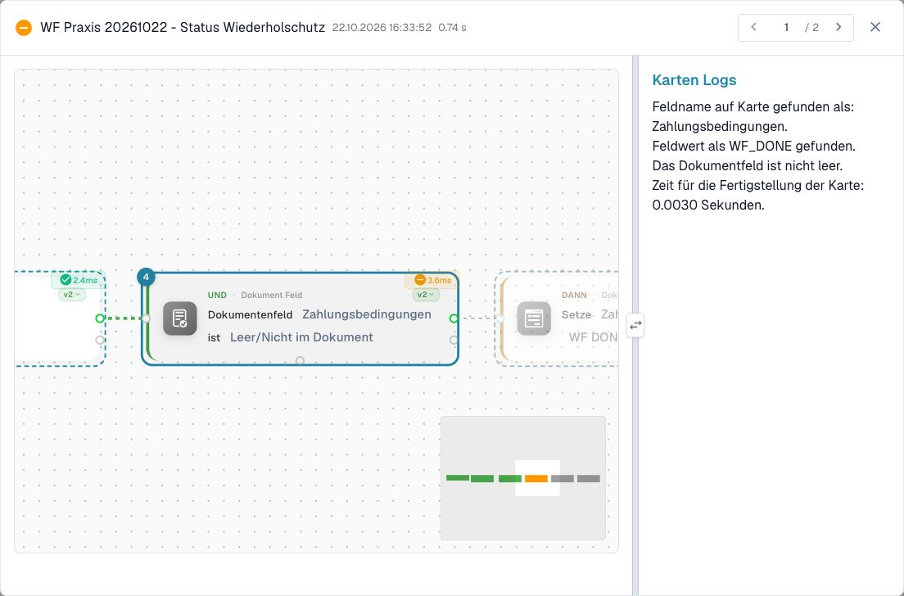
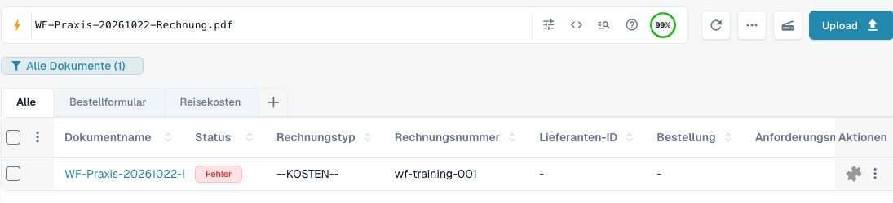
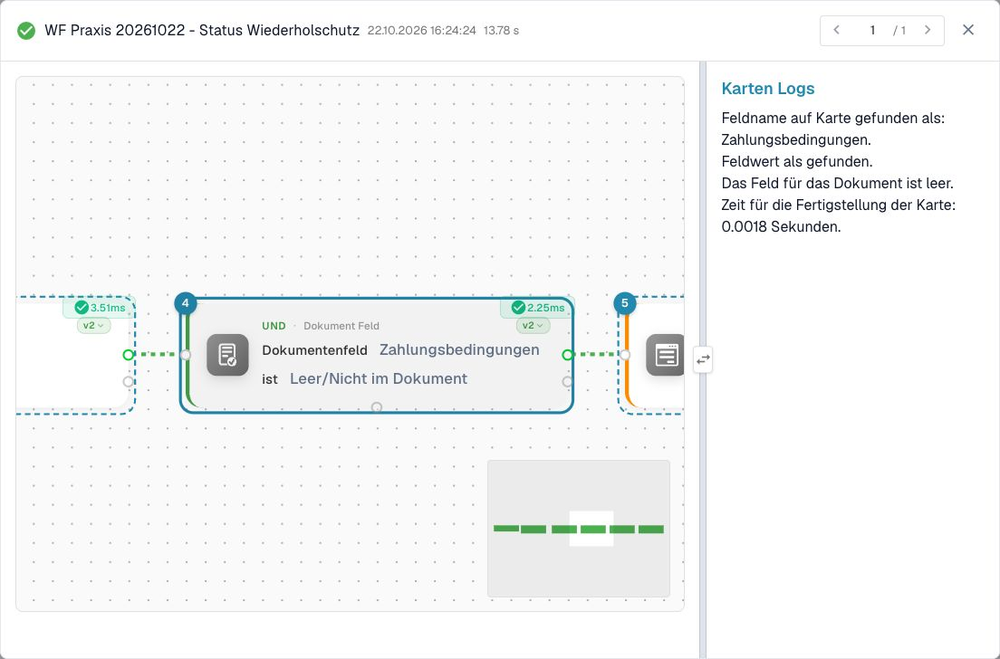
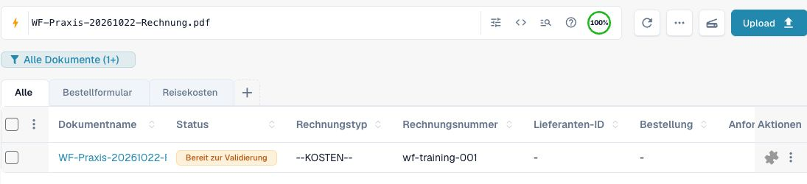
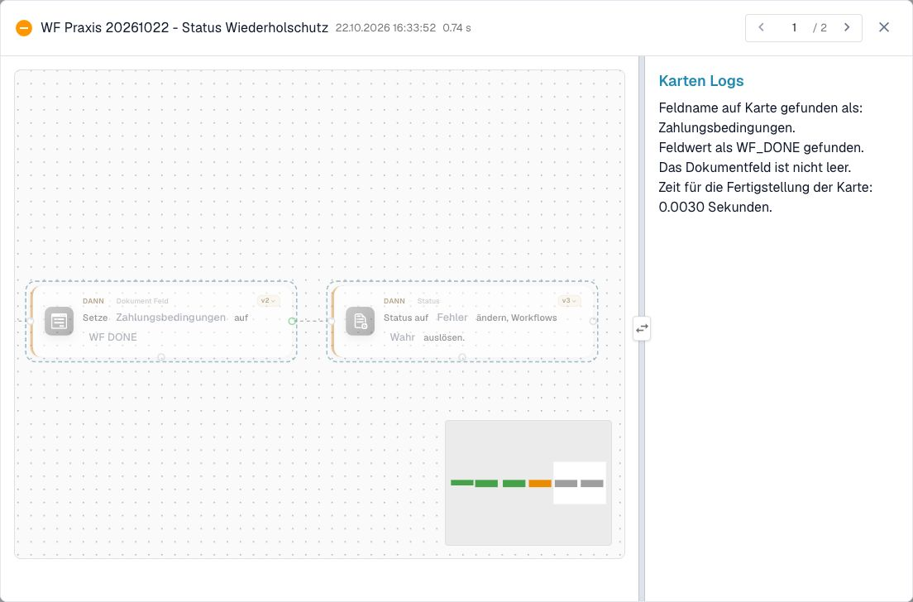
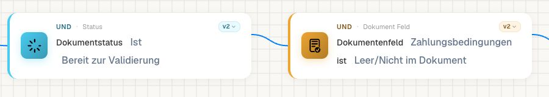
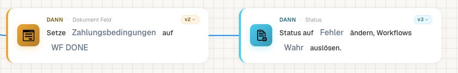

# P0: Status wechseln und erneute Ausführung begrenzen



[Video mit deutschen Untertiteln und Sprechertext öffnen](https://docbits-videos.fra1.cdn.digitaloceanspaces.com/settings-assistant/workflow-masterclass-02-admin/v1/de.html).

Mit **Change Status to** ändern Sie den Dokumentstatus. In Version 3 steuert `trigger_docflow`, ob eine weitere Workflow-Verarbeitung angefordert wird. Wählen Sie den Wert ausdrücklich. Bei fehlendem Parameter verwendet der Code `true`; die Ausführung der älteren Versionen 1/2 liest diesen Schalter nicht auf dieselbe Weise. Prüfen Sie die gespeicherte Kartenversion.

Beginnen Sie mit `validated_pending_approval` und `trigger_docflow=false`. Der Schlüssel ist eine technische Auswahl; ein frei erfundenes `pending_approval` ist kein Ersatz. Ein Advanced-Test simuliert den Statuswechsel. Er belegt weder die gespeicherte Änderung noch die Verarbeitung einer angeforderten Folgeausführung.

Ein begrenzter Geschäftsablauf prüft den Ausgangsstatus und ein fachliches Bearbeitungsmerkmal, führt die Aktion aus und wechselt in den Folgezustand. Bei erneutem Ereignis darf die ursprüngliche Bedingung nicht mehr gelten. Zwei gleichzeitig gestartete Läufe können ein solches Merkmal jedoch beide vorher lesen: Für Exporte und Aufgaben muss der Zielprozess doppelte Verarbeitung zusätzlich erkennen.

Für die Abnahme vergleichen Sie ersten und zweiten echten Lauf: Dokumentstatus, angeforderte Folgeausführung und Anzahl erzeugter Aufgaben oder Zielbelege. Wechseln Sie nicht allein zum Ausprobieren zwischen zwei Statuswerten hin und her. Eine unerfüllte Freigabebedingung wird durch einen Statuswechsel nicht zur erteilten Freigabe.

## Den ersten und zweiten Lauf vergleichen

1. Beginnen Sie mit einem eigenen Trainingsbeleg und notieren Sie seinen Ausgangsstatus. Begrenzen Sie die Regel durch die Trainingsnummer und einen fachlichen Zustand, der nach erfolgreicher Verarbeitung nicht mehr gilt.
2. Öffnen Sie die tatsächlich gespeicherte Statuskarte. Prüfen Sie Version 3, den ausgewählten Folgestatus und den sichtbaren Wert für das erneute Auslösen. Ein Statusname allein zeigt diesen Schalter nicht.
3. Führen Sie zunächst den ausdrücklich gewählten Testweg aus. Ein Advanced-Test bestätigt den simulierten Kartenpfad. Für die reale Änderung kontrollieren Sie anschließend einen passenden Dokumentlauf und den Dokumentstatus.
4. Wiederholen Sie denselben vorgesehenen Anlass. Vergleichen Sie einen neuen Lauf mit dem ersten und zählen Sie die tatsächlichen Aufgaben oder Zielbelege. Ein unveränderter Belegstatus allein schließt eine doppelte Zustellung nicht aus.

Halten Sie die erlaubten Übergänge in einer kleinen Tabelle fest: Ausgangszustand → Bedingung → Aktion → Folgezustand → Verhalten bei Wiederholung. Fügen Sie den Fall hinzu, dass zwei Aufrufe nahezu gleichzeitig eintreffen. Ein einfaches gelesenes Bearbeitungsmerkmal stellt dabei keine atomare Sperre dar.

Für die Einführung in den Betrieb verwenden Sie [Vom Test zur kontrollierten Aktivierung](../workflow-go-live.md). Eine absichtlich angeforderte Folgeausführung ist erst dann abgeschlossen nachgewiesen, wenn ihr neuer Lauf tatsächlich sichtbar ist.

## Zwei echte Dokumentereignisse am selben Trainingsbeleg

Der folgende Dev-Nachweis verwendet eine eigene Rechnung mit **WF-TRAINING-001**, Betrag **1785,00** und zunächst leeren Zahlungsbedingungen. Ausschließlich für diese Übung dient dieses leere Feld als Bearbeitungsmerkmal. Im Betrieb gehört ein solches Merkmal in ein dafür vorgesehenes Feld; vorhandene Zahlungsbedingungen dürfen dafür nicht überschrieben werden.

Der gespeicherte Graph prüft Rechnung → genaue Trainingsnummer → Bereit zur Validierung → Bearbeitungsmerkmal leer. Erst danach setzt er `payment_terms` auf `WF_DONE` und ändert den Status mit Karte v3 auf `error`, `trigger_docflow=true`.

Für den ersten Anlass wurde der eigene Beleg zunächst ohne Workflow-Auslösung in den Ausgangsstatus Fehler gesetzt. Danach wurde ausschließlich diese begrenzte Regel aktiviert und der normale Wechsel auf Bereit zur Validierung mit Workflow-Auslösung angefordert. Die Verarbeitung lief asynchron. Die unmittelbare Antwort zeigte noch einen ausstehenden Auftrag; erst der später gespeicherte Lauf und der neu gelesene Beleg belegten den Abschluss. Der Anlass wurde währenddessen nicht erneut gesendet.

| Nachweis | Erster Lauf, 16:24:24 | Zweiter Lauf, 16:33:52 |
| --- | --- | --- |
| Anfangsstatus für die Regel | Bereit zur Validierung | Bereit zur Validierung |
| Gelesenes Merkmal | leer | `WF_DONE` |
| Leere-Prüfung | erfüllt | `failed_condition` |
| Merkmal setzen | ausgeführt | nicht ausgeführt |
| Statusaktion | ausgeführt: Fehler | nicht ausgeführt |
| Neu gelesener Dokumentstatus | Fehler | Bereit zur Validierung |

Die Zeiten stammen aus der deutschen Oberfläche vom 22. Oktober 2026. Vor dem zweiten Anlass wurde dieselbe eigene Regel erneut aktiviert und derselbe normale Übergang auf Bereit zur Validierung ausgelöst. Alle drei vorgeschalteten Bedingungen waren wieder erfüllt. Erst das bereits gesetzte Merkmal stoppte den zweiten Lauf. Die übrigen Belegfelder, Tabellen und Zuständigkeit blieben bei beiden Läufen unverändert; Aufgaben und Exporte erzeugte diese Übung nicht.

<figure><figcaption>
Sechs erreichte Karten im ersten echten Ereignislauf. Der Protokolltext bestätigt die ausgeführte Statusänderung; der ausgewählte Fehlerstatus ist Teil der Übung.
</figcaption></figure>

<figure><figcaption>
Der neue Lauf liest WF_DONE. Dadurch endet der Aktionspfad vor der erneuten Markierung und Statusänderung.
</figcaption></figure>

Dokumentzustände und nicht ausgeführte Aktionen vergleichen

<figure><figcaption>
Neu gelesener erster Dokumentzustand.
</figcaption></figure>

<figure><figcaption>
Der gespeicherte erste Kartenlog bestätigt den leeren Ausgangswert.
</figcaption></figure>

<figure><figcaption>
Neu gelesener zweiter Dokumentzustand; die Statusaktion wurde nicht wiederholt.
</figcaption></figure>

<figure><figcaption>
Beide Aktionskarten sind im gespeicherten zweiten Lauf nicht ausgeführt. Das Protokoll rechts gehört zur verfehlten Leerprüfung.
</figcaption></figure>

Nach jedem Anlass wurde die eigene Regel wieder ausgeschaltet. Bereits angenommene Aufträge wurden bis zum gespeicherten Ergebnis geprüft. Anschließend wurden die ursprünglich leeren Zahlungsbedingungen wiederhergestellt und die übrigen Geschäftsdaten erneut verglichen. Der Beleg blieb Bereit zur Validierung. Dieser Nachweis bestätigt zwei nacheinander ausgelöste Dokumentereignisse und den Marker-Schutz. Er bestätigt weder eine atomare Sperre bei Gleichzeitigkeit noch eine zweite Ausführung derselben Regel durch den automatisch angeforderten Fehler-Folgelauf: Zu diesem Zeitpunkt war die Trainingsregel bereits inaktiv.

[Ergebnistabelle und Abnahmehinweise herunterladen](../../../.gitbook/assets/wf-practice-20261022-status-evidence-de.zip).

## Karten und Beispielparameter

<figure><figcaption>
Im isolierten Rechnungsbeispiel dienen die zuvor leeren Zahlungsbedingungen vorübergehend als Trainingsmerkmal. Verwenden Sie im Betrieb ein dafür vorgesehenes fachliches Feld.
</figcaption></figure>

<figure><figcaption>
Gespeicherte Karte v3 mit Workflows auslösen = Wahr. Der Fehlerstatus ist in diesem Beispiel absichtlich gewählt und bedeutet keinen Kartenfehler.
</figcaption></figure>

Die Werte zeigen einzelne Kartenparameter, keinen importierbaren Gesamtworkflow. YOUR_* muss durch eine eigene Testauswahl ersetzt werden. Die versteckte Aufrufer-ID verwaltet der Designer. Katalogstand: Dev, DocFlow 2.10.38, 21. Oktober 2026; verfügbare Versionen und Freigaben in Ihrer Organisation separat prüfen.

### `staus_change` · v3

Identität: `4e0d38a2-a0af-4c1c-b0c2-2f380d70d910`

| Parameter | Typ / Auswahl | Beispiel |
| --- | --- | --- |
| `trigger_docflow` | `trigger_docflow:bool` | `false` |
| `status` | `error / rejected / ready_for_validation / validated_pending_approval / approved_pending_second_approval / archived / finished / exported` | `"validated_pending_approval"` |

## Fachliche Prüffälle

| Fall | Eingabe / Aufbau | Erwartung |
| --- | --- | --- |
| STATUS-01 | v3; trigger_docflow=false | validated_pending_approval; trigger=false |
| STATUS-02 | v3; trigger_docflow=true | Folgeausführung angefordert ≠ abgeschlossen |
| STATUS-03 | v3; trigger_docflow: — | default=true |
| STATUS-04 | RUN-1 → RUN-2 | tasks=1; destination_records=1 |

## Prüfstand und Aussagegrenzen

Die isolierten Kartenfälle im Übungspaket wurden in Advanced Test geprüft. Zusätzlich belegen die beiden oben gezeigten gespeicherten Dokumentläufe die tatsächliche Änderung und das Ausbleiben der zweiten Wirkung. Aufgaben, Exportzustellung, gleichzeitige Aufrufe und weitere Statusvarianten sind damit nicht abgenommen.

[Weiter im Lernweg](../workflow-learning-path.md) · [Übungspaket](../workflow-training-kit.md)
