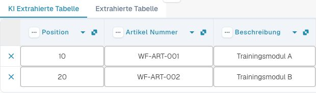
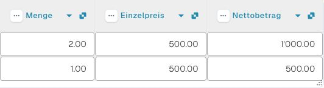
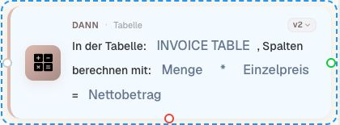
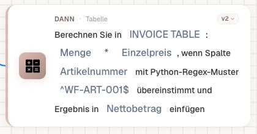
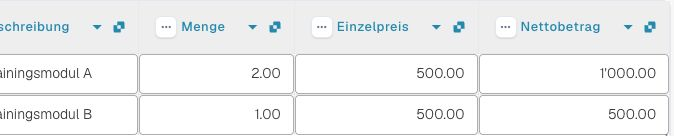
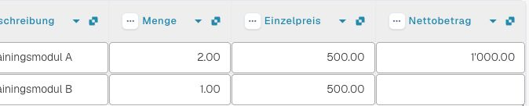
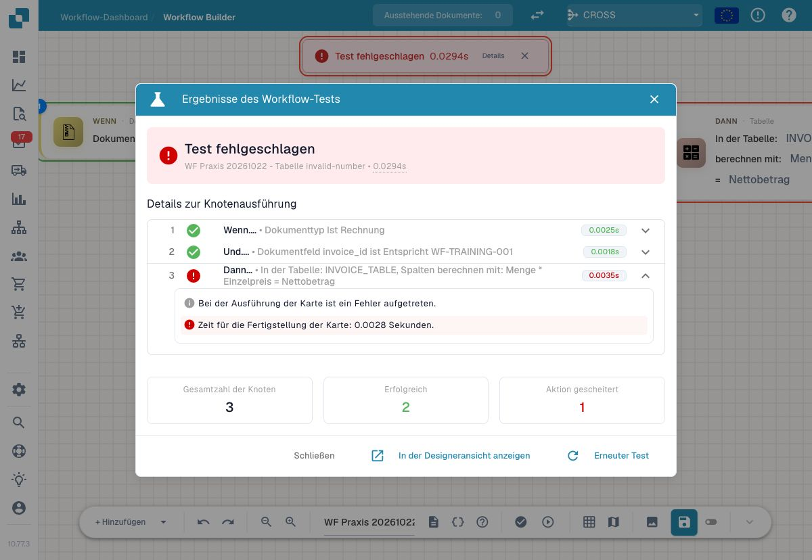

# P1: Tabellen berechnen und Regex-Abhängigkeit prüfen

**Calculate Columns** rechnet mit zwei Spalten derselben Zeile und schreibt die Ergebnisspalte. **Calculate in / CALC_COLUMNS_REGEX** ergänzt eine Regex-Bedingung auf einer dritten Spalte. Die Regex entscheidet, ob gerechnet wird; sie extrahiert oder ersetzt hier keinen Teil des Texts. Die frühere Ersetzungserklärung gehört nicht zu dieser Karte.

Beispiel: `QTY=2`, `PRICE=10`, Operation `*`, Ergebnis `TOTAL=20.0`. Bei der Regex-Variante verwenden Sie `TYPE`, Muster `^A$`. Eine A-Zeile wird berechnet. Für eine nicht passende B-Zeile schreibt der geprüfte Code einen leeren Ergebniswert; ein vorhandener TOTAL-Wert bleibt dabei nicht automatisch erhalten.

Die Rechenhilfe rundet numerische Ergebnisse auf vier Dezimalstellen. Leere Einzelwerte können als 0 behandelt werden; zwei leere Texte ergeben leer. Mit `+` können nicht numerische Texte als Text verbunden werden. Im isolierten Test der geprüften Rechenhilfe erzeugt beispielsweise `2 / 0` einen `ZeroDivisionError`. Davon getrennt meldete die Rechenkarte im Dev-Advanced-Test nur „Card Test simulated success“: Dieser Test berechnete keinen nachgewiesenen Zellwert. Ein grüner Knoten belegt deshalb weder einen leeren Ergebniswert noch eine erfolgreiche echte Division durch null. Prüfen Sie Zahlen und erforderliche Zellen deshalb vor der Berechnung; definieren Sie einen Fehlerweg.

Halten Sie eine vollständige Vorher-nachher-Tabelle fest: zwei passende Zeilen, eine unpassende Regex-Zeile, leere Eingabe, ungültiger Text und Division durch null. Bei A→B-abhängigen Berechnungen verbinden Sie die Karten ausdrücklich und prüfen Sie, welchen aktualisierten Wert die zweite Karte liest. Vergleichen Sie jede Zeile und vorhandene Fremdspalten, nicht nur den Dokumentstatus.

## Vorher, Formel und Nachher gemeinsam prüfen

Verwenden Sie eine kleine eigene Tabelle mit vollständig sichtbaren Mengen- und Preiswerten. Bewahren Sie die Eingangswerte unverändert auf. Wählen Sie dann die tatsächlich unterstützten Quell- und Zielspalten sowie den Operator der Karte. Eine gleich benannte Dokumentvariable ist keine Tabellenspalte.

Berechnen Sie den erwarteten Wert zunächst unabhängig. Führen Sie danach den passenden Testweg aus und vergleichen Sie die vollständige Ergebnistabelle. Prüfen Sie zusätzlich, welchen Wert die unmittelbar nachfolgende Karte tatsächlich liest. Ein erfolgreicher Rechenschritt allein beweist keine korrekte Weiterverwendung.

Bei einer Regex-abhängigen Auswahl gehören ein Treffer und ein Nichttreffer in dieselbe Abnahme. Kontrollieren Sie, welche Zeile beziehungsweise welcher Wert die Auswahl tatsächlich erreicht. Ergänzen Sie fehlende Eingaben, nicht numerischen Text und Division durch null als eigene Fehlerfälle; ersetzen Sie einen Fehler nicht stillschweigend durch null.

Für die Dokumentation benötigen Sie die Eingangstabelle, die ausgefüllte Formel-/Regex-Konfiguration und das konkrete Resultat. Bei einer tatsächlich gespeicherten Tabellenänderung prüfen Sie zusätzlich den Beleg nach dem Neuladen. Ein Advanced-Test mit Custom Data bleibt ein simulierter Nachweis.

### Echte Eingangstabelle des Trainingsbelegs

Der synthetische Rechnungsbeleg wurde am 22. Oktober 2026 in Dev importiert. Die beiden Ausschnitte zeigen dieselbe unveränderte Eingangstabelle; wegen ihrer Breite wurde sie horizontal verschoben. Es wurde noch keine Rechenkarte ausgeführt.

| Position | Artikel | Menge | Einzelpreis | Nettobetrag | Unabhängig erwartetes Produkt |
| --- | --- | --- | --- | --- | --- |
| 10 | WF-ART-001 | 2 | 500 | 1000 | 1000 |
| 20 | WF-ART-002 | 1 | 500 | 500 | 500 |

<figure><figcaption>
Eingangstabelle: Positionen und Artikel, vor der Berechnung.
</figcaption></figure>

<figure><figcaption>
Dieselben Zeilen nach horizontalem Verschieben: Mengen und Beträge, weiterhin vor der Berechnung.
</figcaption></figure>

### Tatsächlich konfigurierte Karten

Die normale v2-Karte berechnet im Trainingsbeleg `INVOICE_TABLE.QUANTITY * INVOICE_TABLE.UNIT_PRICE` und schreibt `NET_AMOUNT`. Die technische Tabelle `INVOICE_TABLE` erscheint auf der Karte als „INVOICE TABLE“. Die Spalten heißen in der deutschen Anzeige Menge, Einzelpreis und Nettobetrag.

<figure><figcaption>
Normale Berechnung für alle Zeilen derselben Tabelle.
</figcaption></figure>

Die Regex-Variante verwendet zusätzlich `ITEM_NUMBER` als Abhängigkeit und das vollständige Muster `^WF-ART-001$`. Damit passt im gezeigten Beleg nur Position 10. Die Karte ersetzt den Ergebniswert von Position 20 durch leer; sie bewahrt ihn nicht automatisch.

<figure><figcaption>
Die Regex steuert die Zeilenauswahl, keine Textersetzung.
</figcaption></figure>

### Gespeicherte Wirkung und Fehlerfall vergleichen

Die normale Berechnung und die Regex-Variante wurden am 22. Oktober 2026 tatsächlich auf dem eigenen synthetischen Rechnungsbeleg ausgeführt. Beide Workflows blieben inaktiv; ausgewählt wurde ausschließlich dieser Trainingsbeleg. Nach jedem Lauf wurde der gespeicherte Datensatz erneut gelesen. Die übrigen Dokumentfelder, Quellspalten und Tabellenwerte blieben unverändert.

| Position | Eingang | Nach normaler Berechnung | Nach Regex-Variante |
| --- | --- | --- | --- |
| 10, WF-ART-001 | 2 × 500 | 1000 | 1000 |
| 20, WF-ART-002 | 1 × 500 | 500 | leer; Artikelnummer trifft nicht zu |

<figure><figcaption>
Normale Berechnung: Beide bestehenden, fachlich korrekten Werte werden erneut berechnet. Diese Aufnahme behauptet keine Reparatur zuvor falscher Beträge.
</figcaption></figure>

<figure><figcaption>
Regex-Nichttreffer: Der bisherige Ergebniswert der zweiten Zeile wurde geleert. Der Beleg wurde dafür über das Dashboard frisch geöffnet.
</figcaption></figure>

Zeigt eine bereits offene Belegansicht noch alte Werte oder einen Aktualisierungshinweis, verwenden Sie den normalen Rückweg zum Dashboard und öffnen Sie den eigenen Beleg erneut. Vergleichen Sie den aktuellen Datensatz und den Laufzeitpunkt. Ein alter Tabelleninhalt ist kein Nachweis der gerade ausgeführten Karte.

Der technische Fehlerfall wurde dagegen ausschließlich mit vollständigen Custom Data im Advanced-Test ausgeführt: `UNIT_PRICE="abc"`, Operation `*`. Einstieg und Trainingsnummer-Prüfung waren erfolgreich; die Berechnungskarte meldete einen Fehler. Diese fehlerhafte Eingabe wurde nicht in den echten Beleg geschrieben.

<figure><figcaption>
Ungültiger Zahlentext ist ein eigener Fehlerfall. Die Details gehören zur betroffenen Rechenkarte.
</figcaption></figure>

## Karten und Beispielparameter

Die Werte zeigen einzelne Kartenparameter, keinen importierbaren Gesamtworkflow. YOUR_* muss durch eine eigene Testauswahl ersetzt werden. Die versteckte Aufrufer-ID verwaltet der Designer. Katalogstand: Dev, DocFlow 2.10.38, 21. Oktober 2026; verfügbare Versionen und Freigaben in Ihrer Organisation separat prüfen.

### `calc_columns` · v2

Identität: `92d7a634-736a-4e1f-80b3-2b521efcd81c`

| Parameter | Typ / Auswahl | Beispiel |
| --- | --- | --- |
| `result_column_name` | `result_column_name:str` | `"TOTAL"` |
| `table_column_name_left` | `table_column_name_left:str` | `"QTY"` |
| `math_operator` | `+ / - / / / *` | `"*"` |
| `table_column_name_right` | `table_column_name_right:str` | `"PRICE"` |
| `table_name` | `table_name:str` | `"LINE_ITEMS"` |

### `calc_columns_regex` · v2

Identität: `dbf035c8-927b-444a-9e5a-18555f5deacf`

| Parameter | Typ / Auswahl | Beispiel |
| --- | --- | --- |
| `table_name` | `table_name:str` | `"LINE_ITEMS"` |
| `result_column_name` | `result_column_name:str` | `"TOTAL"` |
| `regex_pattern` | `regex_pattern:str` | `"^A$"` |
| `column_name_dependency` | `column_name_dependency:str` | `"TYPE"` |
| `table_column_name_right` | `table_column_name_right:str` | `"PRICE"` |
| `math_operator` | `+ / - / / / *` | `"*"` |
| `table_column_name_left` | `table_column_name_left:str` | `"QTY"` |

## Fachliche Prüffälle

| Fall | Eingabe / Aufbau | Erwartung |
| --- | --- | --- |
| CALC-01 | QTY=2; PRICE=10; TYPE=A; ^A$ | TOTAL=20.0 |
| CALC-02 | QTY=2; PRICE=10; TYPE=B; ^A$; TOTAL=99 | TOTAL="" |
| CALC-03 | 10 / 3 | 3.3333 |
| CALC-04 | 10 / 0 | leerer Ergebniswert; aktueller Advanced-Test weiterhin success |
| CALC-05 | "" + 2 | 2.0 |
| CALC-06 | x + y | "x y" |

## Prüfstand und Aussagegrenzen

Parameter und Verhalten wurden gegen den Dev-Katalog und den geprüften Quellstand abgeglichen. Normale Berechnung und Regex-Auswahl sind zusätzlich durch tatsächliche gespeicherte Änderungen am eigenen synthetischen Trainingsbeleg belegt. Der ungültige Zahlentext wurde im Advanced-Test simuliert. Die weiteren fachlichen Prüffälle bleiben eine Abnahmeanleitung; persönliche Freigaben und externe Zustellungen wurden hier nicht durchgeführt.

[Weiter im Lernweg](../workflow-learning-path.md) · [Übungspaket](../workflow-training-kit.md)
