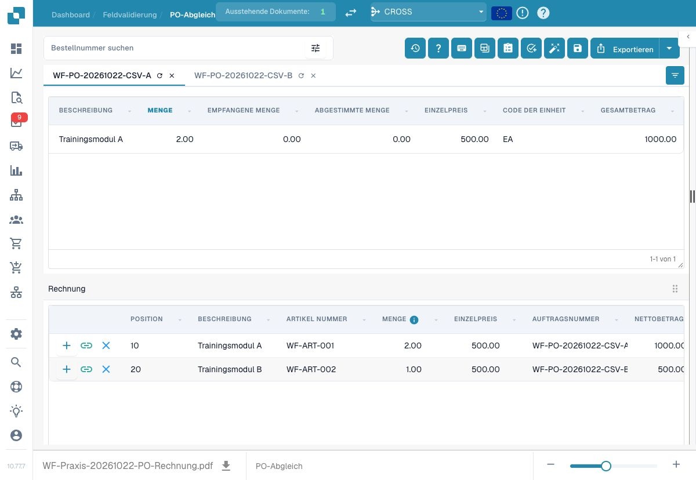
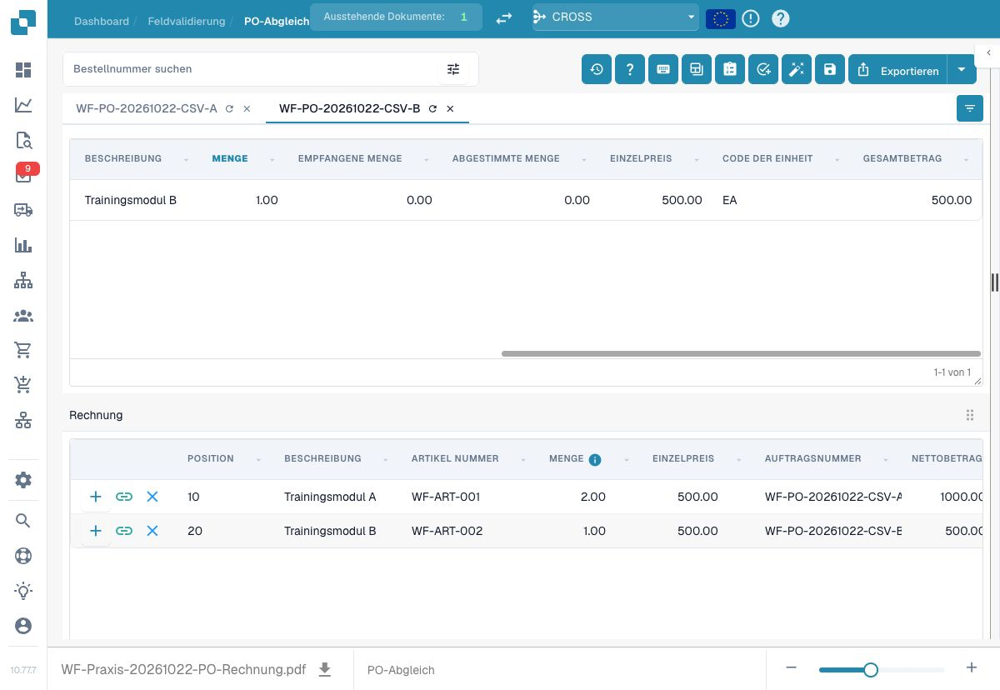
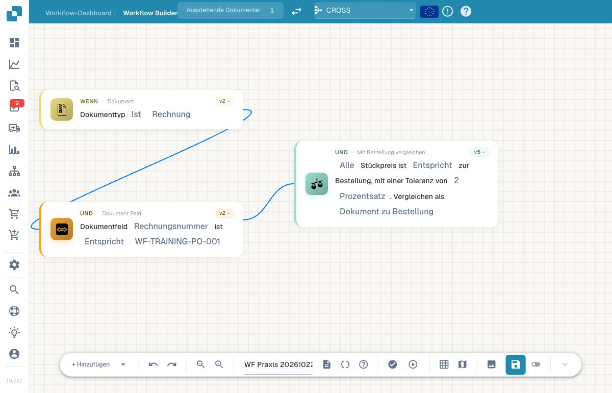
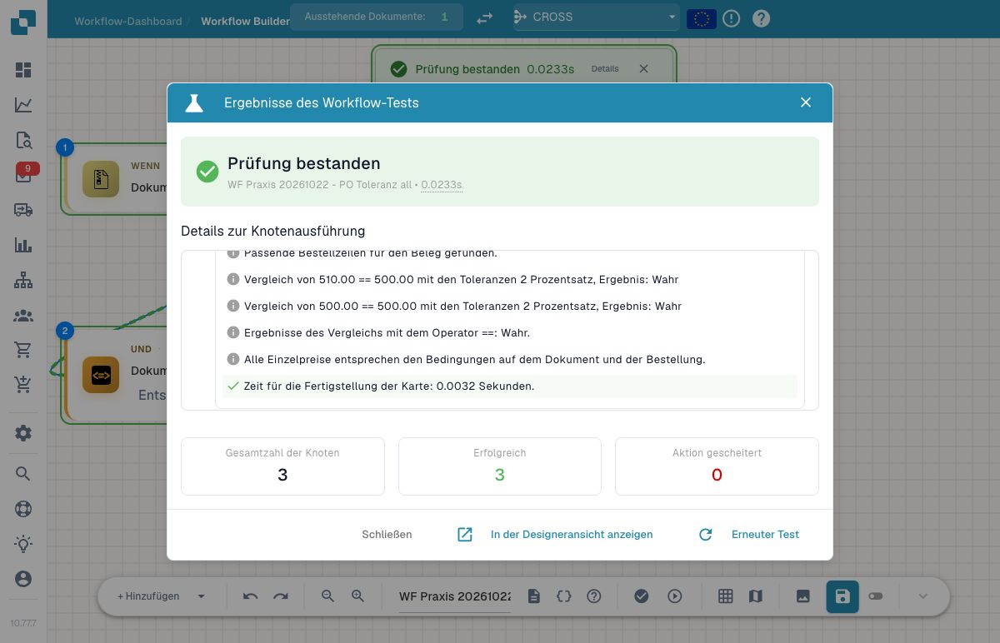
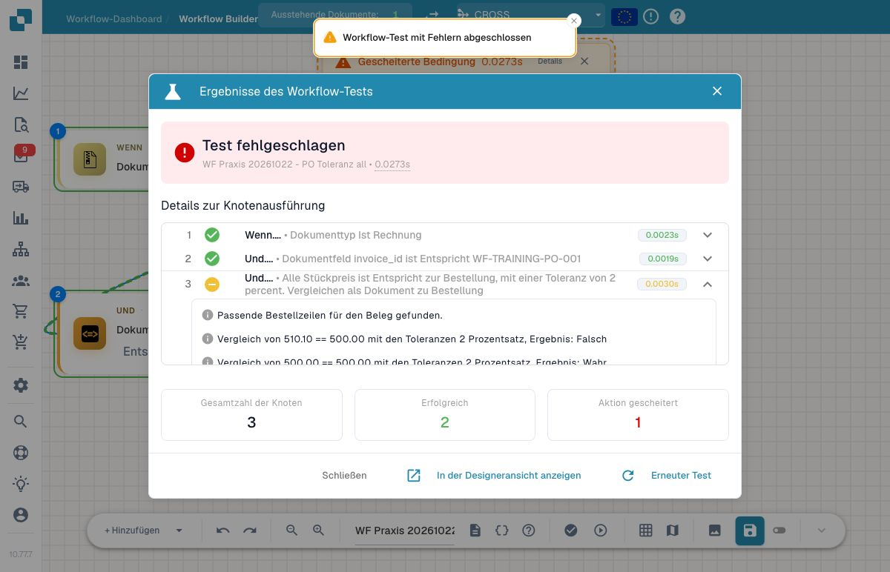
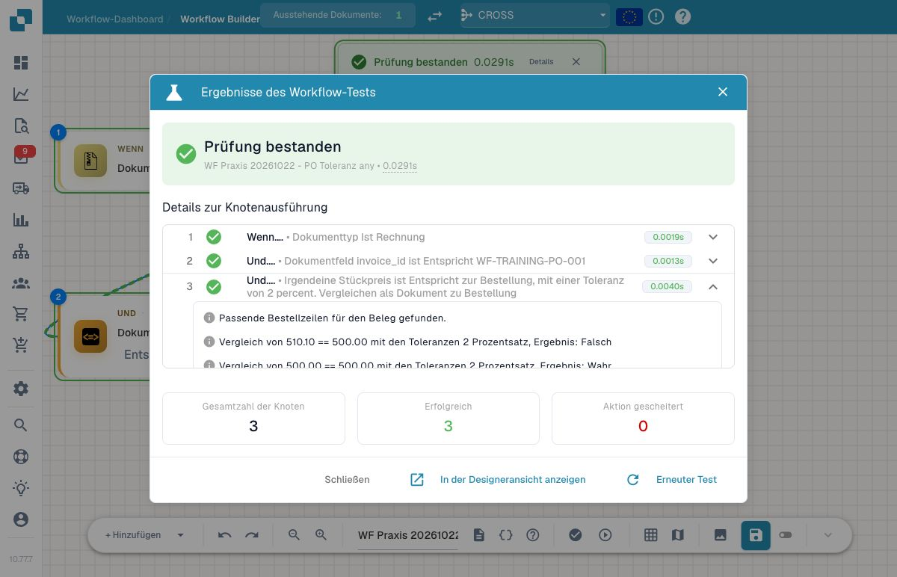
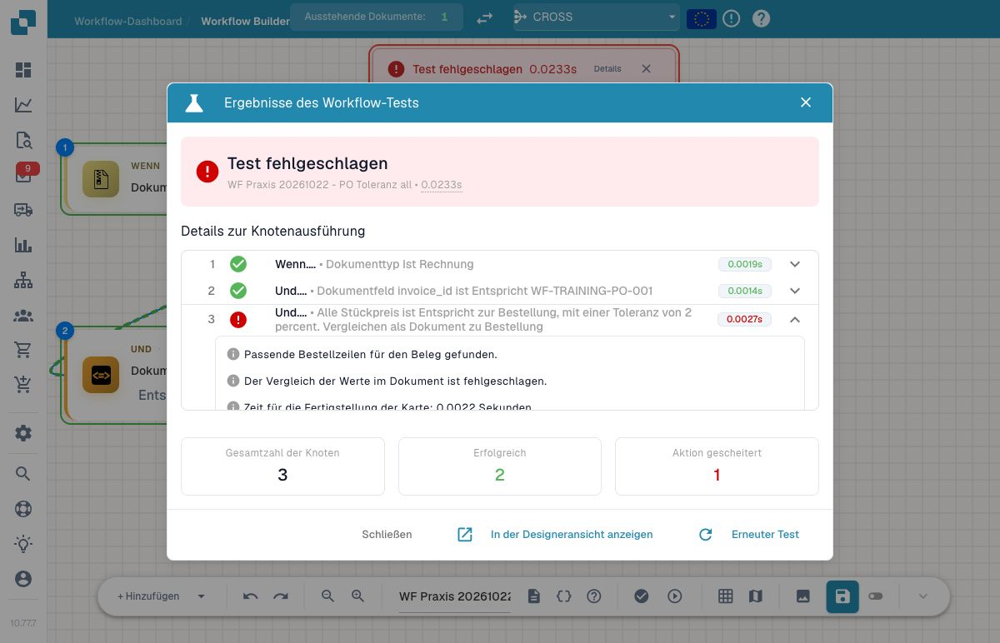

# P1: Toleranzen und PO-Vergleich mit eindeutiger Referenz



[Vertiefungsvideo mit deutschen Untertiteln und Sprechertext öffnen](https://docbits-videos.fra1.cdn.digitaloceanspaces.com/settings-assistant/workflow-masterclass-05-admin/v1/de.html).

Bei einer Prozenttoleranz zählt die **Referenzseite**. In der geprüften PO-Karte, Version 5, liest sich `document_po` als Dokumentwert gegen Bestellwert; der Bestellwert ist die Prozentbasis. `po_document` kehrt Vergleich und Basis um. Die sechs zulässigen Richtungen schließen auch den empfangenen Wert ein. Wählen Sie Richtung, Operator und Any/All ausdrücklich.

Beispiel: Bestellung 100, Dokument 102.02, Gleichheit mit 2 Prozent. Mit Bestellreferenz liegt das zulässige Band bei 98 bis 102: außerhalb. Mit Dokumentreferenz liegt es bei 99.9796 bis 104.0604: der Bestellwert 100 liegt darin. Bei Dokument 102 ist die obere Grenze der ersten Richtung eingeschlossen. Eine absolute Toleranz 2 verwendet dieselbe Einheit wie der verglichene Wert.

Die Karte normalisiert Preise je Preiseinheit und berücksichtigt je Vergleichsrichtung Bestell- beziehungsweise Empfangsdaten. Prüfen Sie Zuordnung, Mengen und Einheiten vor der Toleranz. Any benötigt einen passenden Vergleich, All alle tatsächlich verglichenen Ergebnisse. **Keine vergleichbare Position** ist in v5 ein Datenfehler und kein automatisch erfülltes All. Nicht zugeordnete Zeilen müssen separat erfasst werden.

Bei bestehenden Workflows lesen Sie die gespeicherte Version, Vergleichsrichtung und den Operator erneut: Migrationen haben Vergleichseinstellungen verändert. Die früheren Bezeichnungen reichen als Abnahme nicht. Halten Sie Ausgangswerte und Referenz, Entscheidung bei exakter Grenze, kleinste Überschreitung, Rundungspräzision, fehlende Bestellung und unzugeordnete Position fest. Die Beispielrechnung ersetzt keine PO-Abnahme mit Ihren Stammdaten.

## Von der Konfiguration zur nachvollziehbaren Rechnung

Beginnen Sie mit genau einem tatsächlich verbundenen Rechnungs-/Bestellzeilenpaar. Vergleichen Sie Bestellreferenz, Positionszuordnung, Menge, Einzelpreis und Währung. Eine eingetragene Bestellnummer allein verbindet die Positionen noch nicht.

Notieren Sie vor der Toleranzprüfung, welche Seite die Referenz bildet. Bei einer Referenz von 100 und einer Abweichung von 5 ergibt eine Prozenttoleranz eine andere Aussage als beim umgekehrten Bezug auf 105. Prüfen Sie die im gewählten Operator enthaltene Vergleichsrichtung; ein Prozentwert ohne Referenzseite ist unvollständig beschrieben.

Testen Sie den Wert innerhalb der Toleranz, exakt an der Grenze und außerhalb. Wiederholen Sie den Vergleich mit zwei zugeordneten Positionen: eine passende und eine abweichende. Lesen Sie danach Any und All am tatsächlich ausgewählten Kartenmodus ab. Prüfen Sie außerdem den Fall ohne vergleichbare Zeile; werten Sie ihn nicht als erfolgreiche fachliche Freigabe.

Für den Nachweis gehören drei Ansichten zusammen: die verbundenen Positionen, die vollständig ausgefüllte Karte mit Version/Richtung/Einheit und das konkrete Ergebnis. Trennen Sie einen berechneten Erwartungswert von einem tatsächlich ausgeführten Test. Der [Rechnungsfall](../invoice-approval-export-tutorial.md) zeigt den Bestellabgleich im Gesamtablauf.

## Tatsächlich zugeordnete Trainingspositionen

Die Rechnung `WF-TRAINING-PO-001` enthält zwei Positionen desselben fiktiven Lieferanten. Position 10 gehört zur Bestellung `WF-PO-20261022-CSV-A`: 2 EA zu je 500,00 EUR, netto 1.000,00 EUR. Position 20 gehört zur Bestellung `WF-PO-20261022-CSV-B`: 1 EA zu 500,00 EUR, netto 500,00 EUR. Beide Bestellungen besitzen jeweils genau diese eine Position.

<figure><figcaption>
Bestellung A ist ausgewählt. Die Link-Symbole an beiden Rechnungspositionen zeigen deren Zuordnungen; die obere Tabelle zeigt die Stammdaten der ausgewählten Bestellung.
</figcaption></figure>

<figure><figcaption>
Nach Auswahl von Bestellung B sind deren Menge, Preiseinheit und Betrag sichtbar. Englische Stammdatenwerte wie EA bleiben unverändert.
</figcaption></figure>

Nach der normalen Prüfung und Speicherung öffnete der PO-Abgleich mit zwei erfolgreich gespeicherten Zeilenverbindungen. Der Dokumentdatensatz meldete `full_matched`, die Ansicht 1.500,00 EUR abgestimmte Summe und 0,00 EUR offenen Betrag. Die Stammdatenspalte „Abgestimmte Menge“ der oberen Tabelle ist davon getrennt zu lesen; ihr angezeigter Wert 0 ist kein Zähler dieser beiden Dokumentverbindungen.

Für diesen reinen Trainingsnachweis blieb der automatische Export ausgeschaltet. Der geplante Liefertermin wurde aus der Bestellung übernommen; der Zahlungshinweis bezeichnet ausdrücklich einen Trainingsbeleg ohne Zahlung. Eine persönliche Freigabe oder tatsächliche Lieferung ist damit nicht belegt.

Die Positionsprüfung im PO-Abgleich zeigte eine Mengentoleranz von 0,5 als Wert und eine Preistoleranz von 1 Prozent. Die unten behandelte Workflow-Karte verwendet ausdrücklich 2 Prozent. Diese Einstellungen gehören zu unterschiedlichen Prüfungen; aus einer erfolgreichen Zeilenzuordnung folgt noch kein Ergebnis der Workflow-Karte.

## Ausgeführter Vergleich in Version 5

Der eigene inaktive Trainingsworkflow begrenzt sich auf `INVOICE` und genau `WF-TRAINING-PO-001`. Seine einzige Fachprüfung lautet All, Gleichheit, 2 Prozent, Dokument zu Bestellung. Ein ausgewählter echter Lauf am zugeordneten Beleg führte alle drei Knoten erfolgreich aus. Geschäftsfelder, Tabellen, Zuständigkeit, Status und PO-Verbindungen blieben vor und nach dem Lauf gleich.

<figure><figcaption>
Die gespeicherte Version und alle fünf Vergleichsparameter sind sichtbar. Der Graph enthält keine Export- oder Freigabeaktion.
</figcaption></figure>

Danach wurden vollständige Belegdaten mit Layout und vorhandenen Zeilenverbindungen als **benutzerdefinierte Daten im Advanced Test** verwendet. Nur diese Testkopien enthalten die abweichenden Preise beziehungsweise erneuerten Zeilen-IDs. Sie wurden nicht auf die echte Rechnung zurückgeschrieben. Die zweite Position bleibt in allen Preisfällen bei 500,00 EUR.

| Ausgeführter Fall | Erster Dokumentpreis / Bestellpreis | Modus und Richtung | Tatsächlicher Kartenpfad |
| --- | --- | --- | --- |
| Ausgangsdaten | 500,00 / 500,00 | All, `document_po` | `success` |
| Exakte Obergrenze | 510,00 / 500,00 | All, `document_po` | `success` |
| Knapp darüber | 510,10 / 500,00 | All, `document_po` | `failed_condition` |
| Dieselben zwei Positionen | 510,10 / 500,00 | Any, `document_po` | `success` |
| Umgekehrte Basis | 510,10 / 500,00 | All, `po_document` | `success` |
| Neue Tabellenzeilen-IDs bei alten Verbindungen | Kein tatsächlich vergleichbares Paar | All, `document_po` | `error` |

500 × 2 % ergibt 10; das eingeschlossene Band lautet 490 bis 510. Bei umgekehrter Richtung ist 510,10 die Basis: 2 % sind 10,202, die Untergrenze 499,898. Deshalb liegt der Bestellpreis 500 dann innerhalb des Bands.

<figure><figcaption>
Der Grenzwert 510,00 besteht. Beide tatsächlichen Einzelvergleiche und das All-Ergebnis sind im Testprotokoll sichtbar.
</figcaption></figure>

<figure><figcaption>
Bei 510,10 scheitert die Bedingung. Der Pfad failed_condition ist von einem technischen Ausführungsfehler zu unterscheiden. Der native Kartentitel enthält hier das englische Einheitenwort percent.
</figcaption></figure>

<figure><figcaption>
Dieselben zwei Positionen bestehen im Any-Modus, den die Oberfläche „Irgendeine“ nennt. Die native Abschlussmeldung „Jeder Stückpreis“ ist dafür missverständlich: Maßgeblich sind die sichtbaren Einzelergebnisse Falsch/Wahr und der ausgewählte Any-Modus.
</figcaption></figure>

<figure><figcaption>
Vorhandene Verbindungsdatensätze allein reichen nicht: Ohne passende aktuelle Zeilen-IDs kann v5 keinen Wert vergleichen. Der allgemeine Hinweis auf gefundene Bestellzeilen steht hier vor dem eigentlichen Vergleichsfehler.
</figcaption></figure>

Die sechs Testergebnisse und drei inaktiven Trainingsvorlagen enthalten die beobachteten Kartenpfade und Vergleichsmeldungen. Ein Any-Erfolg beweist nur einen passenden Vergleich; die Abdeckung aller Rechnungszeilen bleibt eine eigene Prüfung.


sechs Testergebnisse und drei inaktiven Trainingsvorlagen


## Karten und Beispielparameter

Die Werte zeigen einzelne Kartenparameter, keinen importierbaren Gesamtworkflow. YOUR_* muss durch eine eigene Testauswahl ersetzt werden. Die versteckte Aufrufer-ID verwaltet der Designer. Katalogstand: Dev, DocFlow 2.10.38, 21. Oktober 2026; verfügbare Versionen und Freigaben in Ihrer Organisation separat prüfen.

### `condition_docfield_operator_docfield_tolerances` · v2

Identität: `d0472648-d1a2-499d-83e3-b47306ae130a`

| Parameter | Typ / Auswahl | Beispiel |
| --- | --- | --- |
| `field_name_left` | `field_name_left:str` | `"total_amount"` |
| `operator` | `eq / neq / gt / ge / lt / le` | `"eq"` |
| `field_name_right` | `field_name_right:str` | `"expected_amount"` |
| `tolerance_amount` | `tolerance_amount` | `"2"` |
| `tolerance_type` | `percent / value` | `"percent"` |

### `condition_doc_to_po_unit_price` · v5

Identität: `ed2cd0fe-ac87-4bae-9a86-0b0576159b28`

| Parameter | Typ / Auswahl | Beispiel |
| --- | --- | --- |
| `operator_any_all` | `match_any / match_all` | `"match_all"` |
| `operator` | `eq / neq / gt / ge / lt / le` | `"eq"` |
| `tolerance_amount` | `tolerance_amount` | `"2"` |
| `tolerance_type` | `percent / value` | `"percent"` |
| `comparison_data` | `po_document / received_document / po_received / document_po / document_received / received_po` | `"document_po"` |

## Fachliche Prüffälle

| Fall | Eingabe / Aufbau | Erwartung |
| --- | --- | --- |
| PO-01 | document_po; PO=100; DOC=102; eq; 2 percent | true |
| PO-02 | document_po; PO=100; DOC=102.02; eq; 2 percent | false |
| PO-03 | po_document; PO=100; DOC=102.02; eq; 2 percent | true |
| PO-04 | compared_rows=0 | Datenfehler |
| PO-05 | unmatched_rows>0 | Abdeckung getrennt prüfen |

## Prüfstand und Aussagegrenzen

Geprüft am 22. Oktober 2026 in Dev mit deutscher Oberfläche, Build 10.77.7: zwei echte PO-Zuordnungen, ein ausgewählter tatsächlicher Kartenlauf und sechs Advanced Tests. Die fachlichen PO-01 bis PO-05 oben bleiben zusätzlich eine übertragbare Abnahmeanleitung. Dieses Kapitel belegt weder persönliche Freigaben noch Exportzustellungen.

[Weiter im Lernweg](../workflow-learning-path.md) · [Übungspaket](../workflow-training-kit.md)
