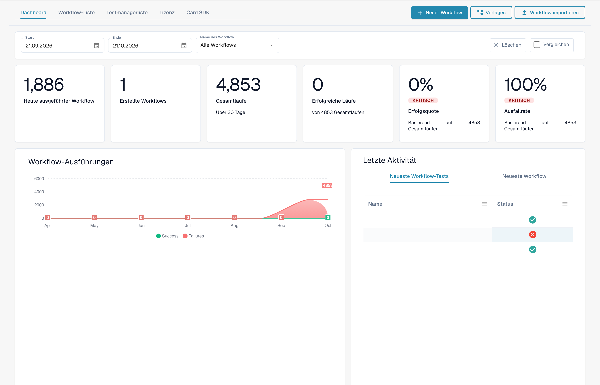
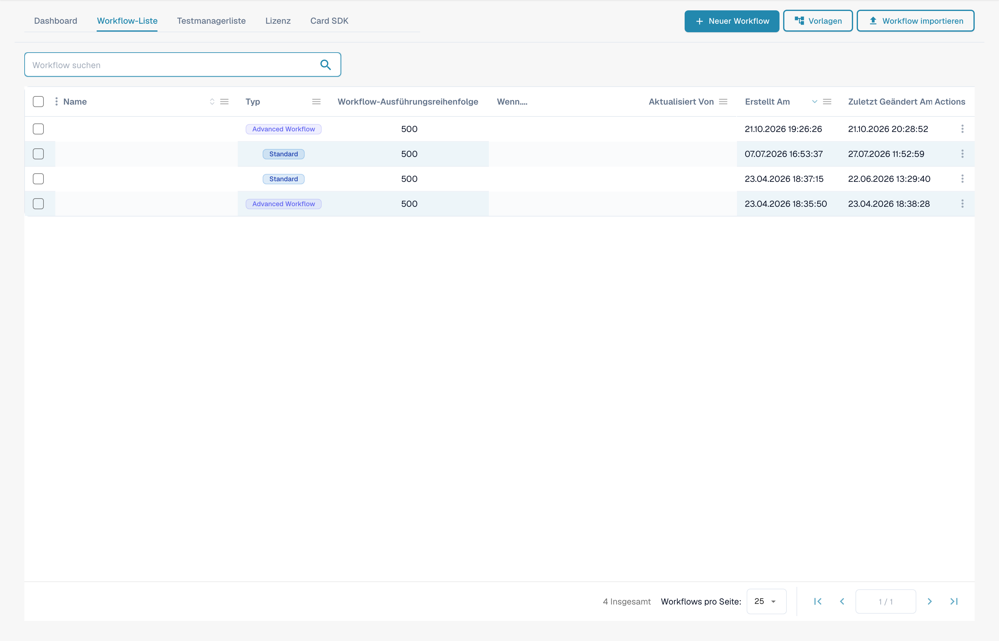
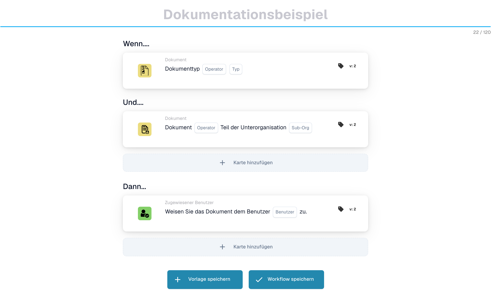

# Leitfäden für Workflow-Muster

**Version:** 1.0 **Letzte Aktualisierung:** 23. Oktober 2025

***

## Übersicht

Dieses Verzeichnis enthält umfassende Workflow-Musterhandbücher, die veranschaulichen, wie mehrere Workflow-Karten kombiniert werden, um gängige Geschäftsszenarien zu lösen. Jedes Muster bietet schrittweise Implementierungsanweisungen, vollständige Beispiele und Best Practices.

**Was sind Workflow-Muster?**

Workflow-Muster sind bewährte, wiederverwendbare Lösungen für häufige Herausforderungen bei der Dokumentationsverarbeitung. Anstatt bei Null anzufangen, können Sie diese Muster als Vorlagen verwenden und sie an Ihre spezifischen Bedürfnisse anpassen.

***

## Der Workflow Builder im Überblick

Jedes Muster auf dieser Seite wird im **Workflow-Builder** zusammengestellt. Sie erreichen es über **Workflow-Dashboard → Workflow-Liste → Workflow hinzufügen** (oder durch Öffnen eines vorhandenen Workflows). Das Dashboard zeigt Ihnen den Ausführungsverlauf und die Erfolgs-/Fehlerquoten für alle Ihre Workflows:

<figure><figcaption><p>Das Workflow Dashboard – Lauf-Summen, Erfolgs-/Fehlerquoten und letzte Aktivität für jeden Workflow. Vertrauliche Namen und Dokumentverweise sind ausgeblendet.</p></figcaption></figure>

Die Registerkarte **Workflow-Liste** listet jeden Workflow mit seinem Typ, seiner Ausführungsreihenfolge und seinem Auslöser auf. Verwenden Sie **Workflow hinzufügen**, um einen neuen zu erstellen, oder klicken Sie auf einen Workflow, um ihn im Builder zu öffnen:

<figure><figcaption><p>Die Workflow List – jede Zeile ist ein Workflow, den Sie öffnen, ein-/ausschalten oder bearbeiten können. Vertrauliche Namen und Dokumentverweise sind ausgeblendet.</p></figcaption></figure>

Ein Workflow besteht aus drei Kartengruppen: **Wenn** (Auslöser), **Und** (zusätzliche Bedingungen) und **Dann** (Aktionen). Das folgende, nicht gespeicherte Beispiel zeigt diese Struktur. Dokumenttyp, Unterorganisation und Benutzer sind noch auszuwählen:

<figure><figcaption><p>Nicht gespeichertes Beispiel mit Wenn-, Und- und Dann-Karten. Füllen Sie alle Platzhalter vor der Ausführung aus.</p></figcaption></figure>

Klicken Sie in einer beliebigen Gruppe auf **Karte hinzufügen**, um die Kartenbibliothek zu öffnen. Die Karten sind nach Kategorien organisiert (Vergleich mit Bestellung, Partnerkarten, Dokumentfeld, Datum und Uhrzeit, Dokument, Logik, Status, Tabelle, Beauftragter usw.), sodass Sie den Baustein finden können, den jedes Muster erfordert:

<figure><figcaption><p>Verfügbare Karten der ausgewählten Kategorie. Füllen Sie die Platzhalter vor der Verwendung aus. Einzelne Beschriftungen dieser Kartenversion sind in der Oberfläche noch unübersetzt oder fachlich ungenau. Die Erläuterungen auf dieser Seite verwenden die passenden Begriffe.</p></figcaption></figure>

***

## Verfügbare Muster

### 1. [API-Integrationsmuster](api-integration-pattern.md)

**Komplexität:** Mittel | **Einrichtungszeit:** 45-60 Minuten

Erfahren Sie, wie Sie DocBits mit externen APIs integrieren, um Daten aus externen Systemen abzurufen, zu validieren und zu speichern.

**Anwendungsfälle:**

* Rufen Sie Echtzeitpreise aus externen Systemen ab
* Validieren Sie Lieferanteninformationen anhand von Masterdatenbanken
* Suchen Sie in Katalogsystemen nach Produktdetails
* Erhalten Sie Wechselkurse von Währungsdiensten
* Überprüfen Sie Adressen mit Geokodierungsdiensten

**Verwendete Karten:** CALL\_API, CONDITION\_HTTPS\_REQUEST\_STATUS, ACTION\_SET\_FIELD\_TO\_TEXT, CONDITION\_COMPARE\_TWO\_DOCFIELD\_VALUES

[**Vollständiges Muster anzeigen →**](api-integration-pattern.md)

***

### 2. [Aufgabenverwaltungsmuster](task-management-pattern.md)

**Komplexität:** Niedrig-Mittel | **Einrichtungszeit:** 30-45 Minuten

Beherrschen Sie die Kunst des Erstellens, Zuweisens, Verfolgens und Verwaltens von Aufgaben innerhalb der DocBits-Workflows für Genehmigungs- und Überprüfungsprozesse.

**Anwendungsfälle:**

* Erstellen Sie Genehmigungsworkflows
* Weisen Sie Benutzern Überprüfungsaufgaben zu
* Behandeln Sie Ausnahmen, die ein menschliches Eingreifen erfordern
* Eskalieren Sie Probleme an Manager
* Erstellen Sie mehrstufige Genehmigungsketten
* Verfolgen Sie die Aufgabenerledigung und Fristen

**Verwendete Karten:** tasks\_create, ACTION\_ASSIGN\_TO\_USER, ACTION\_SEND\_EMAIL\_TO\_GROUPS, CONDITION\_TASK\_STATUS

[**Vollständiges Muster anzeigen →**](task-management-pattern.md)

***

### 3. [PO-Übereinstimmungsmuster](po-matching-pattern.md)

**Komplexität:** Mittel-Hoch | **Einrichtungszeit:** 60-90 Minuten

Implementieren Sie umfassende Workflows für den Bestellabgleich, um Rechnungen anhand von Bestellungen mit toleranzbasierter Weiterleitung zu validieren.

**Anwendungsfälle:**

* Validieren Sie Rechnungen anhand von Bestellungen
* Erkennen Sie Preisfehler vor der Zahlung
* Identifizieren Sie Mengenabweichungen
* Durchsetzung von Beschaffungskontrollen
* Vermeiden Sie Doppelzahlungen
* Automatisieren Sie den Drei-Wege-Abgleich

**Verwendete Karten:** PURCHASE\_ORDER\_FULL\_MATCH, CONDITION\_DOC\_TO\_PO\_UNIT\_PRICE, CONDITION\_DOC\_TO\_PO\_QUANTITY, CONDITION\_DOC\_TO\_PO\_TAX\_LINES

[**Vollständiges Muster anzeigen →**](po-matching-pattern.md)

***

### 4. [Entscheidungslogikmuster](decision-logic-pattern.md)

**Komplexität:** Mittel | **Einrichtungszeit:** 30-45 Minuten

Implementieren Sie komplexe Entscheidungsbäume und bedingte Routing-Logik, um Dokumente auf der Grundlage von Geschäftsregeln über verschiedene Pfade zu verarbeiten.

**Anwendungsfälle:**

* Leiten Sie Dokumente nach Betragsschwellenwerten weiter
* Wenden Sie unterschiedliche Regeln für unterschiedliche Dokumenttypen an
* Implementieren Sie eine mehrstufige Genehmigungslogik
* Behandeln Sie komplexe Geschäftsrichtlinien
* Erstellen Sie dynamisches Routing basierend auf mehreren Kriterien
* Implementieren Sie Genehmigungsmatrizen

**Verwendete Karten:** CONDITION\_DOC\_FIELD\_AMOUNT, CONDITION\_DOC\_TYPE\_IS\_ISNOT, CONDITION\_SUPPLIER\_STATUS\_IS\_ISNOT, ACTION\_ASSIGN\_TO\_USER

[**Vollständiges Muster anzeigen →**](decision-logic-pattern.md)

***

### 5. [Datentransformationsmuster](data-transformation-pattern.md)

**Komplexität:** Mittel | **Einrichtungszeit:** 30-45 Minuten

Transformieren, berechnen, formatieren und reichern Sie Dokumentdaten an, um sie für den Export vorzubereiten, Berechnungen durchzuführen und Formate zu standardisieren.

**Anwendungsfälle:**

* Berechnen Sie Summen, Zwischensummen und Steuern
* Konvertieren Sie Währungen oder Einheiten
* Formatieren Sie Daten, Zahlen und Text
* Leiten Sie Werte aus vorhandenen Feldern ab
* Bereichern Sie Daten aus externen Quellen
* Datenformate standardisieren
* Berechnungen validieren

**Verwendete Karten:** ACTION\_CALCULATE\_FIELD, ACTION\_SET\_FIELD\_TO\_TEXT, ACTION\_COPY\_FIELD\_VALUE, CALL\_API, CONDITION\_COMPARE\_TWO\_DOCFIELD\_VALUES

[**Vollständiges Muster anzeigen →**](data-transformation-pattern.md)

***

## Anleitung zur Musterauswahl

### Durch Komplexität

| Komplexität      | Muster                                                                                                                                                                                      | Am besten für                               |
| --------------- | --------------------------------------------------------------------------------------------------------------------------------------------------------------------------------------------- | -------------------------------------- |
| **Niedrig-Mittel**  | [Aufgabenverwaltung](task-management-pattern.md)                                                                                                                                                 | Anfänger, einfache Arbeitsabläufe            |
| **Mittel**      | <p><a href="api-integration-pattern.md">API-Integration</a><br><a href="decision-logic-pattern.md">Entscheidungslogik</a><br><a href="data-transformation-pattern.md">Datentransformation</a></p> | Fortgeschrittene Benutzer, Standard-Workflows |
| **Mittel-Hoch** | [PO-Matching](po-matching-pattern.md)                                                                                                                                                         | Fortgeschrittene Benutzer, komplexe Validierung     |

***

### Nach Anwendungsfall

| Ich muss...                     | Verwenden Sie dieses Muster                                              |
| -------------------------------- | ------------------------------------------------------------- |
| Integration mit externen Systemen  | [API-Integrationsmuster](api-integration-pattern.md)         |
| Erstellen Sie Genehmigungsworkflows        | [Aufgabenverwaltungsmuster](task-management-pattern.md)         |
| Gegen Bestellungen validieren | [PO-Übereinstimmungsmuster](po-matching-pattern.md)                 |
| Route basierend auf den Bedingungen        | [Entscheidungslogikmuster](decision-logic-pattern.md)           |
| Daten berechnen und transformieren     | [Datentransformationsmuster](data-transformation-pattern.md) |

***

### Nach Branche/Abteilung

| Branche/Abteilung    | Empfohlene Muster                                                                                                                        |
| ---------------------- | ------------------------------------------------------------------------------------------------------------------------------------------- |
| **Finanzen/Buchhaltung** | [Bestellabgleich](po-matching-pattern.md), [Aufgabenverwaltung](task-management-pattern.md), [Datentransformation](data-transformation-pattern.md) |
| **Beschaffung**        | [Bestellabgleich](po-matching-pattern.md), [Entscheidungslogik](decision-logic-pattern.md), [API-Integration](api-integration-pattern.md)           |
| **Operationen**         | [Aufgabenverwaltung](task-management-pattern.md), [Entscheidungslogik](decision-logic-pattern.md)                                                  |
| **IT/Integration**     | [API-Integration](api-integration-pattern.md), [Datentransformation](data-transformation-pattern.md)                                        |
| **Alle Abteilungen**    | [Entscheidungslogik](decision-logic-pattern.md), [Aufgabenmanagement](task-management-pattern.md)                                                  |

***

## So verwenden Sie diese Muster

### Schritt 1: Wählen Sie ein Muster

1. Sehen Sie sich die Musterbeschreibungen oben an
2. Identifizieren Sie, welches Muster zu Ihrem Anwendungsfall passt
3. Überprüfen Sie die Komplexität und die geschätzte Einrichtungszeit
4. Lesen Sie den Abschnitt „Verwendungszweck“ in der Musteranleitung

### Schritt 2: Überprüfen Sie die Voraussetzungen

In jedem Musterführer ist Folgendes aufgeführt:

* Erforderliche Kenntnisse
* Verwandte Leitfäden, die Sie zuerst lesen sollten
* Karten, die verwendet werden
* Konfigurationsanforderungen

### Schritt 3: Befolgen Sie die Schritt-für-Schritt-Anweisungen

Jedes Muster bietet:

* Vollständiges Workflow-Beispiel
* Schritt-für-Schritt-Anleitung zur Implementierung
* Konfigurationsvorlagen
* Beispiele aus der Praxis
* Tipps zur Fehlerbehebung

### Schritt 4: Passen Sie es an Ihre Bedürfnisse an

* Passen Sie das Beispiel an Ihre Geschäftsregeln an
* Passen Sie Schwellenwerte und Toleranzen an
* Ändern Sie die Routing-Logik
* Fügen Sie nach Bedarf Schritte hinzu bzw. entfernen Sie sie
* Vor dem Produktionseinsatz gründlich testen

### Schritt 5: Überwachen und optimieren

* Verfolgen Sie die Workflow-Leistung
* Überwachen Sie die Erfolgsraten
* Sammeln Sie Benutzerfeedback
* Konfiguration verfeinern
* Dokumentanpassungen

***

## Musterkombinationen

Viele reale Szenarien erfordern die Kombination mehrerer Muster:

### Beispiel 1: Rechnungsverarbeitung abschließen

```
1. API Integration Pattern → Fetch current pricing
2. Data Transformation Pattern → Calculate totals
3. PO Matching Pattern → Validate against PO
4. Decision Logic Pattern → Route based on variance
5. Task Management Pattern → Create approval tasks
```

### Beispiel 2: Genehmigung hochwertiger Rechnungen

```
1. Data Transformation Pattern → Calculate amounts
2. Decision Logic Pattern → Check thresholds
3. Task Management Pattern → Multi-level approval
4. API Integration Pattern → Notify external systems
```

### Beispiel 3: Ausnahmebehandlung

```
1. PO Matching Pattern → Detect variances
2. Decision Logic Pattern → Classify exception severity
3. Task Management Pattern → Create review tasks
4. Data Transformation Pattern → Calculate impact
```

***

## Mustervorlagen

Jedes Muster enthält diese standardisierten Abschnitte:

1. **Übersicht** – Was das Muster bewirkt
2. **Wann zu verwenden** – Geeignete Anwendungsfälle
3. **Vollständiges Beispiel** – Szenario aus der realen Welt
4. **Schritt-für-Schritt** – Anleitung zur Umsetzung
5. **Konfiguration** – Karten-Setup-Vorlagen
6. **Workflow-Diagramm** – Visuelle Darstellung
7. **Erweiterte Variationen** – Alternative Implementierungen
8. **Fehlerbehandlung** – Häufige Probleme und Lösungen
9. **Test-Checkliste** – Validierungsschritte
10. **Verwandte Muster** – Komplementäre Muster
11. **Verwandte Handbücher** – Referenzdokumentation

***

## Hilfe bekommen

### Ressourcen zur Musterunterstützung

**Dokumentation:**

* [Vollständiger Workflow-Leitfaden-Index](..)
* [Individuelle Kartenführer](../then/action)
* [Bedingungskarten-Referenz](../and/condition-cards-complete-guide.md)
* [Workflow-Verknüpfungskarte](https://github.com/Fellow-Consulting-AG/docbits/tree/main/WORKFLOW_LINKING_MAP.md)

**Zusätzliche Ressourcen:**

* [Kurzanleitung](https://github.com/Fellow-Consulting-AG/docbits/tree/main/WORKFLOW_LINKING_QUICK_REFERENCE.md)
* [Versionshinweise Oktober 2025](https://github.com/Fellow-Consulting-AG/docbits/tree/main/readme/administration-and-setup/workflow/changelog/2025-10-october.md)
* [Referenz zur Kartenversionierung](../cards-overview/po-comparison-versions-guide.md)

**Kontakt:**

* Muster-Feedback: docs@docbits.com
* Technischer Support: support@docbits.com
* Implementierungshilfe: Consulting@docbits.com

***

## Musterstatistiken

| Metrisch                      | Wert               |
| --------------------------- | ------------------- |
| **Gesamtmuster**          | 5                   |
| **Gesamtzahl der abgedeckten Karten**     | 30+                 |
| **Kombinierte Dokumentation**  | \~1.200 Zeilen       |
| **Beispielszenarien**       | 25+                 |
| **Konfigurationsvorlagen** | 15+                 |
| **Workflow-Diagramm**       | 5 vollständige Diagramme |
| **Querverweise**        | Über 87 interne Links  |

***

## Beitrag zu Mustern

Haben Sie ein Arbeitsablaufmuster, von dem andere profitieren würden?

**Richtlinien für Musterbeiträge:**

1. **Dokumentieren Sie Ihren Workflow**
   * Klares Geschäftsszenario
   * Schrittweise Umsetzung
   * Beispiele für funktionierende Konfigurationen
   * Testergebnisse aus der Praxis
2. **Mustervorlage folgen**
   * Verwenden Sie die Standardabschnittsstruktur
   * Fügen Sie alle erforderlichen Elemente ein
   * Stellen Sie Diagramme/Beispiele bereit
   * Anleitung zur Fehlerbehebung hinzufügen
3. **Zur Überprüfung einreichen**
   * E-Mail an: docs@docbits.com
   * Enthalten: Musterbeschreibung, Anwendungsfälle, Implementierungsleitfaden
   * Wir werden die offizielle Dokumentation überprüfen und möglicherweise ergänzen

**Vorteile:**

* Helfen Sie anderen DocBits-Benutzern
* Lassen Sie sich in der Dokumentation anerkennen
* Verbessern Sie die gesamte Produktwissensbasis
* Erhalten Sie Feedback zu Ihrer Umsetzung

***

## Änderungsprotokoll

### Version 1.0 (23. Oktober 2025)

* Erstveröffentlichung von 5 umfassenden Workflow-Mustern
* API-Integrationsmuster hinzugefügt
* Aufgabenverwaltungsmuster hinzugefügt
* PO-Matching-Muster hinzugefügt
* Entscheidungslogikmuster hinzugefügt
* Datentransformationsmuster hinzugefügt
* Querverweisverlinkung implementiert (87 Links)
* Anleitung zur Musterauswahl erstellt

***

## Nächste Schritte

**Neu bei Workflow-Mustern?**

1. Beginnen Sie mit [Aufgabenverwaltungsmuster](task-management-pattern.md) – am einfachsten zu verstehen
2. Überprüfen Sie [Entscheidungslogikmuster](decision-logic-pattern.md) – grundlegend für alle Arbeitsabläufe
3. Entdecken Sie [API-Integrationsmuster](api-integration-pattern.md) – allgemeiner Integrationsbedarf

**Bereit zur Implementierung?**

1. Wählen Sie Ihr Muster aus der Liste oben
2. Lesen Sie die vollständige Musteranleitung
3. Sehen Sie sich die Voraussetzungen und zugehörigen Leitfäden an
4. Befolgen Sie die Schritt-für-Schritt-Anleitung
5. Testen Sie mit Beispieldokumenten
6. Bereitstellung für die Produktion
7. Überwachen und optimieren

**Benötigen Sie weitere Hilfe?**

* Überprüfen Sie [Übersicht über die Workflow-Dokumentation](..)
* Überprüfen Sie [Kurzanleitung](https://github.com/Fellow-Consulting-AG/docbits/tree/main/WORKFLOW_LINKING_QUICK_REFERENCE.md)
* Kontaktieren Sie das Support-Team

***

**Letzte Aktualisierung:** 23. Oktober 2025 **Verwaltet von:** Dokumentationsteam **Version:** 1.0
