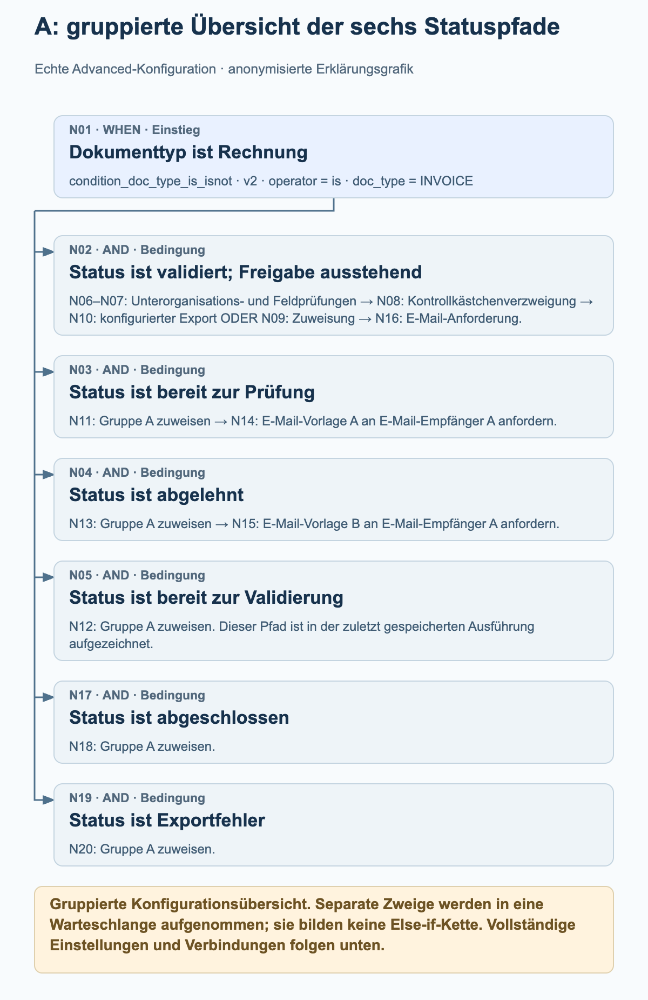
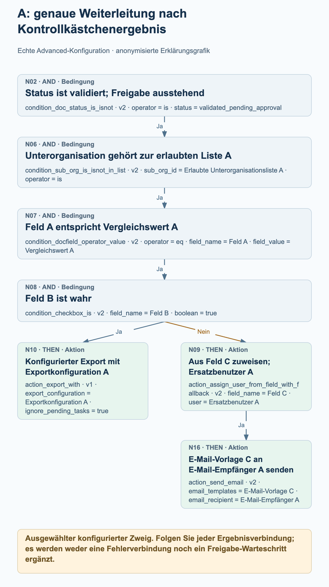
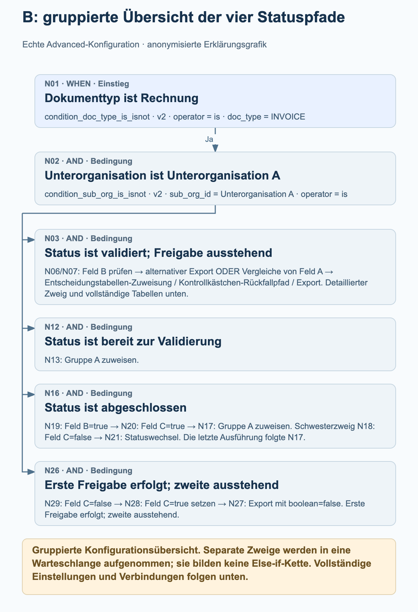

# Advanced-Workflows aus der Produktion: echte Beispiele

Zwei aktive Advanced-Workflows aus der Produktion zeigen, wie die Weiterleitung echter Rechnungen Statuszweige, Kontrollkästchen, Zuweisungen und konfigurierte Exportaktionen verbindet. Die vier Prozessgrafiken erklären ausgewählte Teile der Graphen; die vollständigen Knoteneinstellungen und Verbindungen sind separat aufgeführt.

Quellenprüfung mit rein lesendem Zugriff am 27. Oktober 2026: Beide aktuellen Konfigurationen stimmen bei Knoten, Karten, Versionen, Einstellungen und Verbindungen mit den Daten ihrer zuletzt gespeicherten Ausführungen überein. Beispiel A hat 20 Knoten und 19 Verbindungen; Beispiel B hat 30 Knoten und 30 Verbindungen. Beide gespeicherten Ausführungen haben den Gesamtstatus failed_condition, obwohl jede eine erfolgreiche Gruppenzuweisung enthält. Es handelt sich um beobachtete Konfigurationen und gespeicherte Ausführungsnachweise, nicht um neu ausgeführte Tests. Werte für Organisationen, Felder, Benutzer, Gruppen, Tabellen, Vorlagen und Empfänger sind anonymisiert. Die Platzhalter erhalten die Unterschiede innerhalb jedes Beispiels; über beide Beispiele hinweg bezeichnen sie nicht dieselbe reale Entität.

## So lesen Sie diese Graphen

Jede Verbindung folgt einem bestimmten Ergebnis: success, failed_condition oder error. Diese Beispiele enthalten Verbindungen für success und failed_condition; keiner der beiden Graphen konfiguriert eine error-Verbindung. Eine nicht erfüllte Bedingung ist ein reguläres Bedingungsergebnis und darf nicht als technischer Fehler gelesen werden.

Mehrere ausgehende success-Verbindungen fügen mehrere Ziele zur Ausführungswarteschlange hinzu. Sie bilden keine Else-if-Kette und bedeuten nicht, dass Aktionen parallel laufen. Ein Ziel wird innerhalb einer einzelnen Graphenausführung höchstens einmal verarbeitet. Folgen Sie den tatsächlichen Verbindungen, statt den Ablauf aus der Position einer Karte abzuleiten.

Ein Ziel mit mehreren eingehenden Verbindungen wartet nicht automatisch auf alle Eingänge. In Beispiel B kann jede der beiden konfigurierten failed_condition-Verbindungen die gewöhnliche Bedingungskarte N14 in die Warteschlange aufnehmen; sie ist kein separates ALL- oder ANY-Gateway.

Zuweisungen belegen nicht, dass eine Person ein Dokument freigegeben hat. Aus einer Zuweisung oder einer konfigurierten Exportkarte lassen sich weder ein Warteschritt noch eine abgeschlossene Freigabe oder eine Empfangsbestätigung eines externen Systems ableiten. Die Grafiken ergänzen keine solchen Schritte.

Die gruppierten Übersichten fassen Statuspfade zusammen und gruppieren nachgelagerte Knoten ausdrücklich. Die Detailgrafiken zeigen die ausgewählten Kontrollkästchen- oder Rückfallpfade ausführlicher. Verwenden Sie die vollständigen Knoten- und Verbindungslisten, um den gesamten konfigurierten Graphen zu prüfen.

## A. Statusweiterleitung mit einem Kontrollkästchen für Export oder Zuweisung

Eine Rechnung verzweigt zu sechs Statusprüfungen. Der Zweig für validierte Dokumente mit ausstehender Freigabe prüft zusätzlich eine Liste erlaubter Unterorganisationen, vergleicht Feld A und prüft Feld B. Das Kontrollkästchenergebnis wählt eine konfigurierte Exportkarte oder eine Zuweisung aus einem Feld mit anschließender E-Mail. Andere Statuspfade weisen Gruppe A zu; zwei davon senden anschließend eine konfigurierte E-Mail.

### A: gruppierte Übersicht der sechs Statuspfade

<figure><figcaption>N01 verzweigt zu sechs separaten Statusprüfungen. Die Übersicht gruppiert den längeren Zweig N02 und zeigt die konfigurierten Zuweisungs- und E-Mail-Pfade für die anderen Statuswerte. Sie ist eine gruppierte Konfigurationsübersicht, kein Ausführungsverlauf und keine Else-if-Kette.</figcaption></figure>

### A: genaue Weiterleitung nach Kontrollkästchenergebnis

<figure><figcaption>Ausführlicher Zweig N02 → N06 → N07 → N08. Feld B=true folgt success zur konfigurierten Exportkarte N10 mit ignore_pending_tasks=true. Die failed_condition-Verbindung führt zur Zuweisungskarte aus einem Feld N09, deren success zu E-Mail-Karte N16 führt. Daraus folgen weder ein Exportergebnis noch eine menschliche Freigabe oder ein Warteschritt.</figcaption></figure>

### Was die zuletzt gespeicherte Ausführung tatsächlich zeigt

Gespeicherte Ausführung: 26. Oktober 2026, 12:01:54 UTC. N01 und die Prüfung auf ready_for_validation bei N05 lieferten success; anschließend lieferte Zuweisung N12 success. Die anderen fünf Statusprüfungen lieferten failed_condition; für die übrigen Knoten ist in dieser Ausführung kein Ergebnis aufgezeichnet. Der Gesamteintrag lautet failed_condition. Diese Ausführung belegt somit den Gruppenzuweisungspfad N01 → N05 → N12; sie belegt nicht die Kontrollkästchen-, Export- oder E-Mail-Pfade.

- Nach erfolgreicher N01 werden die Statusprüfungen N02, N03, N04, N05, N17 und N19 über separate success-Verbindungen in die Warteschlange aufgenommen. Sie bilden keine Else-if-Kette.
- Der detaillierte Freigabezweig verläuft über success von N02 → N06 → N07 → N08. N08 prüft Feld B auf true. Ihre success-Verbindung führt zu N10; ihre failed_condition-Verbindung führt zu N09.
- N10 ist action_export_with v1, konfiguriert mit Exportkonfiguration A und ignore_pending_tasks=true. Die Grafik nennt die Konfiguration und behauptet weder einen erfolgreichen Export noch einen externen Empfang. Bei dieser Karte deaktiviert ignore_pending_tasks=true die Prüfung auf offene Aufgaben für die Exportanforderung; dies ist eine Option dieses konkreten Beispiels.
- N09 ist für die Zuweisung aus Feld C mit Ersatzbenutzer A konfiguriert. Nur ihre success-Verbindung führt zu N16, konfiguriert mit E-Mail-Vorlage C und E-Mail-Empfänger A.
- Feld C muss eine Benutzer-ID enthalten. Bei einer nicht passenden Benutzer-ID kann der konfigurierte Ersatzbenutzer verwendet werden; ein fehlendes Dokumentfeld kann jedoch scheitern, bevor dieser Rückfall erreicht wird. Der Ersatzbenutzer garantiert keine Zuweisung für jeden Fall eines fehlenden Feldes.
- N11, N12, N13, N18 und N20 konfigurieren innerhalb dieses Beispiels dieselbe Gruppe A. Nur N11 und N13 besitzen verbundene nachfolgende E-Mail-Knoten: N14 und N15.

Vollständige Knotenkonfiguration

| Knoten | Karte | Konfiguration |
| --- | --- | --- |
| N01 | condition_doc_type_is_isnot · v2 | operator = is; doc_type = INVOICE |
| N02 | condition_doc_status_is_isnot · v2 | operator = is; status = validated_pending_approval |
| N03 | condition_doc_status_is_isnot · v2 | operator = is; status = ready_for_review |
| N04 | condition_doc_status_is_isnot · v2 | operator = is; status = rejected |
| N05 | condition_doc_status_is_isnot · v2 | operator = is; status = ready_for_validation |
| N06 | condition_sub_org_is_isnot_in_list · v2 | sub_org_id = Erlaubte Unterorganisationsliste A; operator = is |
| N07 | condition_docfield_operator_value · v2 | operator = eq; field_name = Feld A; field_value = Vergleichswert A |
| N08 | condition_checkbox_is · v2 | field_name = Feld B; boolean = true |
| N09 | action_assign_user_from_field_with_fallback · v2 | field_name = Feld C; user = Ersatzbenutzer A |
| N10 | action_export_with · v1 | export_configuration = Exportkonfiguration A; ignore_pending_tasks = true |
| N11 | doc_group_assign · v2 | groups = Gruppe A; use_decision_table = (leer) |
| N12 | doc_group_assign · v2 | groups = Gruppe A; use_decision_table = (leer) |
| N13 | doc_group_assign · v2 | groups = Gruppe A; use_decision_table = (leer) |
| N14 | action_send_email · v2 | email_templates = E-Mail-Vorlage A; email_recipient = E-Mail-Empfänger A |
| N15 | action_send_email · v2 | email_templates = E-Mail-Vorlage B; email_recipient = E-Mail-Empfänger A |
| N16 | action_send_email · v2 | email_templates = E-Mail-Vorlage C; email_recipient = E-Mail-Empfänger A |
| N17 | condition_doc_status_is_isnot · v2 | operator = is; status = finished |
| N18 | doc_group_assign · v2 | groups = Gruppe A; use_decision_table = (leer) |
| N19 | condition_doc_status_is_isnot · v2 | operator = is; status = export_error |
| N20 | doc_group_assign · v2 | groups = Gruppe A; use_decision_table = (leer) |

Vollständige konfigurierte Verbindungen

| Knoten | Ergebnispfad | Knoten |
| --- | --- | --- |
| N01 | success | N02 |
| N01 | success | N03 |
| N01 | success | N04 |
| N01 | success | N05 |
| N08 | failed_condition | N09 |
| N08 | success | N10 |
| N07 | success | N08 |
| N06 | success | N07 |
| N02 | success | N06 |
| N03 | success | N11 |
| N04 | success | N13 |
| N05 | success | N12 |
| N13 | success | N15 |
| N11 | success | N14 |
| N09 | success | N16 |
| N01 | success | N17 |
| N17 | success | N18 |
| N19 | success | N20 |
| N01 | success | N19 |

## B. Entscheidungstabellen mit Kontrollkästchen-Rückfallpfaden und Statuszweigen

Eine Rechnung in Unterorganisation A verzweigt zu vier Statusprüfungen. Der Pfad für validierte Dokumente mit ausstehender Freigabe verwendet Feld B, zwei alternative Vergleiche von Feld A, Entscheidungstabellen und zusätzliche Kontrollkästchenprüfungen. Der Pfad für abgeschlossene Dokumente verwendet die Felder B und C vor der Zuweisung an Gruppe A oder einem konfigurierten Statuswechsel. Ein separater Pfad bei ausstehender zweiter Freigabe setzt Feld C und ruft den Export auf, wenn seine konfigurierte Bedingung erfüllt ist.

### B: gruppierte Übersicht der vier Statuspfade

<figure><figcaption>N01 und N02 führen zu vier separat verbundenen Statusprüfungen. Die Übersicht gruppiert den größeren Entscheidungstabellenzweig, erhält den Zuweisungspfad vor der Validierung und die Kontrollkästchenverzweigung für abgeschlossene Dokumente und fasst den Exportpfad bei ausstehender zweiter Freigabe zusammen. Die vollständigen Knoten- und Verbindungslisten erhalten alle 30 Knoten und 30 Verbindungen.</figcaption></figure>

### B: genaue Vergleichs- und Entscheidungstabellen-Rückfallpfade

<figure><figcaption>Ausgewählter konfigurierter Zweig nach N01 → N02 → N03 → N07: N05 vergleicht Feld A mit Vergleichswert B. Jede der beiden failed_condition-Verbindungen von N22 (Feld D=false) oder N23 (Feld E=false) kann Entscheidungstabelle B bei der gewöhnlichen Bedingungskarte N14 und anschließend sequenzielle Zuweisung N15 in die Warteschlange aufnehmen. Bei success verläuft N23 stattdessen weiter über N30 → N25 → N24. Daraus folgen weder ein ALL-Zusammenlauf noch eine ANY-Karte, eine abgeschlossene Freigabe oder ein externer Empfang.</figcaption></figure>

### Was die zuletzt gespeicherte Ausführung tatsächlich zeigt

Gespeicherte Ausführung: 27. Oktober 2026, 11:56:25 UTC. N01, N02, die Prüfung auf finished bei N16, die Prüfung Feld B=true bei N19, die Prüfung Feld C=true bei N20 und Gruppenzuweisung N17 lieferten success. N03, N12, N18 und N26 lieferten failed_condition; für die übrigen Knoten ist in dieser Ausführung kein Ergebnis aufgezeichnet. Der Gesamteintrag lautet failed_condition. Diese Ausführung belegt den Zuweisungspfad für abgeschlossene Dokumente, keinen der Entscheidungstabellenpfade, keinen Statuswechsel und keinen Export.

- Nach erfolgreicher Prüfung auf Rechnung und Unterorganisation A nimmt N02 die Statusprüfungen N03, N12, N16 und N26 in die Warteschlange auf. Der Graph wartet nicht auf den Abschluss eines Statuszweigs, bevor ein anderer festgelegt wird.
- Bei success von N03 prüft N06 Feld B=false und N07 Feld B=true. Bei success führt N06 zum Setzen von Feld B=true bei N10 und anschließend zur alternativen Exportkarte N11. Bei success nimmt N07 beide Vergleiche von Feld A, N04 und N05, in die Warteschlange auf.
- N06 und N07 werden vor der Aktualisierung von Feld B durch N10 in die Warteschlange aufgenommen. Beide Prüfungen werden vor dieser Aktualisierung ausgewertet; das Setzen von Feld B=true lässt N07 nicht später in derselben Graphenausführung erfolgreich werden. Später eingereihte Karten können Werte sehen, die frühere Aktionen zurückgeben; Zweige sind keine isolierten Momentaufnahmen.
- Der Pfad für Vergleichswert A führt zu Entscheidungstabelle A bei N08 und sequenzieller Zuweisung N09. Der Pfad für Vergleichswert B prüft Feld D=false bei N22, Feld E=false bei N23 und Feld C=false bei N30, bevor er Feld C=true bei N25 setzt und Export N24 aufruft.
- Ein Ergebnis failed_condition von N22 oder N23 kann N14, die gewöhnliche Bedingungskarte für Entscheidungstabelle B, in die Warteschlange aufnehmen. N14 wartet nicht auf alle Eingänge und ist keine zusätzlich eingeführte ANY-Karte. Ihre success-Verbindung führt zur sequenziellen Zuweisung N15.
- Bei abgeschlossenen Dokumenten prüft N19 Feld B=true und nimmt anschließend N18 und N20 in die Warteschlange auf. Feld C=true bei N20 führt zu Gruppenzuweisung N17. Feld C=false bei N18 führt zu Statuswechselkarte N21, konfiguriert mit validated_pending_approval und trigger_docflow=true. Dies ist kein Warteschritt.
- Der Pfad für approved_pending_second_approval verläuft bei success über N29 → N28 → N27: Feld C=false prüfen, Feld C=true setzen, dann den Export aufrufen. Die Exportkarten N24 und N27 behalten boolean=false bei. Dies ist eine Validierungsoption, keine Anweisung zum Deaktivieren des Exportaufrufs.
- Beide Entscheidungstabellen-Bedingungskarten speichern Daten unter wf_store_data. Ihre Aktionen für die sequenzielle Zuweisung besitzen keine eigenen Einstellungen. Tabellenregeln und tatsächliche Empfänger werden nicht veröffentlicht; der Graph belegt keinen Abschluss einer Freigabe.
- Der alternative Export N11 hängt von Exportattributen des Dokumenttyps ab. Aus seinen leeren Knoteneinstellungen lassen sich weder eine Exportkonfiguration noch ein Ziel ableiten. Statuswechsel N21 fordert nachfolgende Workflow-Auslösungen an; er ergänzt keine implizite Verbindung zurück in dieselbe Graphenausführung.

Vollständige Knotenkonfiguration

| Knoten | Karte | Konfiguration |
| --- | --- | --- |
| N01 | condition_doc_type_is_isnot · v2 | operator = is; doc_type = INVOICE |
| N02 | condition_sub_org_is_isnot · v2 | sub_org_id = Unterorganisation A; operator = is |
| N03 | condition_doc_status_is_isnot · v2 | operator = is; status = validated_pending_approval |
| N04 | condition_docfield_operator_value · v2 | operator = eq; field_name = Feld A; field_value = Vergleichswert A |
| N05 | condition_docfield_operator_value · v2 | operator = eq; field_name = Feld A; field_value = Vergleichswert B |
| N06 | condition_checkbox_is · v2 | field_name = Feld B; boolean = false |
| N07 | condition_checkbox_is · v2 | field_name = Feld B; boolean = true |
| N08 | condition_decision_tree_data · v3 | store_data = wf_store_data; decision_table = Entscheidungstabelle A; boolean = (leer) |
| N09 | action_assign_doc_decision_table_sequential_no_variables · v2 | — |
| N10 | action_set_boolean_field · v2 | boolean = true; field_name = Feld B |
| N11 | action_alternate_export · v2 | — |
| N12 | condition_doc_status_is_isnot_in_list · v2 | operator = is; status = ready_for_validation |
| N13 | doc_group_assign · v2 | groups = Gruppe A; use_decision_table = (leer) |
| N14 | condition_decision_tree_data · v3 | store_data = wf_store_data; decision_table = Entscheidungstabelle B; boolean = (leer) |
| N15 | action_assign_doc_decision_table_sequential_no_variables · v2 | — |
| N16 | condition_doc_status_is_isnot_in_list · v2 | operator = is; status = finished |
| N17 | doc_group_assign · v2 | groups = Gruppe A; use_decision_table = (leer) |
| N18 | condition_checkbox_is · v2 | field_name = Feld C; boolean = false |
| N19 | condition_checkbox_is · v2 | field_name = Feld B; boolean = true |
| N20 | condition_checkbox_is · v2 | field_name = Feld C; boolean = true |
| N21 | staus_change · v3 | status = validated_pending_approval; trigger_docflow = true |
| N22 | condition_checkbox_is · v2 | field_name = Feld D; boolean = false |
| N23 | condition_checkbox_is · v2 | field_name = Feld E; boolean = false |
| N24 | export · v3 | boolean = false |
| N25 | action_set_boolean_field · v2 | boolean = true; field_name = Feld C |
| N26 | condition_doc_status_is_isnot_in_list · v2 | operator = is; status = approved_pending_second_approval |
| N27 | export · v3 | boolean = false |
| N28 | action_set_boolean_field · v2 | boolean = true; field_name = Feld C |
| N29 | condition_checkbox_is · v2 | field_name = Feld C; boolean = false |
| N30 | condition_checkbox_is · v2 | field_name = Feld C; boolean = false |

Vollständige konfigurierte Verbindungen

| Knoten | Ergebnispfad | Knoten |
| --- | --- | --- |
| N01 | success | N02 |
| N02 | success | N03 |
| N03 | success | N06 |
| N03 | success | N07 |
| N07 | success | N04 |
| N07 | success | N05 |
| N06 | success | N10 |
| N10 | success | N11 |
| N02 | success | N12 |
| N12 | success | N13 |
| N16 | success | N19 |
| N20 | success | N17 |
| N19 | success | N20 |
| N19 | success | N18 |
| N18 | success | N21 |
| N04 | success | N08 |
| N02 | success | N16 |
| N05 | success | N22 |
| N22 | success | N23 |
| N25 | success | N24 |
| N02 | success | N26 |
| N22 | failed_condition | N14 |
| N23 | failed_condition | N14 |
| N28 | success | N27 |
| N26 | success | N29 |
| N29 | success | N28 |
| N23 | success | N30 |
| N30 | success | N25 |
| N08 | success | N09 |
| N14 | success | N15 |

## Bevor Sie ein Beispiel anpassen

Ersetzen Sie jeden neutralen Platzhalter durch einen passenden Wert aus Ihrer eigenen Organisation. Erhalten Sie dabei, welche Einstellungen sich auf dasselbe Feld und welche sich auf unterschiedliche Felder beziehen; verwenden Sie die Platzhalter nicht als reale Kennungen.

Prüfen Sie jede Ergebnisverbindung ausdrücklich, einschließlich der Weiterleitung über failed_condition und der Ziele mit mehreren eingehenden Verbindungen. Legen Sie die Fehlerbehandlung für Ihren eigenen Prozess fest, statt anzunehmen, dass der Graph einen nicht verbundenen Fehlerpfad behandelt.

Prüfen Sie Exporteinstellungen, Validierungsoptionen und den Umgang mit offenen Aufgaben anhand Ihrer eigenen Anforderungen. Eine konfigurierte Exportaktion oder ein erfolgreicher Knoteneintrag belegt keinen Empfang durch ein externes System.

Validieren Sie den angepassten Workflow in einer autorisierten Testumgebung, einschließlich aller relevanten Bedingungsergebnisse und fehlender Zuweisungsdaten. Diese Produktionsbeispiele wurden gelesen, ohne sie zu verändern oder erneut auszuführen.
